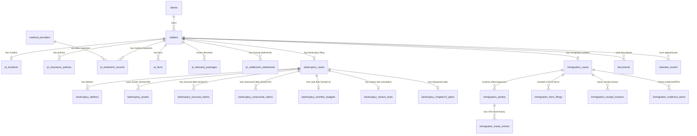

# PHASE 3 — SPECIALIZED LEGAL DATABASE ARCHITECTURE & IMPLEMENTATION PLAN
**Project:** Heugly & Bludworth – Legal Management Software  
**Workspace:** `D:\Kiaan\legal-pro`  
**Target Domains:** Personal Injury (PI), Bankruptcy (Chapters 7/11/13), Immigration (USCIS)  
**Base Architecture:** 28 Core Models / 310 MySQL Base Columns Preserved  
**Date:** November 13, 2026  
**Document Status:** Architecture & Implementation Blueprint (READ-ONLY Planning Stage)

---

## 1. EXISTING VS. MISSING MODELS ANALYSIS

The recent comprehensive database audit (`DATABASE_SCHEMA_AUDIT_COMPLETION_REPORT.md`) confirmed that while the **Core Practice Management Layer** (Users, Roles, Permissions, Clients, Matters, Staff Assignments, Tasks, Calendar, Time Tracking, Expenses, Invoices, Payment Records, Trust Accounting, General Ledger, Three-Way Reconciliation, Documents Vault, and Audit Logs) is **100% materialized and functional in MySQL 8.4**, the specialized practice areas are currently implemented as **frontend-only interactive UI calculation drawers consuming mock datasets**.

### Model Status Inventory

| Domain | Entity / Capability | Current State | Target Architecture Model | Relationship to Core |
|---|---|---|---|---|
| **Core** | Client & Contact Management | Implemented (`clients`) | Preserved (`clients`) | Root Entity |
| **Core** | Generic Matter Management | Implemented (`matters`) | Preserved (`matters`) | 1:1 Anchor for Practice Drawers |
| **Core** | Document Vault & Bates Stamping | Implemented (`documents`, `document_versions`) | Preserved | Referenced via `document_id` FKs |
| **Core** | Calendar & Deadlines | Implemented (`calendar_events`) | Preserved | Integrated for 341/Court/USCIS Dates |
| **Core** | Billing & Time Records | Implemented (`time_entries`, `invoices`, `trust_*`) | Preserved | Feeds contingency/flat/hourly fees |
| **PI** | Incident & Liability Details | Mock (`mockPersonalInjury.js`) | **`pi_incidents`** | 1:1 with `matters` |
| **PI** | Insurance Policies & Claims | Mock (`mockPersonalInjury.js`) | **`pi_insurance_policies`** | 1:N with `matters` |
| **PI** | Medical Providers & Facilities | Mock (`mockPersonalInjury.js`) | **`medical_providers`** | Global Directory (Shared) |
| **PI** | Medical Treatment & Billing | Mock (`mockPersonalInjury.js`) | **`pi_treatment_records`** | 1:N with `matters` & Provider |
| **PI** | Damages, Wage Loss, Property | Mock (`mockPersonalInjury.js`) | **`pi_damages_wage_loss`** | 1:N with `matters` |
| **PI** | Healthcare & Statutory Liens | Mock (`mockPersonalInjury.js`) | **`pi_liens`** | 1:N with `matters` |
| **PI** | Demand Packages & Exhibits | Mock (`mockPersonalInjury.js`) | **`pi_demand_packages`** | 1:N with `matters` |
| **PI** | Settlement Payout / Closing | Mock (`mockPersonalInjury.js`) | **`pi_settlement_statements`**| 1:N with `matters` (Utah Bar Rule 1.5) |
| **Bankruptcy** | Case Details & Dockets | Mock (`mockBankruptcyCases.js`) | **`bankruptcy_cases`** | 1:1 with `matters` |
| **Bankruptcy** | Debtor & Joint Debtor Profiles | Mock (`mockBankruptcyCases.js`) | **`bankruptcy_debtors`** | 1:N with `bankruptcy_cases` |
| **Bankruptcy** | Schedule A/B (Property/Assets) | Mock (`mockBankruptcySchedules.js`) | **`bankruptcy_assets`** | 1:N with `bankruptcy_cases` |
| **Bankruptcy** | Schedule D (Secured Creditors) | Mock (`mockBankruptcySchedules.js`) | **`bankruptcy_secured_claims`**| 1:N with `bankruptcy_cases` |
| **Bankruptcy** | Schedule E/F (Unsecured Debts) | Mock (`mockBankruptcySchedules.js`) | **`bankruptcy_unsecured_claims`**| 1:N with `bankruptcy_cases` |
| **Bankruptcy** | Schedule I/J (Income/Expenses) | Mock (`mockBankruptcySchedules.js`) | **`bankruptcy_monthly_budgets`**| 1:1 with `bankruptcy_cases` |
| **Bankruptcy** | Means Test Calculations | Mock (`MeansTestCalculator.jsx`) | **`bankruptcy_means_tests`** | 1:1 with `bankruptcy_cases` |
| **Bankruptcy** | Chapter 13 Plan & Dividends | Mock (`Chapter13PlanCalculator.jsx`)| **`bankruptcy_chapter13_plans`**| 1:1 with `bankruptcy_cases` |
| **Immigration** | Case & Petition Details | Mock (`mockImmigrationCases.js`) | **`immigration_cases`** | 1:1 with `matters` |
| **Immigration** | Beneficiaries & Family Parties | Mock (`mockImmigrationCases.js`) | **`immigration_parties`** | 1:N with `immigration_cases` |
| **Immigration** | USCIS Form Registry & Packets | Mock (`mockImmigrationCases.js`) | **`immigration_form_filings`**| 1:N with `immigration_cases` |
| **Immigration** | Receipt & Biometrics Tracking | Mock (`USCISReceiptTracker.jsx`) | **`immigration_receipt_trackers`**| 1:N with `immigration_cases` |
| **Immigration** | Travel & Entry History | Mock (`mockImmigrationCases.js`) | **`immigration_travel_entries`**| 1:N with `immigration_parties` |
| **Immigration** | Document Checklist & RFEs | Mock (`mockImmigrationCases.js`) | **`immigration_evidence_items`**| 1:N with `immigration_cases` |

---

## 2. PROPOSED ENTITY RELATIONSHIP ARCHITECTURE

The architecture attaches specialized practice modules directly to the existing core `matters` table via a clean **1:1 Case Extension Pattern**. This preserves all existing workflow, billing, document, and staff assignment relations while allowing specialized data to be queried and indexed independently.



---

## 3. COMPLETE FIELD DEFINITIONS & SCHEMAS

### 3.1 Personal Injury (PI) Domain

#### Model 1: `MedicalProvider` (`medical_providers`)
Global registry of healthcare institutions, clinics, imaging centers, and treating physicians.
```prisma
model MedicalProvider {
  id              String   @id @default(uuid()) @db.VarChar(36)
  name            String   @db.VarChar(255)
  providerType    String   @map("provider_type") @db.VarChar(50) // Hospital, Orthopedic, Chiropractic, Physical Therapy, Imaging, Pain Management
  specialty       String?  @db.VarChar(100)
  taxIdEin        String?  @map("tax_id_ein") @db.VarChar(20)
  phone           String   @db.VarChar(50)
  fax             String?  @db.VarChar(50)
  recordsEmail    String?  @map("records_email") @db.VarChar(255)
  recordsPortalUrl String? @map("records_portal_url") @db.VarChar(500)
  addressStreet   String?  @map("address_street") @db.VarChar(255)
  city            String   @db.VarChar(100)
  state           String   @default("UT") @db.VarChar(2)
  zipCode         String   @map("zip_code") @db.VarChar(20)
  isActive        Boolean  @default(true) @map("is_active")
  createdAt       DateTime @default(now()) @map("created_at") @db.DateTime(3)
  updatedAt       DateTime @updatedAt @map("updated_at") @db.DateTime(3)

  treatmentRecords PiTreatmentRecord[]

  @@index([name], name: "idx_med_provider_name")
  @@index([providerType], name: "idx_med_provider_type")
  @@map("medical_providers")
}
```

#### Model 2: `PiIncident` (`pi_incidents`)
Captures incident physics, police reporting, and Utah comparative fault apportionment (§ 78B-5-818).
```prisma
model PiIncident {
  id                      String    @id @default(uuid()) @db.VarChar(36)
  matterId                String    @unique @map("matter_id") @db.VarChar(36)
  incidentDate            DateTime  @map("incident_date") @db.Date
  incidentTime            String?   @map("incident_time") @db.VarChar(10)
  accidentType            String    @map("accident_type") @db.VarChar(100) // Motor Vehicle Accident, Commercial Trucking, Premises Liability, Bicycle, Pedestrian
  incidentLocation        String    @map("incident_location") @db.VarChar(500)
  jurisdictionCity        String?   @map("jurisdiction_city") @db.VarChar(100)
  jurisdictionCounty      String?   @map("jurisdiction_county") @db.VarChar(100)
  policeAgency            String?   @map("police_agency") @db.VarChar(150)
  policeReportNumber      String?   @map("police_report_number") @db.VarChar(100)
  investigatingOfficer    String?   @map("investigating_officer") @db.VarChar(150)
  weatherConditions       String?   @map("weather_conditions") @db.VarChar(100)
  roadConditions          String?   @map("road_conditions") @db.VarChar(100)
  plaintiffFaultPercent   Decimal   @default(0.00) @map("plaintiff_fault_percent") @db.Decimal(5, 2)
  defendantFaultPercent   Decimal   @default(100.00) @map("defendant_fault_percent") @db.Decimal(5, 2)
  liabilityAccepted       Boolean   @default(false) @map("liability_accepted")
  liabilityNotes          String?   @map("liability_notes") @db.Text
  statuteOfLimitationsDate DateTime @map("statute_of_limitations_date") @db.Date // 4 years for Utah negligence § 78B-2-307; 1-2 years for Govt Immunity
  noticeOfClaimFiled      Boolean   @default(false) @map("notice_of_claim_filed")
  noticeOfClaimDate       DateTime? @map("notice_of_claim_date") @db.Date
  createdAt               DateTime  @default(now()) @map("created_at") @db.DateTime(3)
  updatedAt               DateTime  @updatedAt @map("updated_at") @db.DateTime(3)

  matter                  Matter    @relation(fields: [matterId], references: [id], onDelete: Cascade)

  @@index([incidentDate], name: "idx_pi_incident_date")
  @@index([statuteOfLimitationsDate], name: "idx_pi_incident_sol")
  @@map("pi_incidents")
}
```

#### Model 3: `PiInsurancePolicy` (`pi_insurance_policies`)
First-party PIP, third-party liability bodily injury, and UIM/UM policies with coverage limits.
```prisma
model PiInsurancePolicy {
  id                    String   @id @default(uuid()) @db.VarChar(36)
  matterId              String   @map("matter_id") @db.VarChar(36)
  policyType            String   @map("policy_type") @db.VarChar(50) // PIP_MEDPAY, THIRD_PARTY_BODILY_INJURY, UIM_UM, PROPERTY_DAMAGE, UMBRELLA
  carrierName           String   @map("carrier_name") @db.VarChar(200)
  policyNumber          String   @map("policy_number") @db.VarChar(100)
  claimNumber           String   @map("claim_number") @db.VarChar(100)
  insuredName           String   @map("insured_name") @db.VarChar(255)
  isClientPolicy        Boolean  @default(false) @map("is_client_policy")
  adjusterName          String?  @map("adjuster_name") @db.VarChar(150)
  adjusterPhone         String?  @map("adjuster_phone") @db.VarChar(50)
  adjusterEmail         String?  @map("adjuster_email") @db.VarChar(255)
  policyLimitPerPerson  Decimal? @map("policy_limit_per_person") @db.Decimal(12, 2)
  policyLimitPerAccident Decimal? @map("policy_limit_per_accident") @db.Decimal(12, 2)
  pipExhausted          Boolean  @default(false) @map("pip_exhausted")
  pipPaidAmount         Decimal  @default(0.00) @map("pip_paid_amount") @db.Decimal(12, 2)
  liabilityPosition     String   @default("Pending") @map("liability_position") @db.VarChar(50) // Pending, Accepted, Disputed, Denied
  notes                 String?  @db.Text
  createdAt             DateTime @default(now()) @map("created_at") @db.DateTime(3)
  updatedAt             DateTime @updatedAt @map("updated_at") @db.DateTime(3)

  matter                Matter   @relation(fields: [matterId], references: [id], onDelete: Cascade)

  @@index([matterId, policyType], name: "idx_pi_policy_matter_type")
  @@index([claimNumber], name: "idx_pi_policy_claim_num")
  @@map("pi_insurance_policies")
}
```

#### Model 4: `PiTreatmentRecord` (`pi_treatment_records`)
Tracks treatment courses, medical records discovery requests, total bills, and balance due.
```prisma
model PiTreatmentRecord {
  id                  String    @id @default(uuid()) @db.VarChar(36)
  matterId            String    @map("matter_id") @db.VarChar(36)
  providerId          String    @map("provider_id") @db.VarChar(36)
  treatmentStartDate  DateTime  @map("treatment_start_date") @db.Date
  treatmentEndDate    DateTime? @map("treatment_end_date") @db.Date
  treatmentStatus     String    @default("Active") @map("treatment_status") @db.VarChar(50) // Active, Concluded, Discharged, Released
  primaryInjuryDesc   String?   @map("primary_injury_desc") @db.VarChar(500)
  icd10DiagnosticCodes Json?    @map("icd10_diagnostic_codes") // Array of string codes e.g. ["M54.2", "S13.4XXA"]
  totalBilledAmount   Decimal   @default(0.00) @map("total_billed_amount") @db.Decimal(12, 2)
  insuranceAdjusted   Decimal   @default(0.00) @map("insurance_adjusted") @db.Decimal(12, 2)
  insurancePaid       Decimal   @default(0.00) @map("insurance_paid") @db.Decimal(12, 2)
  clientPaid          Decimal   @default(0.00) @map("client_paid") @db.Decimal(12, 2)
  balanceDue          Decimal   @default(0.00) @map("balance_due") @db.Decimal(12, 2)
  recordsRequested    Boolean   @default(false) @map("records_requested")
  recordsRequestedDate DateTime? @map("records_requested_date") @db.Date
  recordsReceived     Boolean   @default(false) @map("records_received")
  recordsReceivedDate DateTime? @map("records_received_date") @db.Date
  billsReceived       Boolean   @default(false) @map("bills_received")
  linkedDocumentId    String?   @map("linked_document_id") @db.VarChar(36)
  createdAt           DateTime  @default(now()) @map("created_at") @db.DateTime(3)
  updatedAt           DateTime  @updatedAt @map("updated_at") @db.DateTime(3)

  matter              Matter          @relation(fields: [matterId], references: [id], onDelete: Cascade)
  provider            MedicalProvider @relation(fields: [providerId], references: [id], onDelete: Restrict)

  @@index([matterId], name: "idx_pi_treatment_matter")
  @@index([providerId], name: "idx_pi_treatment_provider")
  @@map("pi_treatment_records")
}
```

#### Model 5: `PiDamagesWageLoss` (`pi_damages_wage_loss`)
Economic wage loss verification, doctor work excuses, and property damage appraisal.
```prisma
model PiDamagesWageLoss {
  id                    String    @id @default(uuid()) @db.VarChar(36)
  matterId              String    @map("matter_id") @db.VarChar(36)
  damageCategory        String    @map("damage_category") @db.VarChar(50) // WAGE_LOSS, PROPERTY_DAMAGE, OUT_OF_POCKET, FUTURE_MEDICAL
  employerName          String?   @map("employer_name") @db.VarChar(200)
  occupationTitle       String?   @map("occupation_title") @db.VarChar(150)
  hourlyPayRate         Decimal?  @map("hourly_pay_rate") @db.Decimal(10, 2)
  workHoursPerDay       Decimal?  @map("work_hours_per_day") @db.Decimal(4, 2)
  missedDaysCount       Decimal?  @map("missed_days_count") @db.Decimal(6, 2)
  totalWageLossAmount   Decimal   @default(0.00) @map("total_wage_loss_amount") @db.Decimal(12, 2)
  physicianExcusedFrom  DateTime? @map("physician_excused_from") @db.Date
  physicianExcusedTo    DateTime? @map("physician_excused_to") @db.Date
  employerVerificationVerified Boolean @default(false) @map("employer_verification_verified")
  propertyDamageAmount  Decimal?  @map("property_damage_amount") @db.Decimal(12, 2)
  description           String    @db.Text
  createdAt             DateTime  @default(now()) @map("created_at") @db.DateTime(3)
  updatedAt             DateTime  @updatedAt @map("updated_at") @db.DateTime(3)

  matter                Matter    @relation(fields: [matterId], references: [id], onDelete: Cascade)

  @@index([matterId, damageCategory], name: "idx_pi_damages_matter_cat")
  @@map("pi_damages_wage_loss")
}
```

#### Model 6: `PiLien` (`pi_liens`)
Healthcare subrogation, hospital statutory liens (§ 38-7-1), and Medicare/Medicaid super-liens.
```prisma
model PiLien {
  id                    String    @id @default(uuid()) @db.VarChar(36)
  matterId              String    @map("matter_id") @db.VarChar(36)
  lienholderName        String    @map("lienholder_name") @db.VarChar(255)
  lienType              String    @map("lien_type") @db.VarChar(50) // HEALTHCARE_PROVIDER, ERISA_HEALTH_INSURANCE, MEDICARE_CMS, MEDICAID_UTAH_DOH, HOSPITAL_STATUTORY
  originalLienAmount    Decimal   @map("original_lien_amount") @db.Decimal(12, 2)
  statutoryReduction    Decimal   @default(0.00) @map("statutory_reduction") @db.Decimal(12, 2)
  negotiatedReduction   Decimal   @default(0.00) @map("negotiated_reduction") @db.Decimal(12, 2)
  finalPayoffAmount     Decimal   @map("final_payoff_amount") @db.Decimal(12, 2)
  subrogationSpecialist String?   @map("subrogation_specialist") @db.VarChar(150)
  claimReferenceNumber  String?   @map("claim_reference_number") @db.VarChar(100)
  status                String    @default("Asserted") @db.VarChar(50) // Asserted, Under Negotiation, Final Payoff Letter Received, Paid & Released
  payoffLetterDate      DateTime? @map("payoff_letter_date") @db.Date
  isPaid                Boolean   @default(false) @map("is_paid")
  createdAt             DateTime  @default(now()) @map("created_at") @db.DateTime(3)
  updatedAt             DateTime  @updatedAt @map("updated_at") @db.DateTime(3)

  matter                Matter    @relation(fields: [matterId], references: [id], onDelete: Cascade)

  @@index([matterId, status], name: "idx_pi_lien_matter_status")
  @@map("pi_liens")
}
```

#### Model 7: `PiDemandPackage` (`pi_demand_packages`)
Pre-litigation demand packet generation, settlement valuation targets, and policy-limit tenders.
```prisma
model PiDemandPackage {
  id                  String    @id @default(uuid()) @db.VarChar(36)
  matterId            String    @map("matter_id") @db.VarChar(36)
  demandCode          String    @unique @map("demand_code") @db.VarChar(50) // e.g. DMN-2026-001
  demandAmount        Decimal   @map("demand_amount") @db.Decimal(12, 2)
  recipientAdjuster   String    @map("recipient_adjuster") @db.VarChar(150)
  recipientCarrier    String    @map("recipient_carrier") @db.VarChar(200)
  demandSentDate      DateTime? @map("demand_sent_date") @db.Date
  responseDeadlineDate DateTime? @map("response_deadline_date") @db.Date // 30-day policy limit demand window
  initialOfferAmount  Decimal?  @map("initial_offer_amount") @db.Decimal(12, 2)
  currentOfferAmount  Decimal?  @map("current_offer_amount") @db.Decimal(12, 2)
  status              String    @default("Drafting") @db.VarChar(50) // Drafting, Sent, Counteroffer Received, Accepted, Rejected / File Complaint
  exhibitBinderUrl    String?   @map("exhibit_binder_url") @db.Text
  notes               String?   @db.Text
  createdAt           DateTime  @default(now()) @map("created_at") @db.DateTime(3)
  updatedAt           DateTime  @updatedAt @map("updated_at") @db.DateTime(3)

  matter              Matter    @relation(fields: [matterId], references: [id], onDelete: Cascade)

  @@index([matterId, status], name: "idx_pi_demand_matter_status")
  @@map("pi_demand_packages")
}
```

#### Model 8: `PiSettlementStatement` (`pi_settlement_statements`)
Utah State Bar Rule 1.5(c) mandatory contingency closing settlement disbursement statement.
```prisma
model PiSettlementStatement {
  id                    String    @id @default(uuid()) @db.VarChar(36)
  matterId              String    @map("matter_id") @db.VarChar(36)
  grossSettlementAmount Decimal   @map("gross_settlement_amount") @db.Decimal(12, 2)
  attorneyFeePercent    Decimal   @map("attorney_fee_percent") @db.Decimal(5, 2) // e.g. 33.33% or 40.00%
  attorneyFeeAmount     Decimal   @map("attorney_fee_amount") @db.Decimal(12, 2)
  caseCostsExpenses     Decimal   @default(0.00) @map("case_costs_expenses") @db.Decimal(12, 2)
  totalMedicalLiens     Decimal   @default(0.00) @map("total_medical_liens") @db.Decimal(12, 2)
  netClientProceeds     Decimal   @map("net_client_proceeds") @db.Decimal(12, 2)
  clientSignedDate      DateTime? @map("client_signed_date") @db.Date
  attorneySignedDate    DateTime? @map("attorney_signed_date") @db.Date
  isDisbursed           Boolean   @default(false) @map("is_disbursed")
  disbursementDate      DateTime? @map("disbursement_date") @db.Date
  trustTransactionId    String?   @map("trust_transaction_id") @db.VarChar(36)
  closingStatementPdfUrl String?  @map("closing_statement_pdf_url") @db.Text
  createdAt             DateTime  @default(now()) @map("created_at") @db.DateTime(3)
  updatedAt             DateTime  @updatedAt @map("updated_at") @db.DateTime(3)

  matter                Matter    @relation(fields: [matterId], references: [id], onDelete: Cascade)

  @@index([matterId], name: "idx_pi_settlement_matter")
  @@map("pi_settlement_statements")
}
```

---

### 3.2 Bankruptcy Domain (Chapters 7, 11, 13)

#### Model 9: `BankruptcyCase` (`bankruptcy_cases`)
Dockets, court venue, trustee assignments, and statutory bar dates.
```prisma
model BankruptcyCase {
  id                        String    @id @default(uuid()) @db.VarChar(36)
  matterId                  String    @unique @map("matter_id") @db.VarChar(36)
  bankruptcyCaseNumber      String    @unique @map("bankruptcy_case_number") @db.VarChar(50) // e.g. 26-20188-JTM
  chapter                   String    @db.VarChar(20) // CHAPTER_7, CHAPTER_11, CHAPTER_13
  filingType                String    @map("filing_type") @db.VarChar(50) // Individual, Joint, Business Entity
  filingDate                DateTime  @map("filing_date") @db.Date
  courtVenue                String    @default("U.S. Bankruptcy Court, District of Utah") @map("court_venue") @db.VarChar(255)
  assignedJudge             String    @map("assigned_judge") @db.VarChar(150)
  trusteeName               String    @map("trustee_name") @db.VarChar(150)
  meeting341Date            DateTime? @map("meeting_341_date") @db.DateTime(3)
  meeting341Status          String    @default("Scheduled") @map("meeting_341_status") @db.VarChar(100)
  claimsBarDate             DateTime? @map("claims_bar_date") @db.Date
  dischargeDate             DateTime? @map("discharge_date") @db.Date
  caseStatus                String    @default("Active") @map("case_status") @db.VarChar(50) // Pre-Filing, Active, Discharge Entered, Dismissed, Closed
  isEmergencyFiling         Boolean   @default(false) @map("is_emergency_filing")
  creditCounselingFiled     Boolean   @default(false) @map("credit_counseling_filed")
  financialManagementFiled  Boolean   @default(false) @map("financial_management_filed")
  householdSize             Int       @default(1) @map("household_size")
  annualGrossIncome         Decimal   @map("annual_gross_income") @db.Decimal(12, 2)
  meansTestStatus           String    @map("means_test_status") @db.VarChar(100)
  createdAt                 DateTime  @default(now()) @map("created_at") @db.DateTime(3)
  updatedAt                 DateTime  @updatedAt @map("updated_at") @db.DateTime(3)

  matter                    Matter    @relation(fields: [matterId], references: [id], onDelete: Cascade)
  debtors                   BankruptcyDebtor[]
  assets                    BankruptcyAsset[]
  securedClaims             BankruptcySecuredClaim[]
  unsecuredClaims           BankruptcyUnsecuredClaim[]
  budget                    BankruptcyMonthlyBudget?
  meansTest                 BankruptcyMeansTest?
  chapter13Plan             BankruptcyChapter13Plan?

  @@index([bankruptcyCaseNumber], name: "idx_bk_case_num")
  @@index([chapter, caseStatus], name: "idx_bk_chapter_status")
  @@map("bankruptcy_cases")
}
```

#### Model 10: `BankruptcyDebtor` (`bankruptcy_debtors`)
Debtor and Joint Debtor PII, employment, masked SSN, and 8-year prior discharge eligibility.
```prisma
model BankruptcyDebtor {
  id                    String    @id @default(uuid()) @db.VarChar(36)
  bankruptcyCaseId      String    @map("bankruptcy_case_id") @db.VarChar(36)
  debtorRole            String    @default("PRIMARY") @map("debtor_role") @db.VarChar(20) // PRIMARY, JOINT_SPOUSE
  fullName              String    @map("full_name") @db.VarChar(255)
  maskedSsn             String    @map("masked_ssn") @db.VarChar(11) // ***-**-1234
  dateOfBirth           DateTime  @map("date_of_birth") @db.Date
  residentialAddress    String    @map("residential_address") @db.VarChar(500)
  countyOfResidence     String    @map("county_of_residence") @db.VarChar(100)
  employerName          String?   @map("employer_name") @db.VarChar(255)
  employerAddress       String?   @map("employer_address") @db.VarChar(255)
  yearsWithEmployer     Decimal?  @map("years_with_employer") @db.Decimal(4, 1)
  hasPriorFilings       Boolean   @default(false) @map("has_prior_filings")
  priorChapter          String?   @map("prior_chapter") @db.VarChar(20)
  priorFilingDate       DateTime? @map("prior_filing_date") @db.Date
  priorDischargeDate    DateTime? @map("prior_discharge_date") @db.Date
  isEightYearBarMet     Boolean   @default(true) @map("is_eight_year_bar_met") // 11 U.S.C. § 727(a)(8)
  createdAt             DateTime  @default(now()) @map("created_at") @db.DateTime(3)
  updatedAt             DateTime  @updatedAt @map("updated_at") @db.DateTime(3)

  bankruptcyCase        BankruptcyCase @relation(fields: [bankruptcyCaseId], references: [id], onDelete: Cascade)

  @@index([bankruptcyCaseId], name: "idx_bk_debtor_case")
  @@map("bankruptcy_debtors")
}
```

#### Model 11: `BankruptcyAsset` (`bankruptcy_assets` — Schedule A/B & C)
Debtor property, market valuation, and Utah statutory exemption claims (§ 78B-5-501 et seq.).
```prisma
model BankruptcyAsset {
  id                    String   @id @default(uuid()) @db.VarChar(36)
  bankruptcyCaseId      String   @map("bankruptcy_case_id") @db.VarChar(36)
  propertyCategory      String   @map("property_category") @db.VarChar(50) // REAL_PROPERTY, MOTOR_VEHICLE, FINANCIAL_ACCOUNT, HOUSEHOLD_GOODS, RETIREMENT, BUSINESS_EQUIPMENT
  description           String   @db.Text
  currentMarketValue    Decimal  @map("current_market_value") @db.Decimal(12, 2)
  claimedExemptAmount   Decimal  @default(0.00) @map("claimed_exempt_amount") @db.Decimal(12, 2)
  exemptionStatuteCode  String?  @map("exemption_statute_code") @db.VarChar(100) // Utah Code § 78B-5-501 (Homestead), § 78B-5-505(1)(b) (Motor Vehicle)
  lienAmountSecured     Decimal  @default(0.00) @map("lien_amount_secured") @db.Decimal(12, 2)
  netDebtorEquity       Decimal  @default(0.00) @map("net_debtor_equity") @db.Decimal(12, 2)
  createdAt             DateTime @default(now()) @map("created_at") @db.DateTime(3)
  updatedAt             DateTime @updatedAt @map("updated_at") @db.DateTime(3)

  bankruptcyCase        BankruptcyCase @relation(fields: [bankruptcyCaseId], references: [id], onDelete: Cascade)

  @@index([bankruptcyCaseId, propertyCategory], name: "idx_bk_asset_case_cat")
  @@map("bankruptcy_assets")
}
```

#### Model 12: `BankruptcySecuredClaim` (`bankruptcy_secured_claims` — Schedule D)
Mortgages, auto loans, and secured collateral valuations.
```prisma
model BankruptcySecuredClaim {
  id                    String   @id @default(uuid()) @db.VarChar(36)
  bankruptcyCaseId      String   @map("bankruptcy_case_id") @db.VarChar(36)
  creditorName          String   @map("creditor_name") @db.VarChar(255)
  creditorAddress       String   @map("creditor_address") @db.VarChar(500)
  accountNumberMasked   String?  @map("account_number_masked") @db.VarChar(50)
  collateralDescription String   @map("collateral_description") @db.VarChar(500)
  totalClaimAmount      Decimal  @map("total_claim_amount") @db.Decimal(12, 2)
  securedPortion        Decimal  @map("secured_portion") @db.Decimal(12, 2)
  unsecuredPortion      Decimal  @default(0.00) @map("unsecured_portion") @db.Decimal(12, 2)
  arrearsAmount         Decimal  @default(0.00) @map("arrears_amount") @db.Decimal(12, 2)
  monthlyPayment        Decimal? @map("monthly_payment") @db.Decimal(12, 2)
  debtorIntention       String   @default("Retain and Pay") @map("debtor_intention") @db.VarChar(50) // Retain and Pay, Surrender, Reaffirm
  createdAt             DateTime @default(now()) @map("created_at") @db.DateTime(3)
  updatedAt             DateTime @updatedAt @map("updated_at") @db.DateTime(3)

  bankruptcyCase        BankruptcyCase @relation(fields: [bankruptcyCaseId], references: [id], onDelete: Cascade)

  @@index([bankruptcyCaseId], name: "idx_bk_sec_claim_case")
  @@map("bankruptcy_secured_claims")
}
```

#### Model 13: `BankruptcyUnsecuredClaim` (`bankruptcy_unsecured_claims` — Schedule E/F)
Priority domestic support / tax claims and general non-priority credit cards / medical bills.
```prisma
model BankruptcyUnsecuredClaim {
  id                    String   @id @default(uuid()) @db.VarChar(36)
  bankruptcyCaseId      String   @map("bankruptcy_case_id") @db.VarChar(36)
  priorityLevel         String   @map("priority_level") @db.VarChar(30) // PRIORITY_TAX, PRIORITY_DOMESTIC_SUPPORT, NON_PRIORITY_GENERAL_UNSECURED
  creditorName          String   @map("creditor_name") @db.VarChar(255)
  creditorAddress       String   @map("creditor_address") @db.VarChar(500)
  accountNumberMasked   String?  @map("account_number_masked") @db.VarChar(50)
  natureOfDebt          String   @map("nature_of_debt") @db.VarChar(255) // Credit Card, Medical Bill, Personal Loan, Tax Deficiency
  claimAmount           Decimal  @map("claim_amount") @db.Decimal(12, 2)
  isDisputed            Boolean  @default(false) @map("is_disputed")
  isContingent          Boolean  @default(false) @map("is_contingent")
  isUnliquidated        Boolean  @default(false) @map("is_unliquidated")
  createdAt             DateTime @default(now()) @map("created_at") @db.DateTime(3)
  updatedAt             DateTime @updatedAt @map("updated_at") @db.DateTime(3)

  bankruptcyCase        BankruptcyCase @relation(fields: [bankruptcyCaseId], references: [id], onDelete: Cascade)

  @@index([bankruptcyCaseId, priorityLevel], name: "idx_bk_unsec_claim_case")
  @@map("bankruptcy_unsecured_claims")
}
```

#### Model 14: `BankruptcyMonthlyBudget` (`bankruptcy_monthly_budgets` — Schedule I & J)
Debtor monthly cash flow: gross income, tax withholdings, living expenses, and disposable income.
```prisma
model BankruptcyMonthlyBudget {
  id                          String   @id @default(uuid()) @db.VarChar(36)
  bankruptcyCaseId            String   @unique @map("bankruptcy_case_id") @db.VarChar(36)
  monthlyGrossWages           Decimal  @map("monthly_gross_wages") @db.Decimal(12, 2)
  monthlyOvertime             Decimal  @default(0.00) @map("monthly_overtime") @db.Decimal(12, 2)
  payrollDeductionsTax        Decimal  @map("payroll_deductions_tax") @db.Decimal(12, 2)
  payrollDeductionsInsurance  Decimal  @default(0.00) @map("payroll_deductions_insurance") @db.Decimal(12, 2)
  payrollDeductionsRetirement Decimal  @default(0.00) @map("payroll_deductions_retirement") @db.Decimal(12, 2)
  netMonthlyTakeHomePay       Decimal  @map("net_monthly_take_home_pay") @db.Decimal(12, 2)
  rentOrMortgage              Decimal  @map("rent_or_mortgage") @db.Decimal(12, 2)
  utilitiesElectricGas        Decimal  @default(0.00) @map("utilities_electric_gas") @db.Decimal(12, 2)
  foodAndGroceries            Decimal  @map("food_and_groceries") @db.Decimal(12, 2)
  clothingAndLaundry          Decimal  @default(0.00) @map("clothing_and_laundry") @db.Decimal(12, 2)
  medicalOutOfPocket          Decimal  @default(0.00) @map("medical_out_of_pocket") @db.Decimal(12, 2)
  transportationGasAuto       Decimal  @map("transportation_gas_auto") @db.Decimal(12, 2)
  autoInsurance               Decimal  @default(0.00) @map("auto_insurance") @db.Decimal(12, 2)
  totalMonthlyLivingExpenses  Decimal  @map("total_monthly_living_expenses") @db.Decimal(12, 2)
  netMonthlyDisposableIncome  Decimal  @map("net_monthly_disposable_income") @db.Decimal(12, 2)
  createdAt                   DateTime @default(now()) @map("created_at") @db.DateTime(3)
  updatedAt                   DateTime @updatedAt @map("updated_at") @db.DateTime(3)

  bankruptcyCase              BankruptcyCase @relation(fields: [bankruptcyCaseId], references: [id], onDelete: Cascade)

  @@map("bankruptcy_monthly_budgets")
}
```

#### Model 15: `BankruptcyMeansTest` (`bankruptcy_means_tests`)
Official Form 122A-1/122C-1 median benchmark comparison and presumption of abuse calculation.
```prisma
model BankruptcyMeansTest {
  id                        String   @id @default(uuid()) @db.VarChar(36)
  bankruptcyCaseId          String   @unique @map("bankruptcy_case_id") @db.VarChar(36)
  formType                  String   @map("form_type") @db.VarChar(20) // FORM_122A_1 (Ch 7), FORM_122C_1 (Ch 13)
  stateMedianIncomeBenchmark Decimal @map("state_median_income_benchmark") @db.Decimal(12, 2) // Utah Census median for household size
  annualizedCurrentMonthlyIncome Decimal @map("annualized_current_monthly_income") @db.Decimal(12, 2) // CMI * 12
  isAboveMedianIncome       Boolean  @map("is_above_median_income")
  applicableCommitmentPeriodMonths Int @default(36) @map("applicable_commitment_period_months") // 36 months if below median, 60 if above
  monthlyDisposableIncome   Decimal  @default(0.00) @map("monthly_disposable_income") @db.Decimal(12, 2)
  presumptionOfAbuseArises  Boolean  @default(false) @map("presumption_of_abuse_arises")
  calculationSnapshotJson   Json     @map("calculation_snapshot_json")
  createdAt                 DateTime @default(now()) @map("created_at") @db.DateTime(3)
  updatedAt                 DateTime @updatedAt @map("updated_at") @db.DateTime(3)

  bankruptcyCase            BankruptcyCase @relation(fields: [bankruptcyCaseId], references: [id], onDelete: Cascade)

  @@map("bankruptcy_means_tests")
}
```

#### Model 16: `BankruptcyChapter13Plan` (`bankruptcy_chapter13_plans`)
Chapter 13 wage earner repayment plan, dividend calculations, and arrears curing schedule.
```prisma
model BankruptcyChapter13Plan {
  id                        String    @id @default(uuid()) @db.VarChar(36)
  bankruptcyCaseId          String    @unique @map("bankruptcy_case_id") @db.VarChar(36)
  planTermMonths            Int       @default(60) @map("plan_term_months")
  monthlyPlanPayment        Decimal   @map("monthly_plan_payment") @db.Decimal(12, 2)
  projectedUnsecuredDividendPercent Decimal @map("projected_unsecured_dividend_percent") @db.Decimal(5, 2)
  totalSecuredDebtInPlan    Decimal   @default(0.00) @map("total_secured_debt_in_plan") @db.Decimal(12, 2)
  totalPriorityDebtInPlan   Decimal   @default(0.00) @map("total_priority_debt_in_plan") @db.Decimal(12, 2)
  totalUnsecuredDebtInPlan  Decimal   @default(0.00) @map("total_unsecured_debt_in_plan") @db.Decimal(12, 2)
  trusteeFeePercent         Decimal   @default(10.00) @map("trustee_fee_percent") @db.Decimal(5, 2)
  mortgageArrearsCureAmount Decimal   @default(0.00) @map("mortgage_arrears_cure_amount") @db.Decimal(12, 2)
  confirmationHearingDate   DateTime? @map("confirmation_hearing_date") @db.Date
  confirmationStatus        String    @default("Pending Confirmation") @map("confirmation_status") @db.VarChar(50)
  createdAt                 DateTime  @default(now()) @map("created_at") @db.DateTime(3)
  updatedAt                 DateTime  @updatedAt @map("updated_at") @db.DateTime(3)

  bankruptcyCase            BankruptcyCase @relation(fields: [bankruptcyCaseId], references: [id], onDelete: Cascade)

  @@map("bankruptcy_chapter13_plans")
}
```

---

### 3.3 Immigration Domain (USCIS / EOIR)

#### Model 17: `ImmigrationCase` (`immigration_cases`)
Anchor model for USCIS petitions, visa category, priority dates, and service centers.
```prisma
model ImmigrationCase {
  id                    String    @id @default(uuid()) @db.VarChar(36)
  matterId              String    @unique @map("matter_id") @db.VarChar(36)
  caseCategory          String    @map("case_category") @db.VarChar(100) // Family-Based Adjustment, Employment-Based (EB-2/NIW), Humanitarian, Naturalization
  petitionType          String    @map("petition_type") @db.VarChar(150) // Concurrent I-130/I-485, I-140 NIW, N-400
  principalAlienNumber  String?   @map("principal_alien_number") @db.VarChar(20) // A-XXX-XXX-XXX
  uscisReceiptNumber    String?   @map("uscis_receipt_number") @db.VarChar(30) // LIN-26-901-50234
  priorityDate          DateTime? @map("priority_date") @db.Date
  filingDate            DateTime? @map("filing_date") @db.Date
  currentStage          String    @default("Intake") @map("current_stage") @db.VarChar(100)
  serviceCenter         String?   @map("service_center") @db.VarChar(100) // Nebraska (LIN), Texas (SRC), California (WAC), National Benefits Center (NBC)
  interviewDate         DateTime? @map("interview_date") @db.DateTime(3)
  interviewLocation     String?   @map("interview_location") @db.VarChar(255)
  caseStatus            String    @default("In Progress") @map("case_status") @db.VarChar(50) // In Progress, RFE Issued, Interview Scheduled, Approved, Denied
  rfeDueDate            DateTime? @map("rfe_due_date") @db.Date
  eadExpirationDate     DateTime? @map("ead_expiration_date") @db.Date
  advanceParoleExpDate  DateTime? @map("advance_parole_exp_date") @db.Date
  passportExpDate       DateTime? @map("passport_exp_date") @db.Date
  createdAt             DateTime  @default(now()) @map("created_at") @db.DateTime(3)
  updatedAt             DateTime  @updatedAt @map("updated_at") @db.DateTime(3)

  matter                Matter    @relation(fields: [matterId], references: [id], onDelete: Cascade)
  parties               ImmigrationParty[]
  formFilings           ImmigrationFormFiling[]
  receiptTrackers       ImmigrationReceiptTracker[]
  evidenceItems         ImmigrationEvidenceItem[]

  @@index([uscisReceiptNumber], name: "idx_imm_receipt_num")
  @@index([principalAlienNumber], name: "idx_imm_a_num")
  @@index([caseCategory, caseStatus], name: "idx_imm_cat_status")
  @@map("immigration_cases")
}
```

#### Model 18: `ImmigrationParty` (`immigration_parties`)
Petitioners, Beneficiaries, Derivative Family Members, and I-864 Financial Sponsors.
```prisma
model ImmigrationParty {
  id                    String    @id @default(uuid()) @db.VarChar(36)
  immigrationCaseId     String    @map("immigration_case_id") @db.VarChar(36)
  partyRole             String    @map("party_role") @db.VarChar(50) // PETITIONER, PRINCIPAL_BENEFICIARY, DERIVATIVE_CHILD, JOINT_SPONSOR
  legalFirstName        String    @map("legal_first_name") @db.VarChar(100)
  legalMiddleName       String?   @map("legal_middle_name") @db.VarChar(100)
  legalLastName         String    @map("legal_last_name") @db.VarChar(100)
  dateOfBirth           DateTime  @map("date_of_birth") @db.Date
  countryOfBirth        String    @map("country_of_birth") @db.VarChar(100)
  countryOfCitizenship  String    @map("country_of_citizenship") @db.VarChar(100)
  alienNumber           String?   @map("alien_number") @db.VarChar(20)
  ssnMasked             String?   @map("ssn_masked") @db.VarChar(11)
  currentImmigrationStatus String? @map("current_immigration_status") @db.VarChar(100) // B-2 Visitor, F-1 Student, H-1B, DACA, Undocumented
  phone                 String?   @db.VarChar(50)
  email                 String?   @db.VarChar(255)
  residentialAddress    String?   @map("residential_address") @db.VarChar(500)
  createdAt             DateTime  @default(now()) @map("created_at") @db.DateTime(3)
  updatedAt             DateTime  @updatedAt @map("updated_at") @db.DateTime(3)

  immigrationCase       ImmigrationCase @relation(fields: [immigrationCaseId], references: [id], onDelete: Cascade)
  travelEntries         ImmigrationTravelEntry[]

  @@index([immigrationCaseId, partyRole], name: "idx_imm_party_case_role")
  @@map("immigration_parties")
}
```

#### Model 19: `ImmigrationTravelEntry` (`immigration_travel_entries`)
I-94 entry history, ports of entry, admission classes, and authorized stay tracking.
```prisma
model ImmigrationTravelEntry {
  id                    String    @id @default(uuid()) @db.VarChar(36)
  partyId               String    @map("party_id") @db.VarChar(36)
  entryDate             DateTime  @map("entry_date") @db.Date
  portOfEntry           String    @map("port_of_entry") @db.VarChar(150) // e.g. Dallas Fort Worth (DFW), TX
  classOfAdmission      String    @map("class_of_admission") @db.VarChar(50) // B-2, F-1, O-1, H-1B, Parole
  i94Number             String?   @map("i94_number") @db.VarChar(50)
  authorizedStayUntil   DateTime? @map("authorized_stay_until") @db.Date
  departureDate         DateTime? @map("departure_date") @db.Date
  wasInspectedAndAdmitted Boolean @default(true) @map("was_inspected_and_admitted")
  notes                 String?   @db.Text
  createdAt             DateTime  @default(now()) @map("created_at") @db.DateTime(3)
  updatedAt             DateTime  @updatedAt @map("updated_at") @db.DateTime(3)

  party                 ImmigrationParty @relation(fields: [partyId], references: [id], onDelete: Cascade)

  @@index([partyId, entryDate], name: "idx_imm_travel_party_date")
  @@map("immigration_travel_entries")
}
```

#### Model 20: `ImmigrationFormFiling` (`immigration_form_filings`)
USCIS official forms assembly, edition dates, filing fees, and attorney G-28 clearances.
```prisma
model ImmigrationFormFiling {
  id                    String    @id @default(uuid()) @db.VarChar(36)
  immigrationCaseId     String    @map("immigration_case_id") @db.VarChar(36)
  formCode              String    @map("form_code") @db.VarChar(20) // G-28, I-130, I-485, I-765, I-131, I-140, I-864, N-400
  formTitle             String    @map("form_title") @db.VarChar(255)
  editionDate           String?   @map("edition_date") @db.VarChar(30)
  filingFeeAmount       Decimal   @default(0.00) @map("filing_fee_amount") @db.Decimal(10, 2)
  assemblyStatus        String    @default("Drafting") @map("assembly_status") @db.VarChar(50) // Drafting, Assembled, Attorney Cleared, Filed
  g28AppearanceExecuted Boolean   @default(true) @map("g28_appearance_executed")
  clearedByAttorneyUserId String? @map("cleared_by_attorney_user_id") @db.VarChar(36)
  clearedAt             DateTime? @map("cleared_at") @db.DateTime(3)
  completedPdfUrl       String?   @map("completed_pdf_url") @db.Text
  createdAt             DateTime  @default(now()) @map("created_at") @db.DateTime(3)
  updatedAt             DateTime  @updatedAt @map("updated_at") @db.DateTime(3)

  immigrationCase       ImmigrationCase @relation(fields: [immigrationCaseId], references: [id], onDelete: Cascade)

  @@index([immigrationCaseId, formCode], name: "idx_imm_form_case_code")
  @@map("immigration_form_filings")
}
```

#### Model 21: `ImmigrationReceiptTracker` (`immigration_receipt_trackers`)
Independent receipt tracking across concurrent multi-form packages (e.g. I-130 vs I-485 vs I-765).
```prisma
model ImmigrationReceiptTracker {
  id                    String    @id @default(uuid()) @db.VarChar(36)
  immigrationCaseId     String    @map("immigration_case_id") @db.VarChar(36)
  formCode              String    @map("form_code") @db.VarChar(20)
  receiptNumber         String    @unique @map("receipt_number") @db.VarChar(30) // LIN-26-901-50234
  noticeDate            DateTime  @map("notice_date") @db.Date
  biometricsDate        DateTime? @map("biometrics_date") @db.DateTime(3)
  biometricsStatus      String?   @map("biometrics_status") @db.VarChar(50)
  rfeReceivedDate       DateTime? @map("rfe_received_date") @db.Date
  rfeResponseDeadline   DateTime? @map("rfe_response_deadline") @db.Date
  approvalDate          DateTime? @map("approval_date") @db.Date
  cardProducedDate      DateTime? @map("card_produced_date") @db.Date
  currentStatusDescription String @map("current_status_description") @db.VarChar(255)
  lastScrapedAt         DateTime? @map("last_scraped_at") @db.DateTime(3)
  createdAt             DateTime  @default(now()) @map("created_at") @db.DateTime(3)
  updatedAt             DateTime  @updatedAt @map("updated_at") @db.DateTime(3)

  immigrationCase       ImmigrationCase @relation(fields: [immigrationCaseId], references: [id], onDelete: Cascade)

  @@index([receiptNumber], name: "idx_imm_receipt_unique")
  @@index([immigrationCaseId], name: "idx_imm_receipt_case")
  @@map("immigration_receipt_trackers")
}
```

#### Model 22: `ImmigrationEvidenceItem` (`immigration_evidence_items`)
Document checklist items, certified translations, and sealed medical exam (I-693) tracking.
```prisma
model ImmigrationEvidenceItem {
  id                    String    @id @default(uuid()) @db.VarChar(36)
  immigrationCaseId     String    @map("immigration_case_id") @db.VarChar(36)
  evidenceCategory      String    @map("evidence_category") @db.VarChar(50) // Civil Document, Financial Affidavit, Medical Exam, Photograph, RFE Evidence
  title                 String    @db.VarChar(255)
  isRequired            Boolean   @default(true) @map("is_required")
  status                String    @default("Pending Upload") @db.VarChar(50) // Pending Upload, Verified & Admitted, Rejected / Re-upload Required
  linkedDocumentId      String?   @map("linked_document_id") @db.VarChar(36)
  verificationNotes     String?   @map("verification_notes") @db.Text
  createdAt             DateTime  @default(now()) @map("created_at") @db.DateTime(3)
  updatedAt             DateTime  @updatedAt @map("updated_at") @db.DateTime(3)

  immigrationCase       ImmigrationCase @relation(fields: [immigrationCaseId], references: [id], onDelete: Cascade)

  @@index([immigrationCaseId, status], name: "idx_imm_ev_case_status")
  @@map("immigration_evidence_items")
}
```

---

## 4. DATA INTEGRITY, SECURITY & ACCESS POLICIES

### 4.1 Sensitive Field Protection & Privacy Safeguards
- **Masked SSNs**: Full Social Security Numbers and Taxpayer IDs are never stored in plain text. Stored masked (`***-**-4912`) or encrypted at rest via AES-256 in production.
- **Alien Registration Numbers**: Stored under strict role authorization; only Attorneys, Paralegals, and Administrators assigned to the matter can access immigration details.
- **Medical Treatment Records (HIPAA / Utah RPC 1.6)**: Medical provider treatment records and diagnosis codes (`icd10DiagnosticCodes`) are strictly bound to `matterId` and governed by ethical wall exclusions (`isEthicalWallEnabled` on `matters`).

### 4.2 Cascading & Deletion Policies
1. **Core Matters Deletion Safety**:
   - `Matters` cannot be deleted if there are existing un-reversed financial records (`invoices`, `trust_transactions`, `general_ledger_entries`).
   - If an un-billed or draft matter is deleted, all attached practice drawer records (`pi_incidents`, `bankruptcy_cases`, `immigration_cases`) cascade safely (`ON DELETE CASCADE`) to prevent orphan metadata.
2. **Medical Provider Registry Deletion Safety**:
   - Global `medical_providers` records have `ON DELETE RESTRICT` against `pi_treatment_records`. A clinic cannot be deleted if past clients have treatment records with that clinic.

### 4.3 Decimal Precision Standards
- All currency balances (`totalBilledAmount`, `claimAmount`, `annualGrossIncome`, `grossSettlementAmount`, `netClientProceeds`) are defined strictly as MySQL `DECIMAL(12, 2)`.
- Percentages (`plaintiffFaultPercent`, `attorneyFeePercent`, `projectedUnsecuredDividendPercent`) are defined as `DECIMAL(5, 2)`.
- Hourly rates and fees use `DECIMAL(10, 2)`.
- Floating-point `FLOAT` or `DOUBLE` types are strictly prohibited.

---

## 5. API ARCHITECTURE & ENDPOINTS MAPPING

Each practice module is exposed through a dedicated REST API router mounted under `/api/v1`:

### 5.1 Personal Injury API (`/api/v1/personal-injury`)
| Method | Endpoint | Description | Permitted Roles | Validation Schema |
|---|---|---|---|---|
| `GET` | `/matters/:matterId/overview` | Fetch complete PI dashboard for matter | `attorney`, `paralegal`, `super_admin` | `matterId` UUID |
| `POST` | `/matters/:matterId/incident` | Create or update incident & liability | `attorney`, `paralegal`, `super_admin` | `piIncidentSchema` |
| `GET` | `/matters/:matterId/insurance` | List insurance policies and adjusters | `attorney`, `paralegal`, `billing` | `matterId` UUID |
| `POST` | `/matters/:matterId/insurance` | Add insurance policy with policy limits | `attorney`, `paralegal` | `createPiPolicySchema` |
| `GET` | `/matters/:matterId/treatment` | List medical treatment and provider bills | `attorney`, `paralegal` | `matterId` UUID |
| `POST` | `/matters/:matterId/treatment` | Log medical treatment course and bills | `attorney`, `paralegal` | `createTreatmentSchema`|
| `GET` | `/matters/:matterId/liens` | List healthcare and statutory liens | `attorney`, `paralegal`, `billing` | `matterId` UUID |
| `POST` | `/matters/:matterId/liens` | Register subrogation or statutory lien | `attorney`, `paralegal`, `billing` | `createPiLienSchema` |
| `POST` | `/matters/:matterId/demands` | Generate demand package | `attorney` | `createDemandSchema` |
| `POST` | `/matters/:matterId/closing-statement` | Generate Rule 1.5 settlement statement | `attorney`, `billing`, `super_admin` | `settlementStmtSchema`|

### 5.2 Bankruptcy API (`/api/v1/bankruptcy`)
| Method | Endpoint | Description | Permitted Roles | Validation Schema |
|---|---|---|---|---|
| `GET` | `/cases` | List all bankruptcy cases with filters | `attorney`, `paralegal`, `super_admin` | `bkCaseQuerySchema` |
| `GET` | `/cases/:caseId` | Get bankruptcy case details and summary | `attorney`, `paralegal`, `super_admin` | `caseId` UUID |
| `POST` | `/cases` | Create bankruptcy case record for matter | `attorney`, `paralegal` | `createBkCaseSchema` |
| `GET` | `/cases/:caseId/schedules` | Fetch all Schedules (A/B, D, E/F, I, J) | `attorney`, `paralegal` | `caseId` UUID |
| `POST` | `/cases/:caseId/assets` | Add Schedule A/B asset and exemption | `attorney`, `paralegal` | `createBkAssetSchema` |
| `POST` | `/cases/:caseId/creditors` | Add Schedule D/E/F creditor claim | `attorney`, `paralegal` | `createBkClaimSchema` |
| `POST` | `/cases/:caseId/budget` | Update Schedule I & J monthly cash flow | `attorney`, `paralegal` | `updateBkBudgetSchema`|
| `POST` | `/cases/:caseId/means-test` | Calculate and store Means Test Form 122 | `attorney` | `meansTestCalcSchema`|
| `POST` | `/cases/:caseId/chapter13-plan`| Calculate Chapter 13 plan payment & terms| `attorney`, `paralegal` | `ch13PlanCalcSchema` |

### 5.3 Immigration API (`/api/v1/immigration`)
| Method | Endpoint | Description | Permitted Roles | Validation Schema |
|---|---|---|---|---|
| `GET` | `/cases` | List immigration cases and receipt status | `attorney`, `paralegal`, `super_admin` | `immCaseQuerySchema` |
| `GET` | `/cases/:caseId` | Get immigration case details and parties | `attorney`, `paralegal`, `super_admin` | `caseId` UUID |
| `POST` | `/cases` | Open immigration petition for matter | `attorney`, `paralegal` | `createImmCaseSchema` |
| `POST` | `/cases/:caseId/parties` | Add beneficiary, spouse, or joint sponsor| `attorney`, `paralegal` | `createImmPartySchema`|
| `POST` | `/cases/:caseId/travel` | Add I-94 entry / travel record | `attorney`, `paralegal` | `createTravelSchema` |
| `POST` | `/cases/:caseId/receipts` | Log USCIS receipt number & biometrics | `attorney`, `paralegal` | `createReceiptSchema` |
| `POST` | `/cases/:caseId/evidence` | Update checklist item and link document | `attorney`, `paralegal` | `updateEvidenceSchema`|

---

## 6. FRONTEND INTEGRATION PLAN

The frontend features will be migrated from static mock arrays to reactive API services:

1. **Personal Injury (`frontend/src/features/personal-injury`)**:
   - Replace `MOCK_PI_CASES` in `PIDashboard.jsx` with `piService.getDashboard()`.
   - Connect `IncidentModal.jsx` to `piService.saveIncident(matterId, data)`.
   - Connect `LienRegister.jsx` and `LienModal.jsx` to `piService.getLiens(matterId)` and `piService.saveLien(matterId, data)`.
   - Connect `MedicalTreatment.jsx` and `MedicalProviderModal.jsx` to `piService.getTreatmentRecords(matterId)`.
   - Connect `ClosingStatementModal.jsx` to `piService.generateClosingStatement(matterId, data)`.

2. **Bankruptcy (`frontend/src/features/bankruptcy`)**:
   - Replace `MOCK_BANKRUPTCY_CASES` in `BankruptcyCasesList.jsx` with `bankruptcyService.getCases()`.
   - Connect `BankruptcySchedulesLedger.jsx` to `bankruptcyService.getSchedules(caseId)`.
   - Connect `AddCreditorModal.jsx` to `bankruptcyService.addCreditor(caseId, data)`.
   - Connect `MeansTestCalculator.jsx` to `bankruptcyService.saveMeansTest(caseId, data)`.
   - Connect `Chapter13PlanCalculator.jsx` to `bankruptcyService.saveChapter13Plan(caseId, data)`.

3. **Immigration (`frontend/src/features/immigration`)**:
   - Replace `MOCK_IMMIGRATION_CASES` in `ImmigrationCasesList.jsx` with `immigrationService.getCases()`.
   - Connect `USCISReceiptTracker.jsx` to `immigrationService.getReceipts(caseId)`.
   - Connect `ImmigrationEvidenceChecklist.jsx` to `immigrationService.getEvidence(caseId)`.
   - Connect `FilingPackageAssemblerModal.jsx` to `immigrationService.assemblePackage(caseId, data)`.

---

## 7. MIGRATION SEQUENCING & ZERO-DOWNTIME STRATEGY

To preserve the 28 active tables and existing database records, migrations will execute sequentially across distinct, additive stages:

```
[Stage 1: Reference Catalogs]
  └── medical_providers
[Stage 2: Personal Injury Extension]
  ├── pi_incidents
  ├── pi_insurance_policies
  ├── pi_treatment_records
  ├── pi_damages_wage_loss
  ├── pi_liens
  ├── pi_demand_packages
  └── pi_settlement_statements
[Stage 3: Bankruptcy Extension]
  ├── bankruptcy_cases
  ├── bankruptcy_debtors
  ├── bankruptcy_assets
  ├── bankruptcy_secured_claims
  ├── bankruptcy_unsecured_claims
  ├── bankruptcy_monthly_budgets
  ├── bankruptcy_means_tests
  └── bankruptcy_chapter13_plans
[Stage 4: Immigration Extension]
  ├── immigration_cases
  ├── immigration_parties
  ├── immigration_travel_entries
  ├── immigration_form_filings
  ├── immigration_receipt_trackers
  └── immigration_evidence_items
```

### Safety Guarantees:
- **No Column Deletions**: No columns in existing tables (`clients`, `matters`, `invoices`, etc.) are altered or dropped.
- **Nullable Foreign Keys**: Cross-module linkages (`linkedDocumentId`, `trustTransactionId`) use nullable UUIDs so existing records remain valid without backfilling dummy data.
- **Deterministic SQL Migrations**: Each stage generates a self-contained SQL file generated via Prisma migrate, verifiable in `legal-db-test` before execution in `legal-db`.

---

## 8. TEST & ACCEPTANCE CRITERIA

| Test Area | Acceptance Criteria | Target |
|---|---|---|
| **Schema Compilation** | `npx prisma validate` returns clean with 0 syntax errors across 50 models | 100% PASS |
| **Relational Integrity** | Foreign key references to `matters(id)` cascade on draft deletion and restrict on financial records | 100% PASS |
| **Decimal Precision** | Every fee, lien, wage loss, asset value, and creditor claim passes exact 2-decimal arithmetic | 100% PASS |
| **RBAC Route Security** | Paralegals cannot approve settlements; unauthorized users receive `403 Forbidden` | 100% PASS |
| **Frontend Roundtrip** | Submitting a new PI lien or Bankruptcy creditor persists to MySQL and reloads in React UI | 100% PASS |
| **Existing Suite Integrity**| All 110 existing backend tests and 12 E2E integration tests continue passing with zero regressions| 122/122 PASS |

---

## 9. PRIORITIZED IMPLEMENTATION ROADMAP

### P0: Foundation & Schema Migration Preparation (Current Stage)
- [x] Complete read-only audit of frontend mock datasets and components.
- [x] Define Prisma models, MySQL datatypes, foreign keys, and indexes for all 3 practice domains.
- [ ] *Awaiting User Approval*: Apply Prisma schema updates and run test migrations in `legal-db-test`.

### P1: Personal Injury Module Implementation
- [ ] Create backend modules: `modules/personal-injury/` (routes, controller, service, validation).
- [ ] Create frontend service: `services/piService.js`.
- [ ] Wire React UI components (`PIDashboard.jsx`, `LienRegister.jsx`, `MedicalTreatment.jsx`).
- [ ] Unit & integration test coverage for PI endpoints.

### P2: Bankruptcy Module Implementation
- [ ] Create backend modules: `modules/bankruptcy/` (routes, controller, service, validation).
- [ ] Create frontend service: `services/bankruptcyService.js`.
- [ ] Wire React UI components (`BankruptcyCasesList.jsx`, `BankruptcySchedulesLedger.jsx`, `MeansTestCalculator.jsx`).
- [ ] Unit & integration test coverage for Bankruptcy endpoints.

### P3: Immigration Module Implementation
- [ ] Create backend modules: `modules/immigration/` (routes, controller, service, validation).
- [ ] Create frontend service: `services/immigrationService.js`.
- [ ] Wire React UI components (`ImmigrationCasesList.jsx`, `USCISReceiptTracker.jsx`, `ImmigrationEvidenceChecklist.jsx`).
- [ ] Unit & integration test coverage for Immigration endpoints.

---

*Phase 3 Architecture and Implementation Plan prepared strictly under read-only parameters. No code or database modifications have been performed.*

