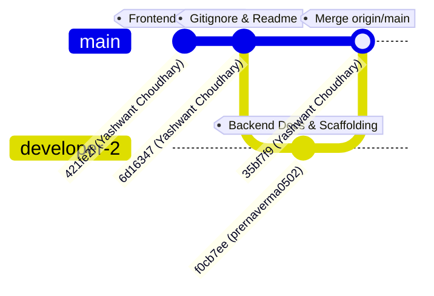

# LEGAL PRACTICE MANAGEMENT SAAS — TWO-DEVELOPER WORK AUDIT & COLLABORATION STATUS

**Project:** Heugly & Bludworth Legal Practice Management Software  
**Document:** Two-Developer Work Audit, Git Attribution, Overlap Analysis & Task Division  
**Date of Audit:** November 13, 2026  
**Auditor:** Automated Engineering Audit System  

---

## 1. GIT REPOSITORY & COMMIT ATTRIBUTION AUDIT

Evidence-based Git analysis confirms two distinct contributors actively collaborating on `main`:



### Contributor 1: Yashwant Choudhary (`yashuchoudhary3621@gmail.com`)
- **Primary Domain:** Frontend Architecture, UI/UX Engineering & Mock Data Modeling.
- **Verified Contributions:**
  - `421fe2f` (2026-11-13 10:51:00): Full React 18 application with Vite 5, Tailwind CSS, Lucide icons, Recharts, and React Router v6.
  - Implemented 211 frontend files comprising 15 functional modules (Intake, Matters, Personal Injury, Bankruptcy, Immigration, Specialty Practices, Billing, Trust, Time Tracking, Settings).
  - Authored 26 structured mock datasets in `frontend/src/data/` defining business entities.
  - Built `frontend/src/services/mockStorage.js` for localStorage data persistence and simulation.
  - `6d16347` (2026-11-13 11:58:42): Root `.gitignore` and `README.md` adjustments.
  - `35bf7f9` (2026-11-13 12:03:49): Clean merge of Developer 2's remote work into local branch.

### Contributor 2: prernaverma0502 (`prernaverma0502@gmail.com`)
- **Primary Domain:** Backend Architecture, Database Design & Technical Documentation.
- **Verified Contributions:**
  - `f0cb7ee` (2026-11-13 12:02:05): Created the comprehensive 16-document backend architectural specification suite in `backend-docs/` (4,274 lines of markdown):
    - Complete MySQL 8.4 schema designs, ER diagrams, Utah RPC 1.15 compliance, and 75+ REST API endpoint specifications.
  - Established initial Node.js / TypeScript / Express scaffolding in `backend/`:
    - `backend/package.json` with Express 4.21, Prisma 5.22, Helmet, CORS, MySQL2, and Zod.
    - `backend/tsconfig.json` for ES2022 / NodeNext module resolution.
    - `backend/prisma/schema.prisma` with 17 initial MySQL models.
    - `backend/src/app.ts`, `server.ts`, `config/env.ts`, `config/database.ts`, and `test-db.ts`.

---

## 2. CODE OVERLAP, CONFLICT & GAP ANALYSIS

### 1. Database Model Gaps vs. Frontend Requirements
While Developer 2's documentation (`backend-docs/03-DATABASE-DESIGN.md`) specifies 25+ relational tables, the actual drafted `backend/prisma/schema.prisma` contains 17 models. Several critical modules implemented in the frontend UI by Developer 1 have **no corresponding Prisma models**:
- **Personal Injury Dockets**: Frontend has comprehensive UI for Damages, Liens, Insurance Policies, Incident Details, Medical Providers, and Demand Packages (`mockPersonalInjury.js`). None of these exist in `schema.prisma`.
- **Bankruptcy (Best Case Parity)**: Frontend has Chapter 7/13 Means Test calculators and Schedules A–J (`mockBankruptcyCases.js`). These tables are omitted in `schema.prisma`.
- **Immigration (Docketwise Parity)**: Frontend has USCIS form sync and questionnaire workflows (`mockImmigrationCases.js`). These tables are omitted in `schema.prisma`.
- **Contacts & Related Parties**: Frontend links multiple parties (adversaries, adjusters, witnesses) to matters (`mockRelatedParties.js`). No `Contact` or `RelatedParty` model exists in `schema.prisma`.
- **Calendar & Docketing**: Frontend calendar relies on `mockCalendar.js`. No `CalendarEvent` model exists in `schema.prisma`.

### 2. API Response Envelope Mismatch
- **Backend Specification (`05-API-SPECIFICATION.md`)**:
  ```json
  {
    "success": true,
    "data": [ ... ],
    "meta": { "total": 24, "page": 1, "limit": 20 }
  }
  ```
- **Frontend Current Expectation**:
  React components and contexts currently expect naked data arrays directly (e.g. `clients.map(...)`, `matters.filter(...)`).
- **Conflict Mitigation**: When building the frontend HTTP client layer, an Axios response interceptor must unpack `response.data.data` to prevent breaking frontend UI components.

### 3. Authentication & Session Strategy
- **Frontend Current Implementation**: `AuthContext.jsx` performs client-side email matching against `mockUsers.js` and writes `current_user_id` to localStorage.
- **Backend Architecture**: `06-AUTHENTICATION-AUTHORIZATION.md` requires JWT access tokens in the `Authorization: Bearer <token>` header and refresh tokens stored in secure `HttpOnly` cookies.
- **Action Needed**: `AuthContext.jsx` must be refactored to call `POST /api/v1/auth/login`, store the JWT in memory/state, and configure Axios headers.

---

## 3. RECOMMENDED FUTURE WORK DIVISION (ZERO-CONFLICT ROADMAP)

To ensure both developers can work simultaneously at full velocity without causing Git merge conflicts or blocking each other:

### Track 1: Developer 2 (`prernaverma0502`) — Backend Core & Database Implementation
*Focus strictly on `backend/` directory.*

1. **Phase 1: Environment & Migration Baseline**:
   - Resolve empty directory `backend/.env` (replace with valid `.env` file).
   - Run `npm install` in `backend/` to install Express, Prisma, TypeScript, and dependencies.
   - Run `npx prisma migrate dev --name init` to generate first migration SQL.
   - Add missing Prisma models for Personal Injury, Bankruptcy, Immigration, and Calendar.
2. **Phase 2: Authentication & Core Scaffolding**:
   - Install `bcryptjs`, `jsonwebtoken`, and `@types/jsonwebtoken`.
   - Implement `backend/src/middlewares/auth.middleware.ts` and `rbac.middleware.ts`.
   - Implement `auth.service.ts`, `auth.controller.ts`, and `auth.routes.ts` (`POST /login`, `GET /me`, `POST /refresh`).
3. **Phase 3: Core Domain CRUD APIs**:
   - Implement Users, Clients, Matters, and Tasks controllers and routes following `05-API-SPECIFICATION.md`.
   - Integrate centralized error-handling middleware (`error.middleware.ts`).

### Track 2: Developer 1 (`Yashwant Choudhary`) — Frontend API Client & State Migration
*Focus strictly on `frontend/` directory.*

1. **Phase 1: HTTP Client & Axios Setup**:
   - Install `axios` in `frontend/package.json`.
   - Create `frontend/src/api/client.js` with base URL (`http://localhost:5000/api/v1`), credentials handling, and response unwrapping interceptors.
2. **Phase 2: API Service Modules**:
   - Create `frontend/src/api/auth.api.js`, `clients.api.js`, `matters.api.js`, `tasks.api.js`.
   - Implement fallback to `mockStorage` if backend API is unreachable (graceful offline/demo mode).
3. **Phase 3: Context Modernization**:
   - Update `AuthContext.jsx` to call `authApi.login()`.
   - Update `ClientContext.jsx` and `MatterContext.jsx` to fetch from live API on mount.

---

## 4. COLLABORATION RULES & BRANCH STRATEGY

1. **Directory Isolation**: Developer 1 commits exclusively inside `frontend/`; Developer 2 commits exclusively inside `backend/` and `backend-docs/`. This eliminates 95% of potential Git merge conflicts.
2. **Feature Branching**: Neither developer should commit directly to `main`. Use descriptive feature branches:
   - `feat/be-auth-service`
   - `feat/be-client-matter-apis`
   - `feat/fe-axios-layer`
   - `feat/fe-auth-integration`
3. **API Contract Adherence**: Any change to API route names, payloads, or response envelopes must be updated in `backend-docs/05-API-SPECIFICATION.md` and approved by both developers prior to implementation.

