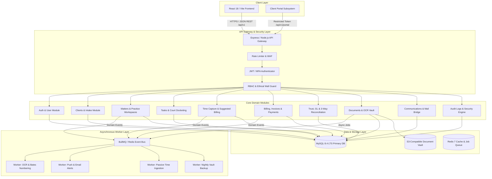
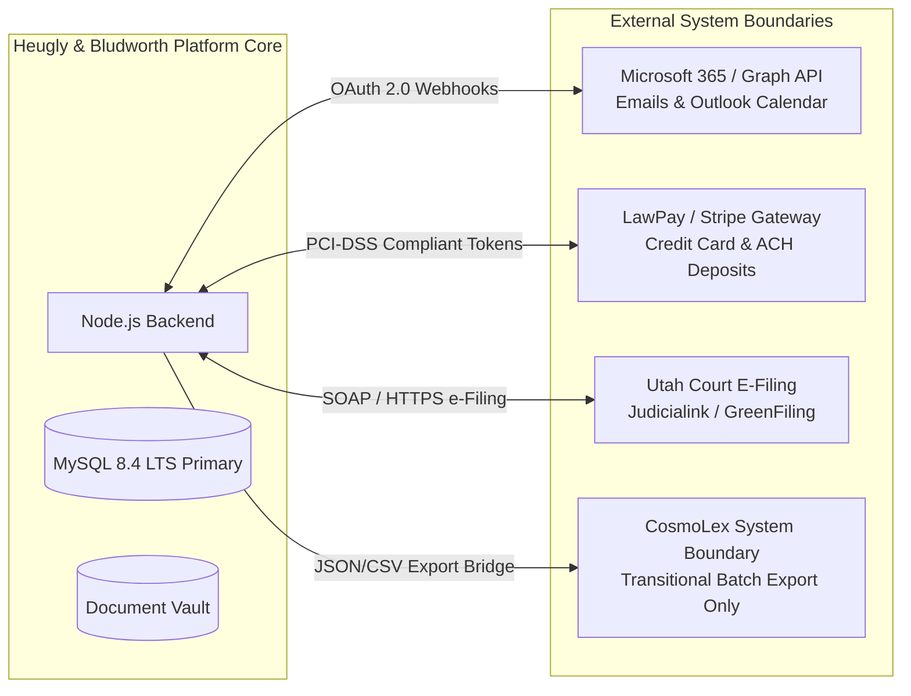

# 01 – BACKEND ARCHITECTURE & SYSTEM DESIGN

**Firm Name:** Heugly & Bludworth, Attorneys at Law  
**System Type:** Enterprise Multi-Practice Legal Management SaaS  
**Architecture Pattern:** Modular Monolith with Domain-Driven Boundaries & Event-Driven Asynchrony  
**Primary Database:** MySQL 8.4 LTS (InnoDB Storage Engine)  
**Concurrency Scale:** 50 active practitioners (concurrent read/write) with scaling headroom to 150+

---

## 1. Architectural Philosophy & Design Principles

The backend architecture is structured as a **Modular Monolith**. Rather than introducing distributed microservice overhead for a 50-person law firm, the modular monolith enforces strict domain isolation at the code level while maintaining a single transactional database boundary (**MySQL 8.4 LTS with InnoDB engine**). This guarantees:
1. **Atomic Financial Consistency (ACID)**: Essential for Utah RPC 1.15 trust accounting, double-entry general ledger balancing, and invoice allocations that cannot afford distributed eventual consistency failures.
2. **Simplified Operational Footprint**: Zero network serialization latency between domain services, low infrastructure overhead, and unified database migrations.
3. **Domain Event Decoupling**: Modules communicate synchronously across direct service interfaces for transactional queries, and asynchronously via an in-memory / Redis event bus for secondary operations (audit logging, task auto-generation, notification dispatch, and OCR processing).

---

## 2. Core Domain Modules & Inter-Module Communication

Each domain module is self-contained with its own Controller, Service, and Data Access Repository. Communication between modules adheres to defined rules:

### 2.1 Module Summary & Responsibilities

| Module | Core Responsibilities | Communicates With | Primary Dependencies |
| :--- | :--- | :--- | :--- |
| **Auth & User Management** | User authentication, JWT issuance, password hashing, session revocation, user profile provisioning, billing rate assignments, role assignments. | All Modules | Database (Users, Roles, Permissions) |
| **Clients & Intake** | Prospective client intake, adverse party conflict search (Utah RPC 1.7), client record creation, master contact records. | Matters, Accounting, Audit Logs | Auth (Reviewer identity) |
| **Matters & Practice Workspaces** | Matter docketing, Filevine stage progression, gatekeeper checklists, specialty workspaces (PI, Bankruptcy, Immigration, Litigation, Probate, Family, Criminal, Appeals, Evictions). | Clients, Tasks, Time, Billing, Documents | Clients (Parent entity), Tasks |
| **Tasks & Activities** | Task assignment, status transitions, firm calendar, URCP Rule 6 deadline computation, litigation checklists. | Matters, Auth, Notifications | Matters, Calendar |
| **Time Tracking & Capture** | Standard billable time logging, daily review slots (12, 4, 6, 9 PM), passive capture ingestion, partner approval workflow, UTBMS coding. | Matters, Billing, Auth | Matters (Target matter), Users (Timekeeper) |
| **Billing & Invoices** | Invoice generation, line-item compilation (time + expenses), payment allocations, AR aging, LEDES export. | Time, Accounting, Matters | TimeEntries, Expenses, General Ledger |
| **Accounting & IOLTA Trust** | Double-entry chart of accounts, general ledger journals, segregated client trust sub-ledgers, 3-way reconciliation ($0 variance), settlement disbursements. | Billing, Matters, Clients | TrustSubLedgers, GeneralLedger |
| **Documents & Vault** | S3 document vault, versioning (`v1.0`..`v2.1`), metadata tagging, privilege classification (Utah RPC 1.6), Bates numbering, OCR pipeline. | Matters, Clients, Audit Logs | S3 Object Storage, Asynchronous Worker |
| **Communications & Messaging** | Microsoft Graph Outlook bridge, unmatched communication queues, SMS threads, secure client portal messaging. | Clients, Matters, Time Capture | External Mail APIs, Matters |
| **Audit Logs & Security** | Immutable audit records of logins, downloads, permission changes, financial postings, restore dry-run drills. | All Modules | Database (AuditLogs) |

---

## 3. Inter-Module Communication Patterns

### Pattern 1: Direct Synchronous Service Calls (Transactional Boundaries)
When an operation requires transactional atomicity (ACID), calling services invoke collaborator services within the same MySQL InnoDB transaction:
- **Example: Invoice Creation (`BillingService` $\rightarrow$ `TimeService` & `AccountingService`)**:
  1. `BillingService.generateInvoice()` opens an InnoDB transaction via `prisma.$transaction`.
  2. Sets `TimeEntry.status = 'Billed'` for all included entries.
  3. Inserts invoice header and line items.
  4. Calls `AccountingService.recordAccountsReceivable(invoice)` to insert double-entry journal items (Debit: 1200 Accounts Receivable, Credit: 4000 Legal Fee Income).
  5. Commits transaction. If any step fails, the entire invoice generation rolls back cleanly.

- **Example: Intake Conversion to Client & Initial Matter (`ClientService` $\rightarrow$ `MatterService`)**:
  1. `ClientService.convertToClient(intakeId)` verifies conflict check is marked `'Cleared'`.
  2. Inserts new `Client` record.
  3. Marks `Intake.convertedToClient = true`.
  4. Calls `MatterService.createMatter()` to scaffold the initial matter file and apply the practice area workflow stages.

### Pattern 2: Asynchronous Domain Events (BullMQ & Redis)
For non-blocking side effects, modules publish typed events to an in-memory / Redis-backed job queue:
- `MatterStageAdvancedEvent`:
  - `TaskService` listens: Spawns automated checklist tasks for the newly entered stage.
  - `NotificationService` listens: Alerts assigned associate attorney and paralegal.
- `PassiveActivityCapturedEvent`:
  - `TimeService` listens: Deduplicates activity against existing time entries and pushes to `SuggestedBilling` queue.
- `DocumentUploadedEvent`:
  - `OcrWorker` listens: Extracts text from PDF/image, indexes words for full-text search, and saves OCR payload.

---

## 4. Concurrency & Scalability Architecture on MySQL 8.4 (50 to 150+ Users)

The platform is engineered specifically for Heugly & Bludworth’s target deployment of **50 combined attorneys and staff**:

### 4.1 Database Connection Pool & InnoDB Buffer Pool
- MySQL 8.4 LTS managed instance configured with:
  - `max_connections = 150`.
  - `innodb_buffer_pool_size = 2G` (or 70% of available RAM in production).
  - `transaction_isolation = 'READ-COMMITTED'` (eliminates unnecessary gap-lock deadlocks common in default `REPEATABLE-READ` during multi-row inserts).
- Application connection pool (Prisma) allocates:
  - Default API pool: 30 connections (fast sub-50ms queries).
  - Background worker pool: 10 connections (batch imports, OCR updates).
  - Reserved administrative connection pool: 5 connections.

### 4.2 Financial Concurrency & Pessimistic Row Locking
To prevent race conditions during high-volume accounting transactions (such as concurrent retainer drawdowns or trust disbursements):
- Database operations on `trust_sub_ledgers` use InnoDB `SELECT ... FOR UPDATE` row-level locks.
- Guarantees serialized execution so two staff members cannot disburse the same client retainer simultaneously.

### 4.3 Caching Strategy (Redis)
- **Session & Permission Cache**: Active user permissions and role definitions are cached in Redis (`ttl = 15m`). Role permission changes invalidate user cache keys immediately.
- **Reference Data Cache**: Practice area workflow stage configurations, Utah court rosters, and Utah median income tables are cached in memory for sub-millisecond retrieval.
- **Dynamic Dockets & Search**: Matter search queries leverage MySQL B-tree indexes and `FULLTEXT` indexes on `ocr_content` with client-level filter scoping to eliminate slow table scans.

---

## 5. System Boundary & External Integrations

- **CosmoLex System Boundary**: CosmoLex does not serve as a real-time data dependency. The backend exposes an audited export endpoint (`/api/v1/integrations/cosmolex/export`) that synchronizes approved batches of time entries and expenses into LEDES 1998B format for archive purposes.
- **Client Portal Isolation**: External clients authenticate via a segregated portal token (`/api/v1/portal/*`). Portal endpoints never return internal attorney notes, non-billable rates, or unapproved financial drafts.
