# 02 – TECHNOLOGY STACK EVALUATION & RECOMMENDATION

**Firm Name:** Heugly & Bludworth, Attorneys at Law  
**Frontend Environment:** React 18 / Vite 5 / Tailwind CSS / Lucide React / Recharts  
**Primary Database Engine:** MySQL 8.4 LTS (Long-Term Support)  
**ORM:** Prisma ORM 5.x (`provider = "mysql"`)  
**Document Purpose:** Evaluation, Comparative Analysis, and Authoritative Backend Stack Selection

---

## 1. Stack Evaluation & Comparative Analysis

To select the ideal backend foundation for Heugly & Bludworth's 50-person law firm SaaS, three leading ecosystem candidates were evaluated across ten mission-critical criteria:

| Evaluation Criterion | Option A: Node.js (TypeScript) + Express / Prisma + MySQL 8.4 | Option B: Python (FastAPI / SQLAlchemy + MySQL) | Option C: Go (Golang) + GORM + MySQL |
| :--- | :--- | :--- | :--- |
| **Full-Stack Type Sharing** | **Exceptional**: Direct sharing of TypeScript interfaces, Zod schemas, and DTOs with React 18. | **Moderate**: Requires duplicate Pydantic / TypeScript type definitions. | **Low**: Go structs require separate code-generation tooling. |
| **Developer Velocity & Team Onboarding** | **High**: Unified JavaScript / TypeScript syntax across frontend and backend. | **High**: Python is approachable, but context switching exists. | **Moderate**: Steeper concurrency paradigm and boilerplate. |
| **ACID Financial Transactions** | **Excellent**: MySQL 8.4 InnoDB engine with Prisma interactive transactions guarantee atomic multi-row updates. | **Excellent**: SQLAlchemy session management supports nested transactions. | **Excellent**: Native database transactions with SQL. |
| **Complex JSON Workflows (Filevine / Best Case)** | **Exceptional**: Native V8 JSON serialization, Zod validation, and MySQL 8.4 native `JSON` type. | **Excellent**: Pydantic models parse JSON rapidly. | **Moderate**: Go rigid struct tags add complexity to dynamic nested questionnaires. |
| **Ecosystem & Legal Tooling** | **Vast**: Packages for PDF generation (PDFKit), DOCX templating, and LEDES 1998B parsing. | **Vast**: Strong AI/ML libraries, but legal SaaS libraries are comparable. | **Limited**: Smaller ecosystem for document manipulation. |
| **Memory & Concurrency for 50 Users** | **Optimal**: Asynchronous event loop easily handles 50-150 concurrent law firm users. | **Optimal**: AsyncIO ASGI server handles concurrent loads well. | **Highest**: Lowest memory footprint, but overkill for 50 users. |

### Final Recommendation: Option A – Node.js (TypeScript) + Express + Prisma ORM + MySQL 8.4 LTS

**Strategic Rationale for Heugly & Bludworth:**
1. **End-to-End TypeScript Fidelity**: The existing React frontend already models complex types (`Client`, `Matter`, `TimeEntry`, `ReconciliationPillar`, `BankruptcyCase`). Using TypeScript on the backend allows shared type definitions and Zod validation schemas, eliminating contract divergence between UI and API.
2. **MySQL 8.4 Long-Term Support (LTS) Enterprise Foundation**:
   - Released by Oracle in 2024 as the premier enterprise Long-Term Support release, guaranteeing stability, predictable security updates, and active enterprise support without sudden deprecations.
   - **Enforced Check Constraints**: MySQL 8.4 fully evaluates and enforces `CHECK` constraints (such as `CHECK (balance >= 0.00)` on trust sub-ledgers and `CHECK (debit >= 0 AND credit >= 0)` on general ledger entries), ensuring compliance with Utah RPC 1.15.
   - **Native JSON Support**: Supports rich document structures for dynamic practice area questionnaires (Form I-130, Means-Test Form 122).
   - **InnoDB Row-Level Locking**: Provides `SELECT ... FOR UPDATE` pessimistic locking to prevent race conditions during high-volume accounting transactions.
   - **InnoDB FULLTEXT Indexing**: High-performance multi-word search across document OCR content without external search cluster overhead.
3. **Prisma ORM for Strict Financial Integrity**: Prisma provides compile-time type-safe queries and interactive database transactions (`prisma.$transaction`), essential for Utah RPC 1.15 trust sub-ledger integrity where race conditions or partial writes are unacceptable.
4. **Operational Simplicity**: A single Node.js runtime environment for both the frontend Vite build pipeline and the backend service minimizes CI/CD complexity, local development friction, and hosting costs.

---

## 2. Comprehensive Technology Stack Specification

```mermaid
graph TD
    subgraph Language & Runtime
        NODE[Node.js v20+ LTS]
        TS[TypeScript 5.x]
    end

    subgraph Web Framework & Routing
        EXP[Express.js 4.x / Modular Routers]
        CORS[CORS & Helmet Security Middleware]
    end

    subgraph Data Access & Persistence
        PRISMA[Prisma ORM 5.x - provider: mysql]
        DB[(MySQL 8.4 LTS - InnoDB / utf8mb4)]
        REDIS[(Redis 7 - BullMQ & Cache)]
    end

    subgraph Security & Validation
        ZOD[Zod Validation Engine]
        JWT[jsonwebtoken + bcryptjs]
        OTPLIB[otplib - TOTP Multi-Factor Auth]
    end

    subgraph Background Jobs & Storage
        BULL[BullMQ Asynchronous Job Queue]
        S3[AWS S3 / MinIO Object Vault]
        TESS[Tesseract.js / PDF-Parse OCR]
    end

    subgraph Testing & Quality
        VITEST[Vitest Testing Framework]
        SUPER[Supertest API Tester]
        TCONT[Testcontainers - mysql:8.4]
    end

    NODE --> EXP
    TS --> NODE
    EXP --> CORS
    EXP --> ZOD
    EXP --> PRISMA
    PRISMA --> DB
    EXP --> REDIS
    REDIS --> BULL
    BULL --> TESS
    EXP --> S3
    EXP --> JWT
    EXP --> OTPLIB
    VITEST --> SUPER
    SUPER --> TCONT
```

### 2.1 Backend Framework & Core Runtime
- **Runtime Environment**: **Node.js 20 LTS** (Long-Term Support, Active Maintenance).
- **Language**: **TypeScript 5.x** configured in strict mode (`"strict": true`).
- **HTTP Server**: **Express.js 4.x** with modular routing architecture. Express provides battle-tested stability, zero vendor lock-in, and extensive middleware interoperability.

### 2.2 Relational Database & ORM
- **Database Engine**: **MySQL 8.4 LTS** (InnoDB Storage Engine, Character Set: `utf8mb4`, Collation: `utf8mb4_0900_ai_ci`).
  - InnoDB ACID compliance with serialized row-level locking for multi-tenant trust accounting.
  - Native `JSON` data type support for practice-area questionnaires (Form I-130, Form 122 Means-Test).
  - Native InnoDB `FULLTEXT` search on `ocr_content` for fast text retrieval across document pleadings and discovery files.
  - Fully enforced `CHECK` constraints on table definitions.
- **ORM / Query Engine**: **Prisma ORM 5.x** configured with `provider = "mysql"`.
  - Type-safe schema-first migrations (`prisma migrate`).
  - Interactive transactions (`prisma.$transaction`) with configurable timeout.
  - Granular connection pooling via MySQL connection string parameters (e.g. `connection_limit=30`).

### 2.3 Authentication, Session & Multi-Factor Auth
- **Token Management**: Stateless JSON Web Tokens (**JWT**) with short-lived access tokens (15 minutes) and long-lived refresh tokens (7 days) stored in `HttpOnly`, `SameSite=Strict`, `Secure` cookies.
- **Password Hashing**: **bcryptjs** (12 salt rounds) to prevent brute-force rainbow table attacks.
- **Multi-Factor Authentication**: **otplib** implementing RFC 6238 TOTP (Google Authenticator, Microsoft Authenticator) with encrypted seed storage.

### 2.4 Request Validation & Data Integrity
- **Validation Engine**: **Zod 3.x**.
  - Shared schemas validating incoming `req.body`, `req.query`, and `req.params`.
  - Type inference exporting TypeScript types directly from validation schemas:
    `type CreateClientDTO = z.infer<typeof createClientSchema>;`

### 2.5 Structured Logging & Observability
- **Logger**: **Pino** or **Winston** configured for structured JSON output.
  - Production logs omit PII (client names, social security numbers, bank routing info).
  - Correlates incoming requests using a unique `X-Request-Id` UUID header.
  - Security and financial audit events streamed directly to the immutable `AuditLog` database table.

### 2.6 Background Task Execution & Caching
- **In-Memory Cache & Message Broker**: **Redis 7**.
- **Job Queue Engine**: **BullMQ**.
  - Handles asynchronous document OCR text extraction.
  - Manages passive billing deduplication batch parsing.
  - Schedules mountain-time daily review notification dispatches (12:00 PM, 4:00 PM, 6:00 PM, 9:00 PM MT).

### 2.7 File & Document Vault Storage
- **Object Storage**: S3-compatible protocol (**AWS S3** or self-hosted **MinIO**).
- **Access Pattern**: Secure presigned upload and download URLs with 15-minute expiration windows.
- **Encryption**: Server-Side Encryption with Customer-Provided Keys or AWS KMS (**AES-256-GCM**).

### 2.8 Testing & Quality Assurance Stack
- **Test Runner**: **Vitest** (extremely fast, native ESM support, compatible with Vite ecosystem).
- **HTTP Integration Testing**: **Supertest** for testing live Express `/api/v1` route endpoints.
- **Database Test Isolation**: **Testcontainers** (spinning up ephemeral MySQL 8.4 Docker instances via `mysql:8.4`) to test real InnoDB transactions and check constraint rollbacks.

### 2.9 Deployment & Containerization Architecture
- **Containerization**: Multi-stage **Docker** container (`node:20-alpine`) optimized for minimal footprint ($< 150 \text{ MB}$).
- **Orchestration / Hosting Targets**:
  - Development / Staging: Docker Compose with local `mysql:8.4`, Redis 7, and MinIO.
  - Production: AWS ECS (Elastic Container Service) with managed AWS RDS MySQL 8.4 and ElastiCache Redis.
