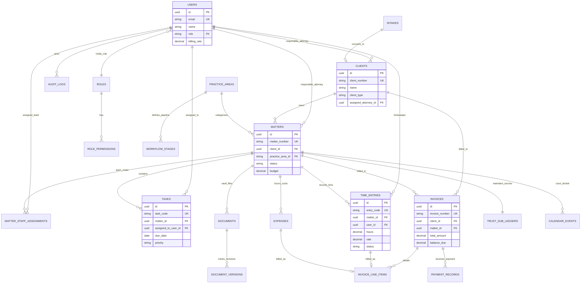
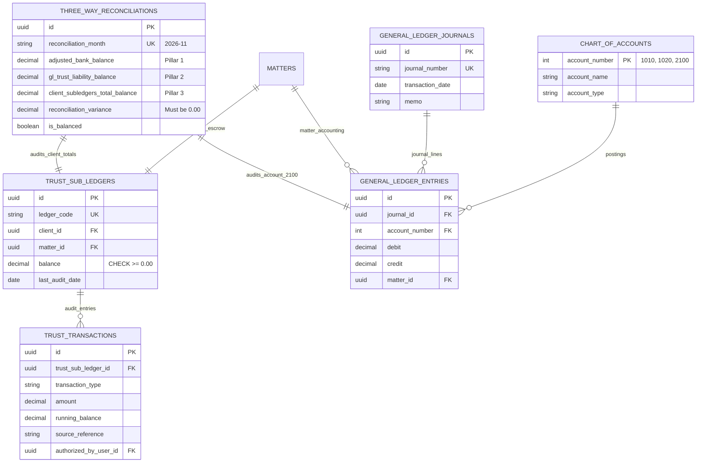

# 04 – ENTITY RELATIONSHIPS & DATA INTEGRITY GUARANTEES

**Firm Name:** Heugly & Bludworth, Attorneys at Law  
**Relational Standard:** 3NF (Third Normal Form) with Select JSON Pragmatic Extensions (MySQL 8.4 Native JSON)  
**Foreign Key Philosophy:** `ON DELETE RESTRICT` for Financial Ledgers; `ON DELETE CASCADE` for Child Line Items

---

## 1. Master Global Domain ER Diagram



---

## 2. Trust Accounting & General Ledger ER Diagram (Utah RPC 1.15)

The financial architecture guarantees that client trust money (IOLTA) is completely segregated from firm operational capital. Anti-commingling rules are structurally enforced:



---

## 3. Practice-Specific Specialty Docket Extensions

To avoid denormalizing core matter records with specialty fields, practice-specific dockets link directly to `matters.id` via 1:1 foreign keys:

```mermaid
erDiagram
    MATTERS ||--o| PERSONAL_INJURY_DOCKETS : "specialty_ext"
    PERSONAL_INJURY_DOCKETS ||--o{ MEDICAL_PROVIDERS : "treatment_records"
    PERSONAL_INJURY_DOCKETS ||--o{ LIEN_REGISTERS : "subrogations"
    PERSONAL_INJURY_DOCKETS ||--o{ SETTLEMENT_STATEMENTS : "contingency_split"

    MATTERS ||--o| BANKRUPTCY_DOCKETS : "specialty_ext"
    BANKRUPTCY_DOCKETS ||--o{ BANKRUPTCY_SCHEDULES : "schedules_A_through_J"
    BANKRUPTCY_DOCKETS ||--o{ BANKRUPTCY_CREDITORS : "matrix_mailing_list"

    MATTERS ||--o| IMMIGRATION_DOCKETS : "specialty_ext"
    IMMIGRATION_DOCKETS ||--o{ USCIS_RECEIPT_MILESTONES : "tracking_steps"

    PERSONAL_INJURY_DOCKETS {
        uuid id PK
        uuid matter_id FK UK
        date accident_date
        string liability_mechanism
        decimal policy_limits
    }
    MEDICAL_PROVIDERS {
        uuid id PK
        uuid pi_docket_id FK
        string facility_name
        decimal billed_amount
        decimal paid_amount
        string records_status
    }
    LIEN_REGISTERS {
        uuid id PK
        uuid pi_docket_id FK
        string lienholder_name
        decimal asserted_amount
        decimal negotiated_amount
        string statutory_basis
    }
    BANKRUPTCY_DOCKETS {
        uuid id PK
        uuid matter_id FK UK
        string chapter "7, 11, 13"
        string trustee_name
        boolean emergency_stay_clock
        date deadline_14_day
    }
    IMMIGRATION_DOCKETS {
        uuid id PK
        uuid matter_id FK UK
        string petition_type "I-130 / I-485"
        string alien_registration_number
        json multi_form_data
    }
```

---

## 4. Cardinality Explanations & Relationship Rules

| Entity Relationship | Cardinality | Business & Regulatory Rule Enforced |
| :--- | :---: | :--- |
| `clients` $\rightarrow$ `matters` | **1 : N** | One client may have multiple active and closed cases. A matter always belongs to exactly one client. |
| `matters` $\rightarrow$ `users` (Staff) | **N : M** | Handled by `matter_staff_assignments`. Multiple attorneys and paralegals collaborate on a case. Restricts ethical wall access. |
| `matters` $\rightarrow$ `trust_sub_ledgers` | **1 : 1** | Exactly one escrow ledger per matter. Anti-commingling guarantees funds are not mingled across cases. |
| `trust_sub_ledgers` $\rightarrow$ `trust_transactions` | **1 : N** | Immutable append-only audit trail. Balance is computed transactionally. Balance check constraint: $\ge \$0.00$. |
| `invoices` $\rightarrow$ `invoice_line_items` | **1 : N** | Cascade delete allowed only in `Draft` status. Once `Sent` or `Paid`, invoices are locked. |
| `time_entries` $\rightarrow$ `invoices` | **N : 1** | A time entry is included in at most one invoice. When billed, `status` transitions to `'Billed'`. |
| `documents` $\rightarrow$ `document_versions` | **1 : N** | Full revision history. File content replacement creates a new version record (`v2.0`). |

---

## 5. Referential Integrity & Deletion Rules

1. **Delete Protection (`ON DELETE RESTRICT`)**:
   - `clients` cannot be deleted if active `matters` exist.
   - `matters` cannot be deleted if posted `time_entries`, `invoices`, or `trust_sub_ledgers` exist.
   - `chart_of_accounts` cannot be deleted if referenced in `general_ledger_entries`.
2. **Cascade Cleanup (`ON DELETE CASCADE`)**:
   - Deleting a `task` removes internal task notifications.
   - Deleting a `draft` invoice removes its unbilled `invoice_line_items` and resets time entries back to `Approved`.
   - Deleting a `document` cascades to its metadata versions in the database, while background workers clean up S3 binaries.

