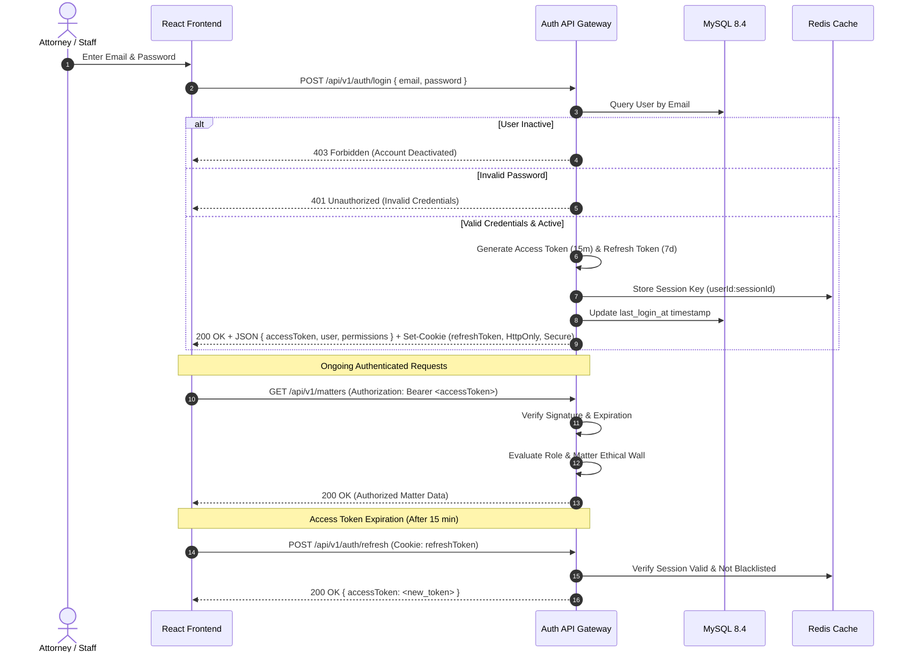

# 06 – AUTHENTICATION, AUTHORIZATION & ETHICAL WALLS

**Firm Name:** Heugly & Bludworth, Attorneys at Law  
**Security Standard:** Defense-in-Depth (Backend Enforced, Zero Trust)  
**Regulatory Standards:** Utah Rules of Professional Conduct (RPC 1.6 Confidentiality & RPC 1.7 Conflict of Interest)

---

## 1. Authentication Lifecycle & Token Architecture

The authentication system employs a stateless, cryptographically signed token design with automatic session rotation:



### 1.1 Password Hashing Specification
- Algorithm: **bcrypt** with **12 salt rounds**.
- Pre-save hashing hooks in Prisma middleware prevent plaintext storage in any environment.
- Enforced password policy: Minimum 12 characters, uppercase, lowercase, number, and special character.

### 1.2 Multi-Factor Authentication (MFA / TOTP)
- Implemented via RFC 6238 Time-Based One-Time Password algorithm (`otplib`).
- QR code generation utilizes `otpauth://totp/HeuglyBludworth:<email>?secret=<secret>&issuer=HeuglyBludworth`.
- TOTP secrets are encrypted at rest using AES-256 before storage in `users.mfa_secret`.
- Six single-use cryptographic recovery backup codes generated and stored as bcrypt hashes.

---

## 2. The Five Firm Roles & Responsibility Matrix

The system provides 5 native roles matching the firm's real organizational structure:

| Role Identifier | Role Title | Real Person Demo Persona | Responsibilities & Capabilities |
| :--- | :--- | :--- | :--- |
| **`super_admin`** | Managing Partner | **Eleanor Heugly, Esq.** (`usr-1`) | Unrestricted governance across all matters, financial accounts, 3-way reconciliations, user provisioning, security policies, and firm branding. |
| **`attorney`** | Senior / Associate Counsel | **Thomas Bludworth, Esq.** (`usr-2`) | Matter management, pleading drafting, task execution, billable time entry, document upload, and settlement evaluation. Ethically walled from unassigned cases. |
| **`paralegal`** | Litigation Paralegal | **Marcus Vance** (`usr-4`) | Case support, court filing exhibits, client document requests, task updates, discovery indexation. Ethically walled from unassigned cases; cannot approve time or view financial ledgers. |
| **`billing`** | Billing & Accounting Director | **Rachel Adams** (`usr-5`) | Invoice compilation, client payment application, operating cash disbursements, IOLTA trust ledger transactions, 3-way reconciliation, and LEDES/CosmoLex batch exports. |
| **`supervisor`** | Practice Group Leader | **David Sterling, Esq.** (`usr-6`) | Cross-matter oversight across assigned practice areas, team workload balancing, partner time-entry approval queues, and case escalation review. |

---

## 3. Backend Authorization Enforcement

**Strict Architectural Mandate**: Never rely solely on frontend React route guards or disabled buttons. Every single API endpoint enforces authorization independently at three distinct layers:

### Layer 1: Identity & Inactive Account Check Middleware (`requireAuth`)
```typescript
export const requireAuth = async (req: Request, res: Response, next: NextFunction) => {
  const token = req.headers.authorization?.replace('Bearer ', '');
  if (!token) return res.status(401).json({ success: false, error: { code: 'UNAUTHORIZED' } });

  const decoded = verifyAccessToken(token);
  const user = await prisma.user.findUnique({ where: { id: decoded.userId } });

  if (!user || user.status === 'Inactive') {
    return res.status(403).json({
      success: false,
      error: { code: 'ACCOUNT_DEACTIVATED', message: 'Account is deactivated.' }
    });
  }

  req.currentUser = user;
  next();
};
```

### Layer 2: Granular Capability Middleware (`requirePermission`)
Evaluates whether the user's role possesses the required capability key:
```typescript
export const requirePermission = (permissionKey: string) => {
  return async (req: Request, res: Response, next: NextFunction) => {
    const role = req.currentUser.role;
    if (role === 'super_admin') return next(); // Super admin bypasses permission checks

    const hasPerm = await prisma.rolePermission.findFirst({
      where: { roleId: role, permissionKey }
    });

    if (!hasPerm) {
      return res.status(403).json({
        success: false,
        error: { code: 'FORBIDDEN', message: `Missing required permission: ${permissionKey}` }
      });
    }

    next();
  };
};
```

### Layer 3: Matter-Level Ethical Wall Middleware (`requireMatterAccess` - Utah RPC 1.6)
Enforces substantive legal ethical walls. Even if an attorney has the `matters:view` permission globally, they are forbidden from inspecting a specific matter if they are walled off due to a prior conflict of interest:
```typescript
export const requireMatterAccess = async (req: Request, res: Response, next: NextFunction) => {
  const { matterId } = req.params;
  const user = req.currentUser;

  // Managing Partner, Supervisors, and Billing have firm-wide matter audit access
  if (['super_admin', 'supervisor', 'billing'].includes(user.role)) {
    return next();
  }

  // Attorneys and Paralegals must be assigned to the matter roster
  const assignment = await prisma.matterStaffAssignment.findFirst({
    where: { matterId, userId: user.id }
  });

  const matter = await prisma.matter.findUnique({
    where: { id: matterId },
    select: { responsibleAttorneyId: true }
  });

  if (matter?.responsibleAttorneyId === user.id || assignment) {
    return next();
  }

  // Audit log the unauthorized ethical wall breach attempt
  await logSecurityEvent({
    userId: user.id,
    action: 'ETHICAL_WALL_ACCESS_DENIED',
    resourceType: 'Matter',
    resourceId: matterId,
    ipAddress: req.ip
  });

  return res.status(403).json({
    success: false,
    error: {
      code: 'ETHICAL_WALL_RESTRICTION',
      message: 'Access denied: You are not assigned to this matter under firm ethical boundaries (Utah RPC 1.6).'
    }
  });
};
```

---

## 4. Account Lifecycle: Provisioning, Status & Password Recovery

### 4.1 Account Provisioning
- Only `super_admin` can create new accounts.
- Initial creation generates a cryptographically random, temporary 24-hour invitation link.
- Mandatory password reset on first workstation login.

### 4.2 Account Deactivation
- `PATCH /api/v1/users/:id/status` allows instant deactivation (`status = 'Inactive'`).
- Immediately terminates all active Redis sessions for that user ID.
- Prevents ongoing API requests even if the user has an unexpired access token.

### 4.3 Secure Password Reset Flow
1. User requests reset via `POST /api/v1/auth/forgot-password`.
2. System generates a secure SHA-256 reset token with 30-minute expiration.
3. Reset link transmitted via firm Microsoft 365 / SendGrid mailer.
4. User submits new password via `POST /api/v1/auth/reset-password`.
5. All existing active sessions for that user are revoked across all devices.

