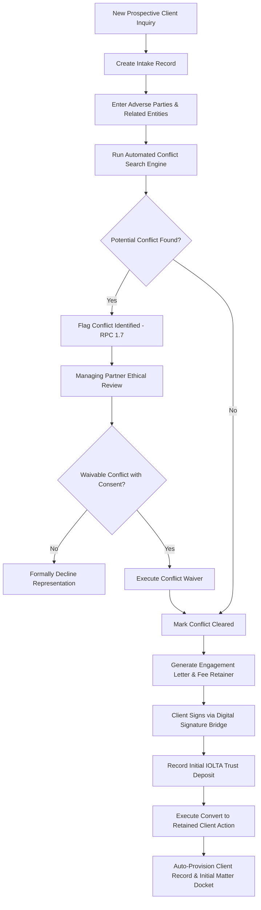
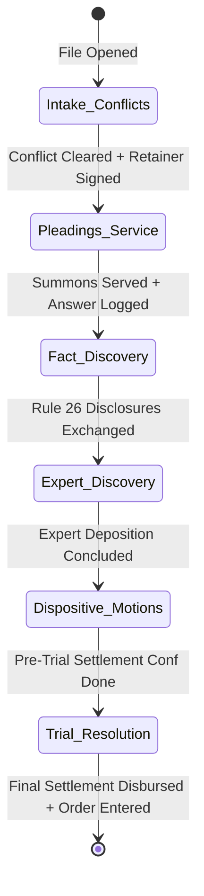
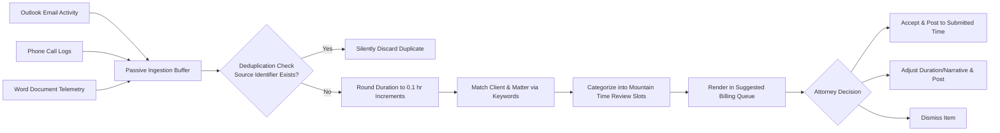
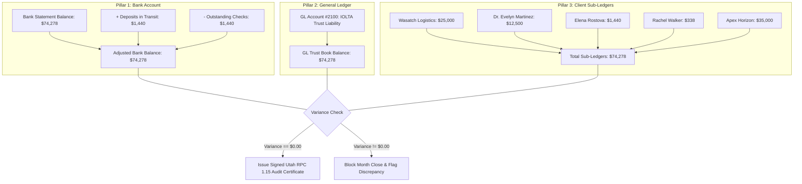
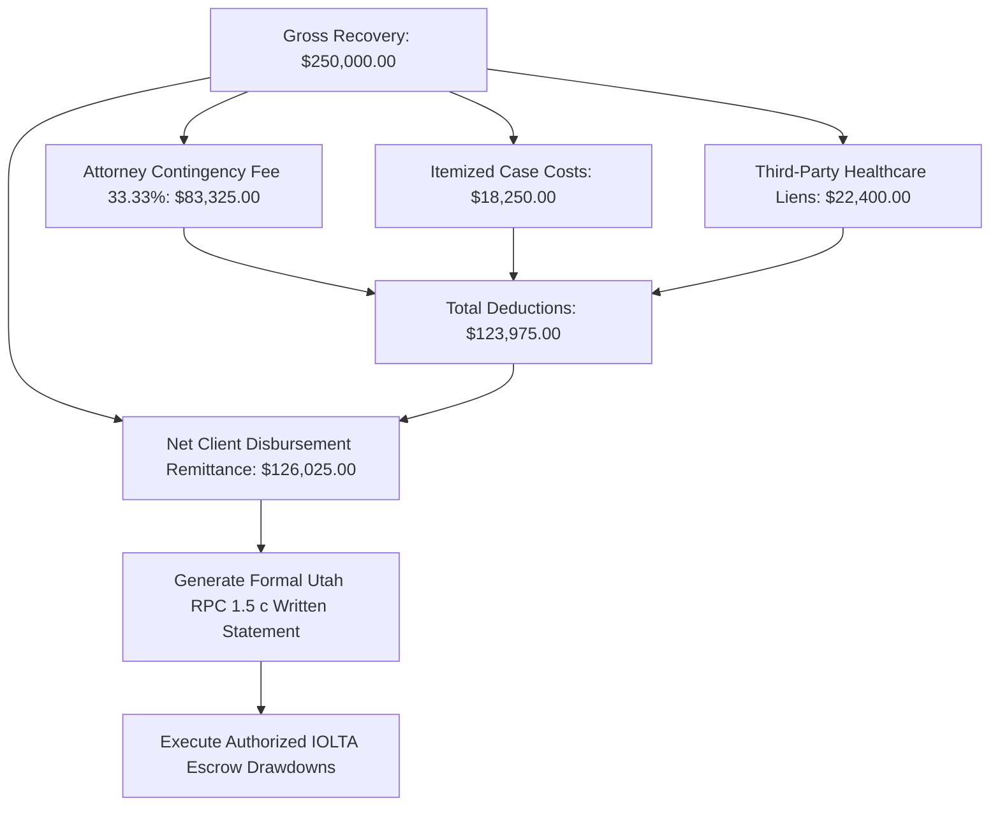

# 07 – SUBSTANTIVE BUSINESS LOGIC & WORKFLOW ENGINES

**Firm Name:** Heugly & Bludworth, Attorneys at Law  
**Jurisdiction:** State of Utah (State Bar & Federal Courts)  
**Functional Parity:** Filevine (Workflows) • Clio (360° Records) • Best Case (Bankruptcy) • Docketwise (Immigration) • Standalone 3-Way Reconciliation (CosmoLex Replacement)

---

## 1. Intake Clearance & Client Conversion Workflow (Utah RPC 1.7)



### 1.1 Transactional Conversion Contract
When `/api/v1/intakes/:id/convert` executes:
1. Validates that `conflict_status === 'Cleared'`. Throws `409 Conflict` if review is pending or adverse.
2. In a single MySQL InnoDB transaction:
   - Inserts `clients` record with unique code `CLI-XXXX`.
   - Inserts initial `matters` docket associated with the selected practice area.
   - Instantiates the `trust_sub_ledgers` account initialized to $\$0.00$.
   - Sets `intakes.converted_to_client = true`.

---

## 2. Configurable Workflow Engine & Stage Gatekeepers (Filevine Model)

Each of the firm's 9 practice areas has a tailored stage pipeline. Matter advancement is guarded by **Gatekeeper Conditions**:



### 2.1 Gatekeeper Enforcement Logic
When a user clicks "Advance Stage" on `MatterDetails.jsx`:
```typescript
async advanceMatterStage(matterId: string, targetStageId: string, verifiedFields: string[]) {
  const stage = await prisma.workflowStage.findUnique({ where: { id: targetStageId } });
  const required = stage.requiredFields as string[]; // e.g. ["Rule 26 Initial Disclosures Exchanged"]

  // Validate that all required gatekeeper items are acknowledged
  const missing = required.filter(item => !verifiedFields.includes(item));
  if (missing.length > 0) {
    throw new ValidationError(`Cannot advance stage: Missing required gatekeepers: ${missing.join(', ')}`);
  }

  return await prisma.$transaction(async (tx) => {
    // 1. Update matter stage
    await tx.matter.update({ where: { id: matterId }, data: { currentStageId: targetStageId } });
    
    // 2. Auto-spawn tasks configured for the target stage
    for (const taskTemplate of stage.autoTasks) {
      await tx.task.create({
        data: {
          matterId,
          title: taskTemplate.title,
          priority: taskTemplate.priority,
          dueDate: computeBusinessDays(new Date(), taskTemplate.dueDays),
          assignedToUserId: resolveRoleToUser(matterId, taskTemplate.role)
        }
      });
    }
  });
}
```

---

## 3. Passive Activity Capture & Deduplication Engine

Audited from `SuggestedBilling.jsx` (RFP Requirement 6):



### 3.1 Mountain-Time Review Schedules
Four daily review checkpoints:
- **12:00 PM MT (Noon)**: Mid-day morning communications review.
- **4:00 PM MT**: Late afternoon court and drafting capture.
- **6:00 PM MT**: End-of-day client consultations and conference calls.
- **9:00 PM MT**: Nightly audit to guarantee zero unbilled hours.

---

## 4. Standalone Three-Way Reconciliation (Utah RPC 1.15)

The core mechanism replacing CosmoLex. Guarantees balanced accounting across all 3 pillars:

$$\text{Pillar 1: Adjusted Bank Balance} = \text{Pillar 2: General Ledger Account 2100} = \text{Pillar 3: Total Client Sub-Ledgers}$$

$$\text{Variance} = |\text{Pillar 1} - \text{Pillar 2}| + |\text{Pillar 2} - \text{Pillar 3}| = \$0.00$$



---

## 5. Personal Injury Contingency Settlement Engine (Utah RPC 1.5(c))

Calculates final distribution statements upon settlement recovery:

$$\text{Net Client Payout} = \text{Gross Settlement} - \left( \text{Gross Settlement} \times \frac{\text{Contingency \%}}{100} \right) - \sum \text{Case Expenses} - \sum \text{Negotiated Liens}$$



---

## 6. Specialty Practice Substantive Engines

### 6.1 Bankruptcy Preparation (Best Case Model)
- **Means-Test Calculator (Form 122)**: Annualizes current monthly income (CMI) across 6 preceding calendar months. Compares debtor income against Utah median benchmarks based on family size (1 to 4+ members). Automatically flags Chapter 7 presumption of abuse.
- **Utah Statutory Exemptions**: Evaluates real property equity against Utah Code § 78B-5-501 ($44,500 single / $89,000 joint homestead) and motor vehicles against § 78B-5-505 ($5,000 vehicle exemption).
- **14-Day Emergency Stay Clock**: Triggers an alert countdown if an emergency petition is filed, tracking statutory deadlines for missing schedules under FRBP Rule 1007.

### 6.2 Immigration Preparation (Docketwise Model)
- **Multi-Form State Synchronization**: Single data store for foreign national aliases, I-94 arrival numbers, alien registration numbers, and prior addresses. Updating a client field immediately updates Form G-28 (Notice of Entry of Appearance), Form I-130 (Petition for Alien Relative), Form I-485 (Adjustment of Status), and Form I-765 (Employment Authorization).
- **Exhibit Package Assembler**: Organizes required evidence into indexed 7-tab exhibit binders (Tab A: Filing Fee Voucher; Tab B: Form G-28; Tab C: Primary Petitions; Tab D: Civil Documents; Tab E: Affidavit of Support I-864; Tab F: Tax Returns & W-2s; Tab G: Photographs).

