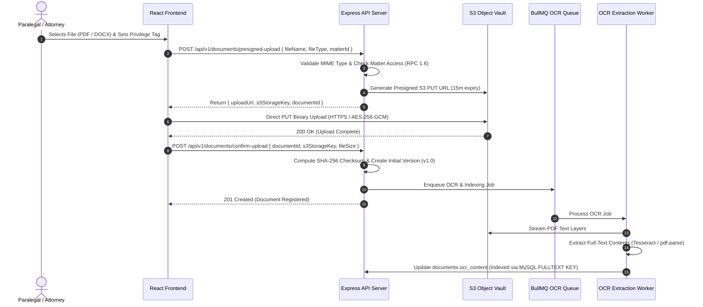
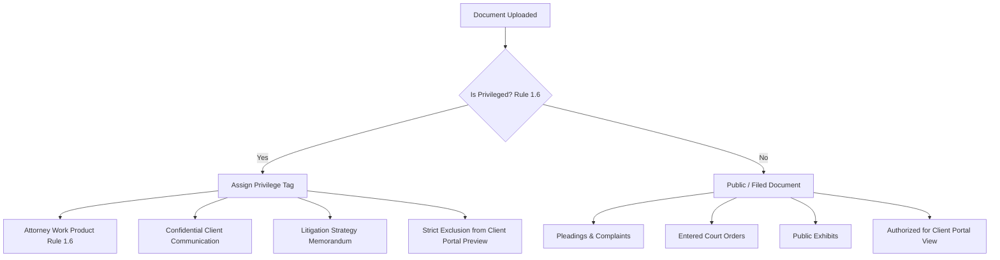

# 08 – FILE STORAGE, DOCUMENT VAULT & OCR MANAGEMENT

**Firm Name:** Heugly & Bludworth, Attorneys at Law  
**Storage Architecture:** S3-Compatible Object Vault with Signed URL Access  
**Security Standard:** AES-256-GCM Encryption at Rest & Utah RPC 1.6 Privileged Isolation

---

## 1. Document Vault Storage Architecture

All legal instruments, court orders, discovery productions, and exhibits are stored in an S3-compatible object storage repository (AWS S3 or self-hosted MinIO). The application server never acts as a permanent storage disk; files are streamed directly via secure presigned URLs:



---

## 2. File Ingestion, Validation & Encryption

### 2.1 File Type Allowlist & MIME Verification
The backend enforces strict MIME-type and magic-byte validation before issuing upload credentials:
- **Allowed Document Types**:
  - Portable Document Format (`application/pdf`)
  - Microsoft Word (`application/vnd.openxmlformats-officedocument.wordprocessingml.document`)
  - Microsoft Excel (`application/vnd.openxmlformats-officedocument.spreadsheetml.sheet`)
  - Images for Evidence / Exhibits (`image/jpeg`, `image/png`, `image/tiff`)
- Executables (`.exe`, `.bat`, `.sh`, `.vbs`, `.js`) and archive binaries (`.zip`, `.tar`) are strictly rejected.

### 2.2 Encryption Standards
- **In Transit**: Enforced TLS 1.3 with strict HTTPS cipher suites.
- **At Rest**: Server-Side Encryption with Customer-Managed Keys (AWS KMS or SSE-S3) utilizing **AES-256-GCM**.
- **Data Integrity**: SHA-256 checksums are calculated during upload confirmation and verified prior to any download stream to guarantee bit-level immutability.

---

## 3. Document Version Control (`v1.0` $\rightarrow$ `v2.1`)

Audited from `DocumentsList.jsx`. Documents in litigation undergo constant revision. Rather than overwriting existing records:
1. Every upload of an existing document generates a new record in `document_versions`.
2. Version labels increment systematically (`v1.0` $\rightarrow$ `v2.0` $\rightarrow$ `v2.1`).
3. Each version preserves its specific author, timestamp, file size, SHA-256 hash, and revision notes.
4. The parent `documents` record points to the current active version while maintaining historical links to all prior iterations.

---

## 4. Utah RPC 1.6 Privilege Classification & Client Portal Boundary



- When the Client Portal queries `/api/v1/portal/documents`, the query automatically appends `WHERE is_privileged = FALSE`.
- Privileged internal work products, forensic accountant reports, and attorney notes can never be accidentally exposed to clients or adverse parties through portal endpoints.

---

## 5. Asynchronous OCR & Full-Text Search Pipeline

1. **Extraction Worker**: Background BullMQ workers consume uploaded documents and extract text:
   - For native digital PDFs: Text streams are parsed directly via `pdf-parse`.
   - For scanned physical paper / images: Optical Character Recognition (**Tesseract.js** or cloud OCR) extracts textual glyphs.
2. **MySQL 8.4 InnoDB Full-Text Indexing**:
   - Extracted text is written to `documents.ocr_content`.
   - Indexed via MySQL InnoDB `FULLTEXT` index:
     ```sql
     ALTER TABLE documents ADD FULLTEXT KEY idx_documents_ocr_content (ocr_content);
     ```
   - Enables instantaneous cross-document search (`searchOCR` toggle in `DocumentsList.jsx`) via:
     ```sql
     SELECT id, title, matter_id FROM documents 
     WHERE MATCH(ocr_content) AGAINST(? IN NATURAL LANGUAGE MODE);
     ```

---

## 6. Automated Bates Numbering for Litigation Productions

For civil litigation document productions:
- The backend provides a Bates numbering stamping engine (`POST /api/v1/documents/bates-stamp`).
- Stamps sequential identifiers on each PDF page footer (e.g. `WASATCH-000001` through `WASATCH-000450`).
- Records the starting and ending Bates ranges in `documents.bates_number_start` and `documents.bates_number_end` for immediate reference in formal trial exhibit binders.

