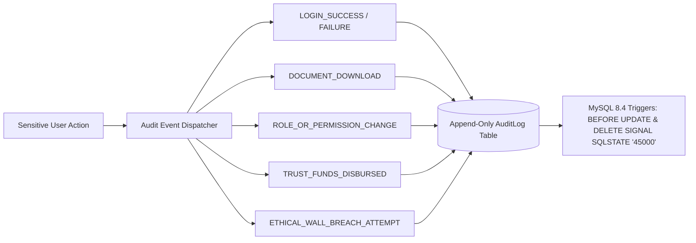
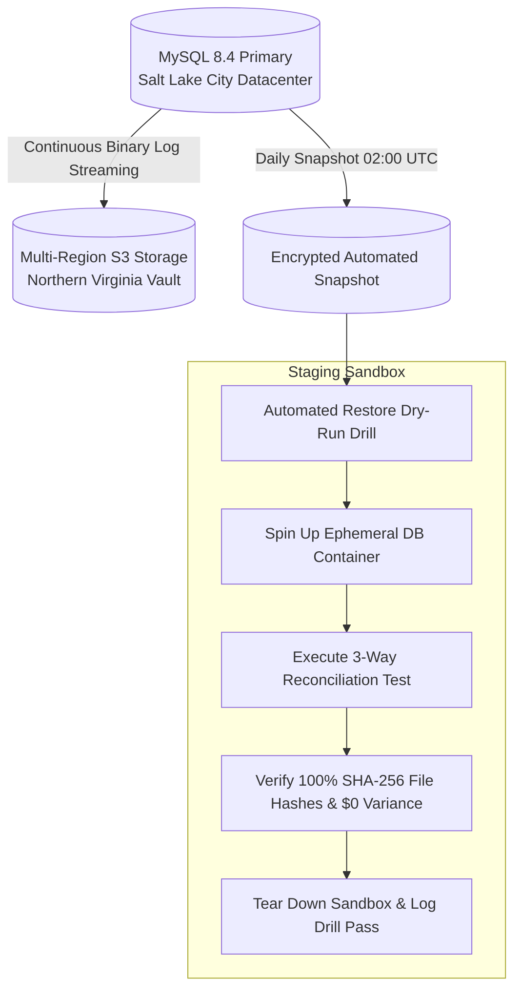

# 09 – SECURITY, COMPLIANCE & DISASTER RECOVERY

**Firm Name:** Heugly & Bludworth, Attorneys at Law  
**Regulatory Standards:** Utah Rules of Professional Conduct (RPC 1.6, 1.7, 1.15, 1.5, 5.1) • ABA Formal Opinions 477R & 512  
**Security Model:** Defense-in-Depth, Principle of Least Privilege, Continuous Audit Logging

---

## 1. Technical Controls vs. Legal/Compliance Requirements Matrix

To ensure clarity between automated architectural defenses and substantive legal obligations, controls are bifurcated:

| Domain | Technical Architecture Controls (Automated Backend) | Legal & Compliance Standards (Attorney / Firm Verification) |
| :--- | :--- | :--- |
| **Confidentiality & Privileged Data** | - AES-256-GCM encryption at rest on DB and S3.<br/>- TLS 1.3 in transit with HSTS.<br/>- Exclusion of `is_privileged = true` documents and internal notes from portal APIs. | **Utah RPC 1.6 & ABA Formal Op. 477R**: Duty to exercise reasonable electronic security precautions.<br/>**ABA Formal Op. 512**: Absolute prohibition on transmitting confidential client matter facts to public LLM training pipelines. |
| **Ethical Walls & Conflicts** | - Backend `requireMatterAccess` middleware rejects unassigned counsel.<br/>- Pre-intake adverse party search engine indexing all entities. | **Utah RPC 1.7 & 1.9**: Attorney conflict screening obligation prior to engagement.<br/>**Utah RPC 1.10**: Strict screening of disqualified attorneys to prevent firm-wide imputation. |
| **Trust Accounting (IOLTA)** | - Database check constraint: `balance >= 0.00`.<br/>- Strict segregation of client sub-ledgers.<br/>- Automatic 3-way reconciliation engine ($0 variance required).<br/>- Prohibition on direct edits/deletes to posted trust journals. | **Utah RPC 1.15(a)-(d)**: Mandates segregated trust accounts, anti-commingling of firm operational funds, accurate record retention for 5 years, and regular 3-way reconciliations. |
| **Contingency Fee Agreements** | - Calculation engine enforcing gross minus fees, costs, and medical liens.<br/>- Automated PDF disbursement statement generation. | **Utah RPC 1.5(c)**: Mandates signed contingency agreements and written closing statements showing net remittance to the client. |
| **Court Deadlines** | - Automated URCP Rule 6 business-day calculator.<br/>- Intermediate weekend/holiday exclusions for $< 11$ days.<br/>- Adding 3 calendar days for electronic service. | **Utah URCP Rule 6**: Statutory civil computation of time.<br/>**Utah RPC 1.1 & 1.3**: Attorney competence and diligence in calendaring statute of limitations. |

---

## 2. Immutable Compliance Audit Trail (`AuditLog`)

Every security-sensitive or financial event emits a non-repudiable audit entry to `audit_logs`:



### 2.1 Audit Record Schema Guarantee
```sql
-- MySQL 8.4 Immutability Triggers (Separate BEFORE UPDATE and BEFORE DELETE triggers)
DELIMITER $$

CREATE TRIGGER trg_protect_audit_logs_update
BEFORE UPDATE ON audit_logs
FOR EACH ROW
BEGIN
    SIGNAL SQLSTATE '45000'
    SET MESSAGE_TEXT = 'Audit records are immutable and cannot be updated under Utah State Bar compliance rules.';
END$$

CREATE TRIGGER trg_protect_audit_logs_delete
BEFORE DELETE ON audit_logs
FOR EACH ROW
BEGIN
    SIGNAL SQLSTATE '45000'
    SET MESSAGE_TEXT = 'Audit records are immutable and cannot be deleted under Utah State Bar compliance rules.';
END$$

DELIMITER ;
```

---

## 3. Threat Modeling & Vulnerability Defenses

| Threat Category | Attack Vector | Technical Backend Mitigation |
| :--- | :--- | :--- |
| **SQL Injection** | Parameter tampering in search filters | Prisma ORM parameterizes all database queries. Raw SQL fragments are forbidden unless wrapped in `Prisma.sql` tagged templates. |
| **Cross-Site Scripting (XSS)** | Malicious client names or notes | Automated input sanitization; Express `helmet` headers enforcing strict Content Security Policy (`CSP`). |
| **Broken Object-Level Auth (BOLA)** | Modifying another client's matter via ID manipulation | `requireMatterAccess` middleware validates authenticated user against `matter_staff_assignments` on every request. |
| **Brute Force & Credential Stuffing**| Repeated workstation login attempts | Express `rate-limit` restricting `/api/v1/auth/login` to 5 failed attempts per 15-minute window per IP. |
| **Session Hijacking** | Token theft via client script | Refresh tokens stored exclusively in `HttpOnly`, `SameSite=Strict`, `Secure` cookies inaccessible to JavaScript. |

---

## 4. Disaster Recovery & Continuity Architecture (RPO / RTO)

Audited from `SecuritySettings.jsx` (RFP Requirement 8):



### 4.1 Service Level Agreements (SLAs)
- **Recovery Point Objective (RPO) $\le$ 24 Hours**:
  - Full automated daily database snapshot at 02:00 UTC.
  - Continuous Binary Log (binlog) streaming and archiving every 15 minutes, allowing MySQL point-in-time recovery (PITR) to within 15 minutes of an outage.
- **Recovery Time Objective (RTO) $\le$ 4 Hours**:
  - Scripted Terraform / Docker restoration playbooks able to reconstruct the entire API and database layer within 4 hours.

### 4.2 Interactive Restore Dry-Run Drill API (`/api/v1/security/restore-drill`)
The backend provides a safe automated endpoint that simulates disaster recovery:
1. Verifies the latest MySQL logical backup (mysqldump / MySQL Enterprise Backup) and SHA-256 checksums.
2. Spins up an isolated staging database and restores schemas.
3. Validates IOLTA three-way ledger balances and file signatures ($0 variance).
4. Destroys sandbox and emits a certified compliance drill event (`RTO: 18 minutes, 0 errors`).

