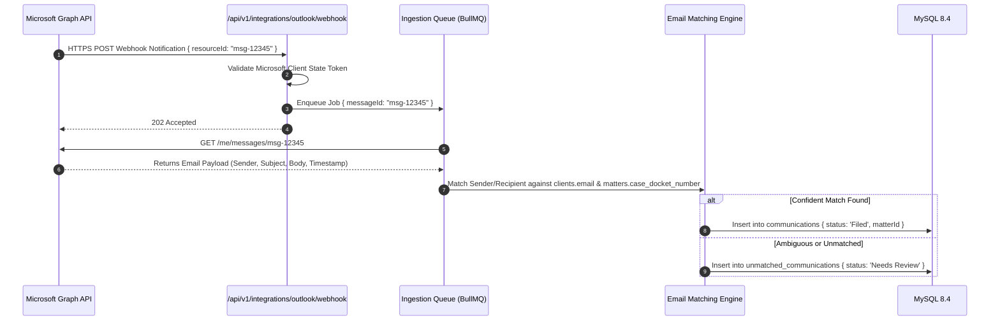
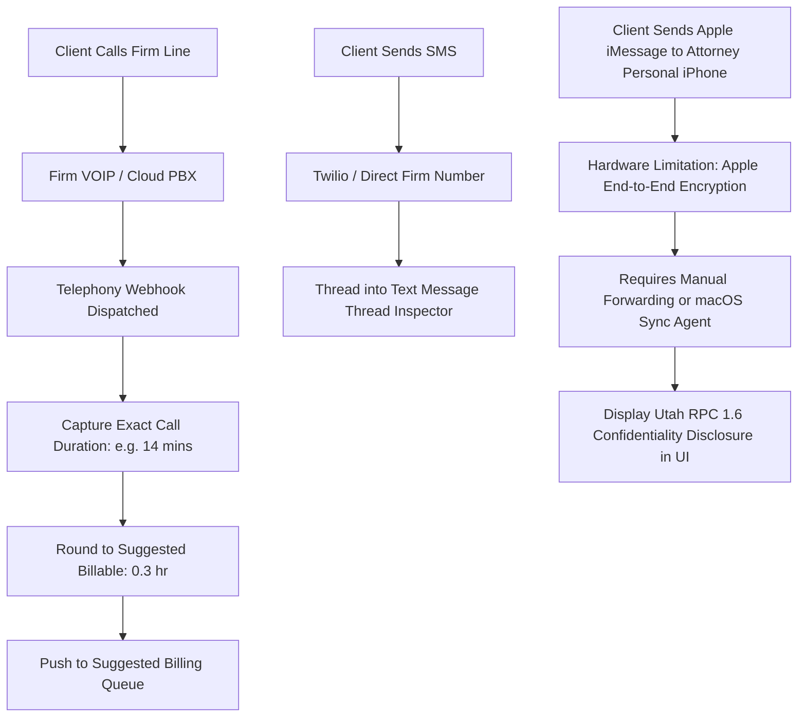
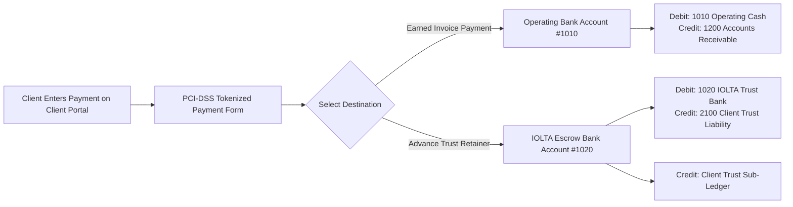

# 10 – INTEGRATIONS & THIRD-PARTY SERVICES REGISTER

**Firm Name:** Heugly & Bludworth, Attorneys at Law  
**Design Principle:** Clean Architectural Boundaries, Least Privilege Scopes & Explicit Audit Logging

---

## 1. Master Third-Party Integration Register

The backend architecture interfaces with seven external ecosystems. Each connection operates under defined security and failure boundaries:

| Integration Provider | Target Domain | Integration Method | Direction | Records Exchanged | Auth & Scopes | Failure & Duplicate Strategy |
| :--- | :--- | :--- | :---: | :--- | :--- | :--- |
| **Microsoft 365 (Graph API)** | Outlook Email & Calendar | RESTful Graph API v1.0 + Webhooks | Bidirectional | Client emails, calendar court notices, message timestamps, attachments. | OAuth 2.0 (`Mail.ReadWrite`, `Calendars.ReadWrite`) | Webhook idempotency keys based on immutable Graph `Message-ID`. Auto-retry with exponential backoff. |
| **Utah State Courts (Judicialink / GreenFiling)** | Civil Court Dockets & Filings | REST API / HTTPS SOAP Web Services | Inbound & Outbound | E-filed complaints, entered court orders, proof of service, docket entries. | X.509 Client Certificates + Firm Bar ECF Credentials | Stored receipt tokens; filing packages tracked as `Pending Submission` until verified court timestamp. |
| **Federal Court CM/ECF** | Bankruptcy Dockets | Automated ECF Package Packaging | Outbound | PDF filing packages, Form 122 Means-Test, formatted creditor matrices (ASCII). | Attorney ECF Login & Password via TLS | Validates 14-day emergency stay compliance before compilation. |
| **Cloud Storage (OneDrive / Dropbox)** | External Document Vaults | REST API v2 + Webhooks | Inbound & Outbound | Document backups, client exhibit collections, execution versions. | OAuth 2.0 PKCE Flow | Preserves original SHA-256 hash. Local S3 vault remains source-of-truth. |
| **Telephony / VOIP (Twilio / Firm PBX)** | Call Logs & SMS Threads | REST API + Event Webhooks | Inbound | Inbound/outbound call durations, dialed numbers, SMS transcripts. | API Secret Key + Webhook Signature Verification | Telephony records indexed by phone number; calls matched to clients via `clients.phone`. |
| **Payment Gateway (LawPay / Stripe)** | Client Card & ACH Processing | Hosted Tokenization + Webhooks | Inbound | Credit card transactions, ACH authorizations, payment receipts. | PCI-DSS Compliant Hosted Fields (`Bearer Secret`) | Strict segregation of destination accounts (`Operating` vs `IOLTA Trust`). No raw cardholder data stored. |
| **CosmoLex Bridge** | Historical Accounting Archival | Batch Export Endpoint | Outbound Only | Approved billable hours, expenses, client matter codes (LEDES 1998B format). | Internal Firm Admin Token | Batch ID tracking (`COSMO-YYYY-MMDD`). Zero real-time database dependency on CosmoLex. |

---

## 2. Detailed Technical Architecture for Critical Connectors

### 2.1 Microsoft 365 & Outlook Mail Bridge
Audited from `OutlookMailBridgeModal.jsx` and `CommunicationsList.jsx`:

- **Duplicate Prevention**: Every message is keyed by the unique RFC 822 `Message-ID`. The database enforces a `UNIQUE(source_identifier)` constraint.
- **Unmatched Queue**: Messages from unknown senders are held in `unmatched_communications` until a paralegal manually links them to a client.

---

### 2.2 Telephony & SMS Capture Architecture (Apple iMessage Limitations)
Audited from RFP Requirement 6 and `AppleSyncLimitationsPanel`:

- **Technical Boundary**: Direct automated extraction from an attorney’s personal Apple iMessage without a dedicated Mac bridge is prevented by Apple's end-to-end encryption. The architecture explicitly marks this technical boundary and provides manual forwarding options with Utah RPC 1.6 disclosures.

---

### 2.3 Legal Payment Gateway Architecture (LawPay / Stripe)
Enforces strict segregation between operational revenue and client escrow deposits:

- **Anti-Commingling Enforcement**: Payment webhooks reject any transaction that attempts to route trust retainer funds into the operating account.

---

### 2.4 CosmoLex Batch Export Bridge (LEDES 1998B)
Audited from `BillableHours.jsx` and `CosmoLexSettings.jsx`:
- **Endpoint**: `POST /api/v1/integrations/cosmolex/export`
- **Output Format**: Standard LEDES 1998B format (`INVOICE_DATE|INVOICE_NUMBER|CLIENT_ID|MATTER_ID|EXP_OR_FEE|TIMEKEEPER|HOURS|RATE|AMOUNT|DESCRIPTION`).
- **Batch State Transition**:
  - Validates all selected entries have `status === 'Approved'`.
  - Generates batch identifier (`COSMO-2026-1101`).
  - Sets `exported_to_cosmolex = true` and records batch reference.
  - Zero external CosmoLex credentials or network dependencies required.

