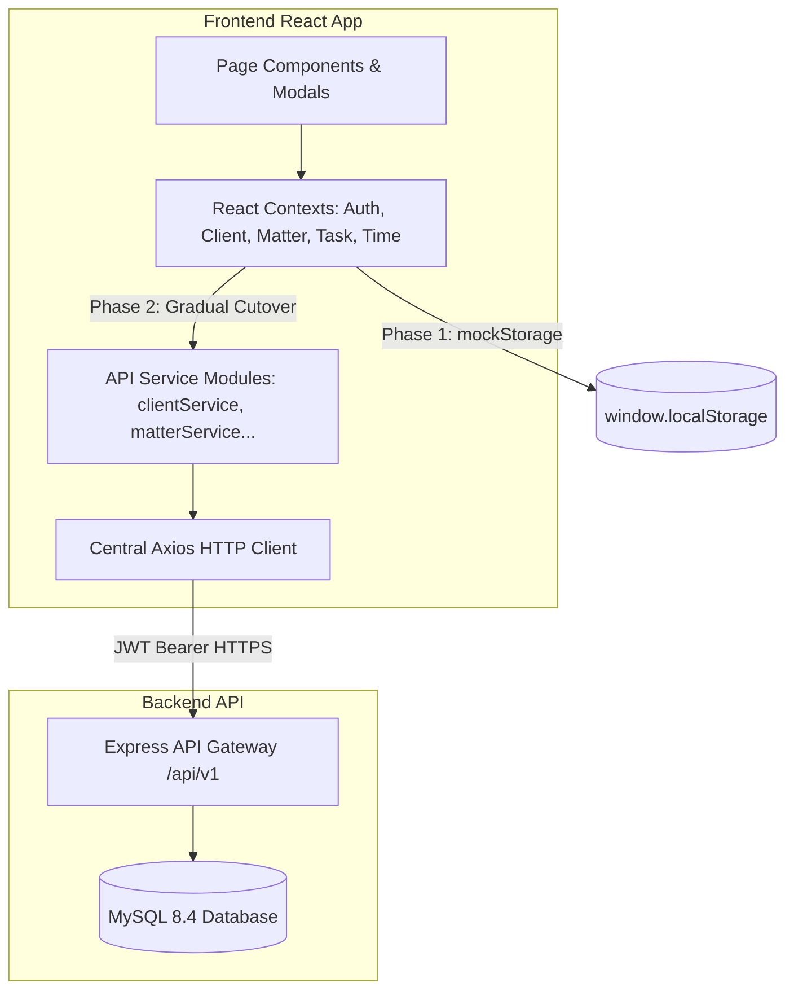

# 11 – FRONTEND-BACKEND INTEGRATION STRATEGY

**Firm Name:** Heugly & Bludworth, Attorneys at Law  
**Frontend Architecture:** React 18 / Vite 5 / Tailwind CSS / React Context  
**Integration Paradigm:** Gradual Module-by-Module Migration (Mock Storage $\rightarrow$ Real REST API)

---

## 1. Migration Architecture: Mock Storage to Live API Layer

The existing frontend currently persists state to `window.localStorage` via [mockStorage.js](file:///d:/legal-ui1/legal-managment/frontend/src/services/mockStorage.js). To achieve a seamless transition without breaking UI layouts or user workflows, an API client layer will be introduced:



---

## 2. Central HTTP Client Specification

An Axios instance configured in `src/services/api/apiClient.js` provides automatic token injection, global error interceptors, and transparent token refreshing:

```javascript
// Proposed implementation contract for apiClient.js
import axios from 'axios';

export const apiClient = axios.create({
  baseURL: import.meta.env.VITE_API_BASE_URL || 'http://localhost:5000/api/v1',
  withCredentials: true, // Transmits HttpOnly refresh token cookie
  headers: {
    'Content-Type': 'application/json',
  },
});

// Request Interceptor: Injects short-lived Bearer access token
apiClient.interceptors.request.use((config) => {
  const token = localStorage.getItem('hb_access_token');
  if (token) {
    config.headers.Authorization = `Bearer ${token}`;
  }
  return config;
});

// Response Interceptor: Catches 401 Unauthorized & performs token refresh
apiClient.interceptors.response.use(
  (response) => response.data,
  async (error) => {
    const originalRequest = error.config;
    if (error.response?.status === 401 && !originalRequest._retry) {
      originalRequest._retry = true;
      try {
        const { data } = await axios.post('/api/v1/auth/refresh', {}, { withCredentials: true });
        localStorage.setItem('hb_access_token', data.accessToken);
        originalRequest.headers.Authorization = `Bearer ${data.accessToken}`;
        return apiClient(originalRequest);
      } catch (refreshErr) {
        localStorage.removeItem('hb_access_token');
        window.location.href = '/login';
      }
    }
    return Promise.reject(error.response?.data?.error || error);
  }
);
```

---

## 3. Context-by-Context Migration Strategy

### 3.1 `AuthContext.jsx` Migration
- **Current State**: Loads user from `mockStorage.get('current_user_id')`.
- **Target State**:
  - `login(email, password)`: Dispatches `POST /api/v1/auth/login`. Stores `accessToken` in memory / storage. Sets user profile.
  - `logout()`: Dispatches `POST /api/v1/auth/logout`. Clears state.
  - `addUser(userData)`: Dispatches `POST /api/v1/users`.
  - `toggleUserStatus(id)`: Dispatches `PATCH /api/v1/users/:id/status`.

### 3.2 `ClientContext.jsx` Migration
- **Current State**: Initializes clients and intakes arrays from `mockStorage`.
- **Target State**:
  - `fetchClients(params)`: Calls `GET /api/v1/clients` with query parameters.
  - `addClient(payload)`: Dispatches `POST /api/v1/clients`.
  - `updateClient(id, payload)`: Dispatches `PUT /api/v1/clients/:id`.
  - `addIntake(payload)`: Dispatches `POST /api/v1/intakes`.
  - `updateConflictCheck(id, status, notes)`: Dispatches `PATCH /api/v1/intakes/:id/conflict`.

### 3.3 `MatterContext.jsx` Migration
- **Current State**: Array of matters stored in `mockStorage`.
- **Target State**:
  - `fetchMatters(filters)`: Calls `GET /api/v1/matters` respecting role and ethical wall restrictions.
  - `addMatter(matterData)`: Dispatches `POST /api/v1/matters`.
  - `advanceStage(matterId, targetStageId, verifiedFields)`: Dispatches `PATCH /api/v1/matters/:id/stage`.

### 3.4 `TaskContext.jsx` Migration
- **Current State**: Client-side array updates.
- **Target State**:
  - `fetchTasks(type)`: Calls `GET /api/v1/tasks/mine` or `GET /api/v1/tasks/team`.
  - `addTask(taskData)`: Dispatches `POST /api/v1/tasks`.
  - `updateTaskStatus(id, newStatus)`: Dispatches `PATCH /api/v1/tasks/:id/status`.

### 3.5 `TimeContext.jsx` Migration
- **Current State**: In-memory array of time entries, expenses, invoices, and CosmoLex export batches.
- **Target State**:
  - `addTimeEntry(entry)`: Dispatches `POST /api/v1/time-entries`.
  - `approveTimeEntries(ids)`: Dispatches `POST /api/v1/time-entries/approvals/batch`.
  - `rejectTimeEntry(id, comment)`: Dispatches `PATCH /api/v1/time-entries/:id/reject`.
  - `acceptSuggestion(id)`: Dispatches `POST /api/v1/time-entries/suggested/:id/accept`.

---

## 4. UI State Handling: Loaders, Errors & Optimistic Updates

1. **Loading Skeletons**: Existing tables (`DataTable.jsx`) and card lists will receive a `loading` prop displaying animated pulse skeletons instead of abrupt content flashes.
2. **Global Error Toast Integration**: The existing `useToast` hook will hook into the Axios error interceptor, automatically surfacing server validation errors (`error.message`).
3. **Optimistic Updates**: For instant-feel interactions (marking a task completed or toggling a checklist item), the UI updates immediately and rolls back if the backend returns an error.

---

## 5. Server-Side Pagination, Filtering & Sorting Protocol

In the final integration, `DataTable.jsx` and `FilterBar.jsx` will support server-driven parameters:

$$\text{Request URL} = \text{/api/v1/clients?page=2\&pageSize=10\&sortBy=name\&sortDir=asc\&status=Active}$$

- **Backend Response Envelope**:
```json
{
  "success": true,
  "data": [ /* 10 client records */ ],
  "pagination": {
    "currentPage": 2,
    "pageSize": 10,
    "totalRecords": 84,
    "totalPages": 9
  }
}
```
- `DataTable.jsx` will utilize `pagination.totalPages` and `pagination.currentPage` for remote page switching rather than slicing client arrays.

---

## 6. File Upload & Download Integration

1. **Upload Execution**:
   - `DocumentsList.jsx` requests a presigned upload URL via `POST /api/v1/documents/presigned-upload`.
   - Browser streams binary file directly to S3 via Axios `PUT` with progress tracking (`onUploadProgress`).
   - Browser confirms upload via `POST /api/v1/documents/confirm-upload`.
2. **Download Execution**:
   - Clicking "Download" calls `GET /api/v1/documents/:id/download`.
   - Backend returns temporary presigned URL.
   - Frontend triggers download via hidden anchor element (`<a href={url} download />`).

