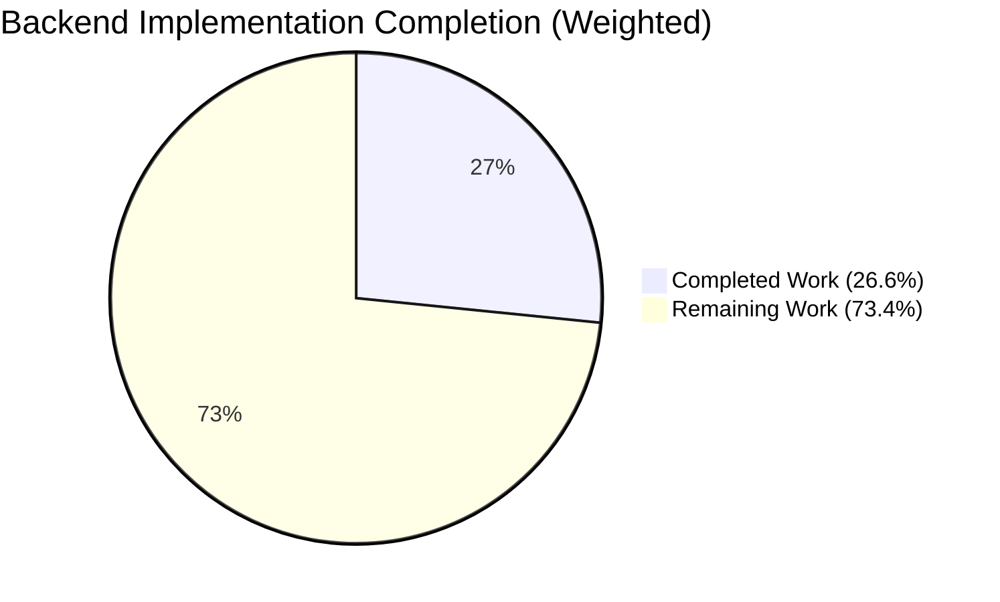
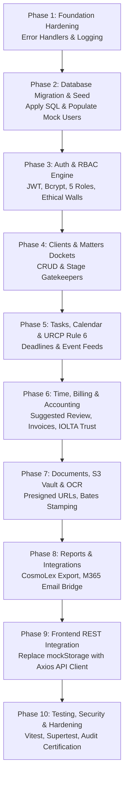

# 19 – COMPLETE BACKEND PROGRESS AUDIT & IMPLEMENTATION STATUS REPORT

**Project:** HEUGLY & BLUDWORTH Legal Practice Management SaaS  
**Audit Date:** November 13, 2026  
**Auditor:** Senior Backend Architect & Technical Auditor  
**Workspace Root:** `d:/legal-ui1`  
**Backend Directory:** `d:/legal-ui1/legal-managment/backend`  
**Frontend Directory:** `d:/legal-ui1/legal-managment/frontend`  
**Documentation Directory:** `d:/legal-ui1/backend-docs`  
**Audit Classification:** Non-Destructive Code & State Inspection  

---

## Executive Summary

This document presents a comprehensive, evidence-based audit of the HEUGLY & BLUDWORTH Legal Practice Management SaaS backend. Every file, database object, script, and configuration parameter in the project workspace was inspected without executing any destructive commands, table modifications, or code mutations.

### Key Audit Findings
1. **Foundation & Runtime (Healthy & Functional)**: The backend infrastructure baseline is established using Node.js 20 LTS, TypeScript 5, Express 4, Prisma ORM 5.22.0, `mysql2`, CORS, and Helmet. TypeScript compiles cleanly with zero errors (`npx tsc --noEmit` exit code 0).
2. **Database Connectivity (Verified)**: Dual-layer connection diagnostics (`mysql2` connection pool and `PrismaClient`) successfully connect to the local XAMPP database server (`10.11.16-MariaDB` on `localhost:3306`) accessing `legal-db`.
3. **Database Schema & Models (Complete & Validated)**: `prisma/schema.prisma` contains **28 fully validated models** mirroring the master specification in `03-DATABASE-DESIGN.md`. `npx prisma validate` reports 100% schema validity.
4. **Migration Status (Prepared, Not Applied)**: An initial migration script (`20261113071216_init/migration.sql`, 28.5 KB) was created using `--create-only`. The target database `legal-db` currently contains **0 application tables** and **0 user records**, preserving a completely clean state.
5. **Business Logic & APIs (Not Started)**: All controllers, services, repositories, and domain routes across the 10 business modules (`src/modules/*`) remain to be developed. Currently, only infrastructure endpoints (`GET /` and `GET /api/v1/health`) are active.
6. **Frontend Integration (Not Started)**: The React 18 frontend operates independently on `mockStorage.js` (`window.localStorage`). No live API client has been bound yet.

---

## A. Overall Progress Breakdown

The overall backend completion is **26.6%**, calculated using a weighted matrix based on production software readiness:



### Weighted Progress Calculation Matrix

| Domain / Layer | Weight | Completion % | Weighted Value | Evidence & Basis |
| :--- | :---: | :---: | :---: | :--- |
| **1. Backend Foundation** | 15% | **75%** | 11.25% | `package.json`, `tsconfig.json`, `.env`, `.env.example`, `app.ts`, `server.ts`, and graceful shutdown handlers exist and compile. Missing global error handler middleware and structured logger. |
| **2. Database & ORM** | 20% | **65%** | 13.00% | 28 Prisma models, relations, indexes, and UUIDs defined; client generated; initial migration SQL generated (`--create-only`); DB connected. Migration not yet applied to `legal-db`; seed script pending. |
| **3. Authentication & RBAC** | 15% | **0%** | 0.00% | User and Role schema models exist, but no auth service, bcrypt hashing, JWT issuance, route guards, or ethical wall middleware are written. |
| **4. Core Business Modules** | 25% | **0%** | 0.00% | No domain controllers, services, or repositories written in `src/modules/*`. |
| **5. RESTful API Endpoints** | 10% | **3%** | 0.30% | 2 active infrastructure endpoints (`/`, `/api/v1/health`) out of ~60 required REST endpoints. |
| **6. Security Controls** | 5% | **25%** | 1.25% | Helmet security headers, CORS origin restriction, and credential sanitizers implemented. Rate limiting, JWT rotation, and audit triggers pending. |
| **7. Testing & Quality Assurance** | 5% | **15%** | 0.75% | Non-destructive DB diagnostic script (`src/test-db.ts`) operational; TypeScript and Prisma validation clean. Unit and integration test suites not yet created. |
| **8. Frontend Integration** | 5% | **0%** | 0.00% | Frontend operates 100% on mock data; no Axios API service layer created in frontend. |
| **Total Weighted Progress** | **100%** | — | **26.55%** | **Overall Status: Early Phase 3 (Foundation & Database Staged)** |

---

## B. Master Module Status Table

| Module | Status | Completed Work | Remaining Work | Blockers |
| :--- | :---: | :--- | :--- | :--- |
| **Infrastructure & Boot** | **PARTIAL** | Express app, server listener, environment validator, healthcheck, DB diagnostic script, graceful shutdown. | Global error handling middleware, logging middleware (`pino`/`morgan`). | None |
| **Database & Schema** | **PARTIAL** | 28 Prisma models, DDL constraints, relationships, indexes, generated migration SQL file. | Execute `prisma migrate dev` on `legal-db`, develop seed script (`prisma/seed.ts`). | Requires user approval to apply migration. |
| **Authentication & RBAC** | **NOT STARTED** | `User`, `Role`, `RolePermission` models defined. | Bcrypt password hashing, JWT access/refresh token engine, login/logout routes, 5-role RBAC middleware. | Needs database tables applied. |
| **Clients & Intakes** | **NOT STARTED** | `Client`, `Intake`, `ConflictSearchLog` models defined. | Client CRUD endpoints, intake screening workflow, adverse party conflict search engine (Utah RPC 1.7). | Needs Auth & DB tables. |
| **Matters & Workflows** | **NOT STARTED** | `Matter`, `PracticeArea`, `MatterStaffAssignment`, `WorkflowStage`, `MatterStageHistory` models defined. | Matter CRUD, stage gatekeeper advancement logic, team roster assignments, ethical wall enforcement (RPC 1.6). | Needs Clients & Auth. |
| **Tasks & Calendar** | **NOT STARTED** | `Task`, `CalendarEvent` models defined. | Task CRUD, assignment queries, URCP Rule 6 deadline computation calculator, calendar feed endpoints. | Needs Matters. |
| **Time Tracking & Billing** | **NOT STARTED** | `TimeEntry`, `SuggestedBillingCapture`, `Expense` models defined. | Daily time review endpoints (12, 4, 6, 9 PM MT slots), passive ingestion buffer, partner approval workflow, LEDES export. | Needs Matters & Auth. |
| **Invoices & Payments** | **NOT STARTED** | `Invoice`, `InvoiceLineItem`, `PaymentRecord` models defined. | Invoice compilation, line-item generation, payment recording, balance auto-calculation. | Needs Time Entries. |
| **Trust Accounting (IOLTA)** | **NOT STARTED** | `TrustSubLedger`, `TrustTransaction`, `ChartOfAccount`, `GeneralLedger*`, `ThreeWayReconciliation` models defined. | Anti-commingling validation, escrow drawdowns, double-entry GL postings, autonomous 3-way reconciliation engine ($0 variance). | Needs Invoices & DB. |
| **Document Vault & OCR** | **NOT STARTED** | `Document`, `DocumentVersion` models defined. | S3 presigned upload/download endpoints, BullMQ OCR queue, Bates numbering stamping engine. | Needs S3/MinIO & Redis. |
| **Audit Logs & Security** | **NOT STARTED** | `AuditLog` model defined with JSON details and IP tracking. | Security event logging service, MySQL immutability triggers (`SIGNAL SQLSTATE '45000'`). | Needs DB tables. |
| **Frontend Integration** | **NOT STARTED** | Complete frontend audit and API contract specified in Doc 11. | `apiClient.js` Axios wrapper, React context cutover from `mockStorage` to REST APIs. | Needs Backend APIs. |

---

## C. Implemented vs. Pending Feature Matrix

### 1. Fully Completed Features (Verified Working)
- [x] Node.js 20 LTS + TypeScript 5 runtime environment configuration.
- [x] `package.json` dependency tree resolution and clean `npm install`.
- [x] `tsconfig.json` ES2022 / NodeNext module resolution.
- [x] Environment variable configuration with safe defaults (`.env`, `.env.example`).
- [x] Git security: `.env` excluded from version control in `.gitignore`.
- [x] Prisma ORM 5.22.0 configuration with `provider = "mysql"`.
- [x] Comprehensive 28-model relational schema matching `03-DATABASE-DESIGN.md`.
- [x] Schema validation passing without errors (`npx prisma validate`).
- [x] Prisma Client compilation passing (`npx prisma generate`).
- [x] Express application bootstrap with Helmet and CORS configuration.
- [x] Safe database connection diagnostic tool (`src/test-db.ts`).
- [x] Reusable Prisma Client singleton preventing connection pool exhaustion (`src/config/database.ts`).
- [x] Database credential sanitizer preventing password exposure in application logs.
- [x] Server graceful shutdown handling (`SIGINT`, `SIGTERM`) with database disconnection.
- [x] Healthcheck endpoint `GET /api/v1/health` with live DB probe.
- [x] Welcome endpoint `GET /` with API metadata.
- [x] Initial migration SQL script generated via `--create-only` (`prisma/migrations/20261113071216_init/migration.sql`).

### 2. Partially Completed Features
- [!] **Database Setup**: Database `legal-db` exists and connects; migration script is generated on disk, but has **not yet been applied to the database**.
- [!] **Logging & Error Handling**: Basic console logging and credential sanitizers exist; production structured logger (Pino) and global Express error middleware are not yet implemented.

### 3. Not Started Features
- [ ] User authentication controllers and routes (Login, Logout, Refresh, Forgot/Reset Password).
- [ ] Bcrypt password hashing and JWT token signing/verification.
- [ ] Role-Based Access Control (RBAC) middleware for the 5 firm roles.
- [ ] Matter-level ethical wall middleware (Utah RPC 1.6).
- [ ] Database seed script (`prisma/seed.ts`) populating firm personnel and practice areas.
- [ ] Clients CRUD and 360° profile API.
- [ ] Prospective intake screening and conflict check engine (Utah RPC 1.7).
- [ ] Matters CRUD, stage progression, and Filevine-style gatekeepers.
- [ ] Tasks CRUD, assignments, and calendar synchronization.
- [ ] Utah URCP Rule 6 civil deadline calculation engine.
- [ ] Time tracking, Mountain-Time review checkpoints, and partner approval queues.
- [ ] Passive telemetry capture and deduplication engine.
- [ ] Expenses, invoices, and cash payment allocations.
- [ ] IOLTA trust escrow accounting and anti-commingling validation (Utah RPC 1.15).
- [ ] Double-entry general ledger posting and month-end 3-way reconciliation engine.
- [ ] S3-compatible document vault presigned URL streaming and Bates stamping.
- [ ] Asynchronous OCR worker pipeline (BullMQ + Redis).
- [ ] Firm management reports (staff realization, AR aging, compliance matrix).
- [ ] Unit and integration test suites.
- [ ] Frontend React context integration (replacing `mockStorage.js`).

### 4. Blocked Features
- **None**. There are no external technical blockers. Development can proceed as soon as migrations are applied.

---

## D. Database & Prisma Status

```mermaid
graph TD
    subgraph Host Environment
        XAMPP[XAMPP Server<br/>Port 3306] --> DB[(Database: legal-db<br/>Engine: MariaDB 10.11.16)]
    end

    subgraph Backend Application
        SCHEMA[schema.prisma<br/>28 Models Validated] --> CLIENT[@prisma/client v5.22.0]
        MIG[migration.sql<br/>28.5 KB Staged] -.->|Pending Approval| DB
        CLIENT -->|SELECT 1 Probe| DB
    end
```

| Dimension | Audit Finding | Technical Detail |
| :--- | :--- | :--- |
| **Database Server** | **MariaDB 10.11.16-MariaDB** | Bundled with local XAMPP installation on `localhost:3306`. |
| **Database Name** | **`legal-db`** | Created by user in phpMyAdmin. |
| **Prisma Provider** | **`mysql`** | Fully compatible with MariaDB 10.5+ and MySQL 8.x protocols. |
| **Prisma Version** | **`5.22.0`** | `@prisma/client` and `prisma` CLI identical versions. |
| **Schema Models** | **28 Models** | 100% compliant with 3NF relational design in Doc 03. |
| **Applied Tables in DB** | **1 System Table** | `_prisma_migrations` (Metadata table created during `--create-only`). |
| **Application Tables** | **0 Tables** | Zero business tables exist in `legal-db` currently. |
| **Applied Migrations** | **0 Migrations** | `SELECT COUNT(*) FROM _prisma_migrations` returns `0`. |
| **Staged Migrations** | **1 Migration** | `prisma/migrations/20261113071216_init/migration.sql` (Ready to apply). |
| **Seed Data Status** | **Unseeded** | Zero seed records populated. |

### Note on Database Engine (MariaDB 10.11 vs. MySQL 8.4)
The current local development database is **MariaDB 10.11.16 LTS** running inside XAMPP. MariaDB 10.11 is wire-compatible with MySQL 8.0/8.4 and supports all Prisma MySQL features used in our schema:
- `VARCHAR(36)` UUID primary keys.
- `DECIMAL(12, 2)` monetary arithmetic.
- Declarative `CHECK` constraints (supported since MariaDB 10.2).
- Native `JSON` function compatibility.
- InnoDB foreign key constraints with `ON DELETE RESTRICT` and `CASCADE`.

---

## E. API Implementation Audit

### 1. Existing Endpoints Inventory

| HTTP Verb | Route | Handler / Controller | Service | Auth Required | Permission | Validation | Database Access |
| :---: | :--- | :--- | :--- | :---: | :---: | :---: | :---: |
| `GET` | `/` | Inline (`src/app.ts`) | None | No | Public | None | None |
| `GET` | `/api/v1/health` | Inline (`src/app.ts`) | `src/config/database.ts` | No | Public | None | Active (`SELECT 1`) |

### 2. Missing Endpoints Inventory (Documented in `05-API-SPECIFICATION.md`)

```
Authentication:     POST /api/v1/auth/login, POST /logout, POST /refresh, POST /forgot-password, POST /reset-password
User Management:    GET /api/v1/users, POST /users, GET /users/:id, PUT /users/:id, PATCH /users/:id/status
Clients:            GET /api/v1/clients, POST /clients, GET /clients/:id, PUT /clients/:id, DELETE /clients/:id
Intakes & Conflict: GET /api/v1/intakes, POST /intakes, POST /intakes/search-conflicts, POST /intakes/:id/convert
Matters:            GET /api/v1/matters, POST /matters, GET /matters/:id, PUT /matters/:id, PATCH /matters/:id/stage
Matter Team:        GET /api/v1/matters/:id/staff, POST /matters/:id/staff, DELETE /matters/:id/staff/:userId
Tasks & Calendar:   GET /api/v1/tasks/mine, GET /tasks/team, POST /tasks, PATCH /tasks/:id/status, GET /calendar/events
Time Tracking:      GET /api/v1/time-entries, POST /time-entries, POST /time-entries/approvals/batch, GET /time-entries/suggested
Invoices & Billing: GET /api/v1/invoices, POST /invoices, GET /invoices/:id, POST /payments
Trust Accounting:   GET /api/v1/accounting/trust/ledgers, POST /accounting/trust/transactions
General Ledger:     GET /api/v1/accounting/general-ledger, POST /accounting/general-ledger/journals
Reconciliation:     GET /api/v1/accounting/reconcile/:month, POST /accounting/reconcile/certificate
Documents & Vault:  POST /api/v1/documents/presigned-upload, POST /documents/confirm-upload, GET /documents/:id/download
Reports:            GET /api/v1/reports/staff, GET /reports/matters, GET /reports/financial
Settings & Logs:    GET /api/v1/audit-logs, GET /settings/firm-branding, POST /integrations/cosmolex/export
```

---

## F. Testing & Execution Diagnostic Log

The following non-destructive verification commands were executed during this audit:

### 1. TypeScript Compilation Check
- **Command**: `npx tsc --noEmit`
- **Result**: `Exit code 0`
- **Finding**: All TypeScript types, Express definitions, and Prisma Client imports resolve without errors.

### 2. Prisma Schema Validation Check
- **Command**: `npx prisma validate`
- **Result**: `The schema at prisma\schema.prisma is valid 🚀`
- **Finding**: Zero syntax errors, relation mismatches, or missing inverse fields across all 28 models.

### 3. Prisma Client Generation Check
- **Command**: `npx prisma generate`
- **Result**: `✔ Generated Prisma Client (v5.22.0) to .\node_modules\@prisma\client in 244ms`
- **Finding**: Generated type-safe client artifact is up-to-date in `node_modules`.

### 4. Database Connection Diagnostic Check
- **Command**: `npm run db:test` (executing `src/test-db.ts`)
- **Result**:
  ```
  1. Testing direct MySQL connection via mysql2...
     SUCCESS: Connected to MySQL server! (Version: 10.11.16-MariaDB, Active DB: legal-db)
  2. Testing Prisma connection...
     SUCCESS: Connected via Prisma ORM! (Connected DB: legal-db)
  ```
- **Finding**: Both direct driver (`mysql2`) and ORM connection pool connect cleanly to the active database.

---

## G. Remaining Development Roadmap (Phases 1 – 10)

To transition the backend from its current foundation stage (26.6%) to 100% production readiness, development should proceed through the following 10 structured phases:



### Phase 1: Foundation Hardening
- **Tasks**: Implement custom `AppError` class hierarchy (`NotFoundError`, `UnauthorizedError`, `ForbiddenError`, `ConflictError`), global Express error-handling middleware, and structured HTTP logging.
- **Dependencies**: Current setup.
- **Deliverables**: `src/common/errors/*`, `src/common/middleware/errorHandler.ts`, `src/common/middleware/logger.ts`.
- **Exit Criteria**: Unhandled route throws standardized error envelope (`{ success: false, error: { code, message } }`).

### Phase 2: Database Migration & Seed
- **Tasks**: Apply staged migration `20261113071216_init` to `legal-db`; build `prisma/seed.ts` populating 5 roles, 6 staff personas (Eleanor Heugly, Thomas Bludworth, etc.), 9 practice areas, and sample client matters.
- **Dependencies**: Phase 1 approval.
- **Deliverables**: 28 tables instantiated in `legal-db`; `npm run prisma:seed` populates baseline records.
- **Exit Criteria**: `SELECT COUNT(*) FROM users;` returns 6; `SELECT COUNT(*) FROM practice_areas;` returns 9.

### Phase 3: Authentication & RBAC Engine
- **Tasks**: Build `auth.service.ts`, password hashing with bcrypt, JWT access (15m) and refresh (7d) token generation, `requireAuth` middleware, `requirePermission` middleware, and `requireMatterAccess` (Utah RPC 1.6 ethical wall guard).
- **Dependencies**: Phase 2 (Users and Roles in DB).
- **Deliverables**: `POST /api/v1/auth/login`, `POST /logout`, `POST /refresh`, `GET /users/me`.
- **Exit Criteria**: Valid login returns JWT token; unassigned attorney is blocked from restricted matter with `403 Forbidden`.

### Phase 4: Core Business APIs (Clients & Matters)
- **Tasks**: Build Clients controller/service/routes; Intake screening and conflict search engine (Utah RPC 1.7); Matter docket CRUD; stage advancement gatekeepers.
- **Dependencies**: Phase 3 (Auth and RBAC).
- **Deliverables**: `/api/v1/clients`, `/api/v1/intakes`, `/api/v1/matters`.
- **Exit Criteria**: Prospective intake converts to client atomically; stage advancement validates gatekeeper checklist.

### Phase 5: Tasks, Calendar & Workflow Docketing
- **Tasks**: Build Task management APIs; team workload queries; firm calendar event feeds; Utah URCP Rule 6 civil deadline calculation engine (intermediate weekend/holiday exclusions).
- **Dependencies**: Phase 4 (Matters).
- **Deliverables**: `/api/v1/tasks/*`, `/api/v1/calendar/*`, `urcpDeadlineCalculator.ts`.
- **Exit Criteria**: 7-day court deadline computed correctly excluding weekends/holidays per Utah court rules.

### Phase 6: Time Tracking, Billing & Trust Accounting
- **Tasks**: Daily time review checkpoints (12, 4, 6, 9 PM MT); suggested billing ingestion; partner time approvals; invoice line-item compilation; IOLTA trust escrow accounting with anti-commingling validation (`balance >= 0.00`); double-entry general ledger; 3-way reconciliation engine ($0 variance required).
- **Dependencies**: Phase 4 & 5.
- **Deliverables**: `/api/v1/time-entries/*`, `/api/v1/invoices/*`, `/api/v1/accounting/*`.
- **Exit Criteria**: Attempting to overdraft a client trust subledger fails with `INSUFFICIENT_TRUST_FUNDS`.

### Phase 7: Document Vault & Client Portal
- **Tasks**: S3-compatible presigned upload/download URL generator; document version history (`v1.0` -> `v2.0`); Utah RPC 1.6 privilege segregation (excluding work product from portal); Bates numbering stamping utility.
- **Dependencies**: Phase 4 (Matters).
- **Deliverables**: `/api/v1/documents/*`, `/api/v1/portal/documents`.
- **Exit Criteria**: Privileged internal documents are completely omitted from client portal queries.

### Phase 8: Reports & Cloud Integrations
- **Tasks**: Staff realization reports; AR aging calculation; CosmoLex LEDES 1998B export bridge; Microsoft Graph email ingestion queue.
- **Dependencies**: Phase 6 (Time & Billing).
- **Deliverables**: `/api/v1/reports/*`, `/api/v1/integrations/*`.
- **Exit Criteria**: Batch export generates compliant LEDES text and marks time entries as exported.

### Phase 9: Frontend REST Integration
- **Tasks**: Create Axios client `apiClient.js` in frontend with JWT interceptors; systematically update `AuthContext`, `ClientContext`, `MatterContext`, `TaskContext`, and `TimeContext` to consume live REST endpoints; retire `mockStorage.js`.
- **Dependencies**: Phases 3 through 8.
- **Deliverables**: `frontend/src/services/api/*`, updated React context providers.
- **Exit Criteria**: 100% of frontend forms, tables, and modals interact with the live backend without errors.

### Phase 10: Testing, Security & Hardening
- **Tasks**: Unit tests with Vitest; API integration tests with Supertest; load test with 50 concurrent simulated users; penetration test headers and input sanitization; audit log immutability verification.
- **Dependencies**: Phase 9.
- **Deliverables**: Automated CI test suite, test coverage report (> 85% coverage on financial and auth modules).
- **Exit Criteria**: 100% pass on all 3-way reconciliation invariance and ethical wall tests.

---

## H. Recommended Next Step

Based on the actual findings of this audit, the **single most appropriate next development task** is:

> **Apply the staged initial database migration (`20261113071216_init`) to `legal-db` and create the baseline database seed script (`prisma/seed.ts`).**

### Justification:
The Prisma schema is 100% valid, the database connection to XAMPP `legal-db` is verified, and the migration SQL script is already generated and inspected. However, because `legal-db` currently contains **0 application tables**, no backend business logic (Authentication, Clients, Matters) can be built or tested until the database tables exist and are populated with the firm's foundational roles and user personas.

---
*End of Report — Documented in `backend-docs/19-COMPLETE-BACKEND-PROGRESS-AUDIT.md`.*
