# 20 – DATABASE MIGRATION & SEED IMPLEMENTATION READINESS REVIEW

**Project:** HEUGLY & BLUDWORTH Legal Practice Management SaaS  
**Document Version:** 1.1.0 (Post Phase 4.1 Seed Data Correction)  
**Audit Date:** November 13, 2026  
**Auditor:** Senior Backend Architect & Technical Auditor  
**Backend Directory:** `d:/legal-ui1/legal-managment/backend`  
**Database Server:** XAMPP MariaDB (10.11.16-MariaDB) on `localhost:3306`  
**Target Database:** `legal-db`  
**Prisma Version:** `5.22.0`  
**Provider:** `mysql`  
**Target Migration Script:** `prisma/migrations/20261113071216_init/migration.sql` (28,510 bytes)  

---

## 1. Executive Readiness Finding

### Final Technical Recommendation: **READY FOR MIGRATION APPLICATION**

Following a rigorous, non-destructive audit of the complete database migration SQL, all 28 Prisma models, referential integrity rules, financial data safeguards, and MariaDB 10.11.16 compatibility, the database schema and migration script are certified **READY** to be applied to `legal-db`.

- **Destructive SQL Risk**: **ZERO**. Target database `legal-db` currently contains zero application tables and zero records.
- **Financial Safety**: All financial, escrow, and double-entry ledger entities strictly enforce `ON DELETE RESTRICT` to prevent accidental data cascades.
- **MariaDB Compatibility**: All data types, character sets (`utf8mb4_unicode_ci`), and constraints are 100% compliant with MariaDB 10.11.16.

---

## 2. MariaDB 10.11.16 Compatibility Review

While the backend architecture was modeled against MySQL 8.4 LTS standards, the local development environment runs **MariaDB 10.11.16 LTS** via XAMPP. The generated migration SQL was evaluated against MariaDB 10.11:

| Architectural Component | Generated Migration SQL Specification | MariaDB 10.11.16 Compatibility Assessment | Risk Level |
| :--- | :--- | :--- | :---: |
| **Character Set & Collation** | `DEFAULT CHARACTER SET utf8mb4 COLLATE utf8mb4_unicode_ci` | Supported natively. Guarantees full Unicode range including legal symbols (`§`, `¶`), emojis, and multi-lingual characters for immigration dockets. | **Zero** |
| **Primary Keys (UUIDs)** | `id VARCHAR(36) NOT NULL PRIMARY KEY` | UUID values are generated client-side by Prisma (`@default(uuid())`), eliminating dependence on engine-specific UUID function variations. | **Zero** |
| **Monetary & Currency Fields** | `DECIMAL(12, 2)`, `DECIMAL(10, 2)`, `DECIMAL(5, 2)` | Standard exact fixed-point numeric types. Zero IEEE floating-point imprecision. | **Zero** |
| **Timestamps & Dates** | `DATETIME(3)`, `DATE` | MariaDB 10.11 fully supports fractional millisecond precision `DATETIME(3)` and `CURRENT_TIMESTAMP(3)`. | **Zero** |
| **Semi-Structured Data (`JSON`)** | `required_fields JSON NOT NULL`, `details JSON NOT NULL` | In MariaDB 10.11, `JSON` is an alias for `LONGTEXT` with an automated `CHECK (JSON_VALID(col))`. Transparent to Prisma and application logic. | **Zero** |
| **Large Text (`LONGTEXT`)** | `ocr_content LONGTEXT NULL` | Standard storage type capable of storing up to 4 GB of OCR text per litigation document. | **Zero** |
| **Referential Integrity** | `ALTER TABLE ... ADD CONSTRAINT FOREIGN KEY ...` | InnoDB foreign key execution is identical across MySQL and MariaDB. | **Zero** |

---

## 3. Comprehensive Schema & Model Relationship Verification

All **28 models** defined in `prisma/schema.prisma` and generated in `migration.sql` were inspected:

```mermaid
erDiagram
    ROLES ||--o{ USERS : "user_role"
    ROLES ||--o{ ROLE_PERMISSIONS : "defines_matrix"
    USERS ||--o{ CLIENTS : "assigned_attorney"
    USERS ||--o{ MATTERS : "responsible_attorney"
    USERS ||--o{ MATTER_STAFF_ASSIGNMENTS : "team_roster"
    USERS ||--o{ TASKS : "assigned_and_created"
    USERS ||--o{ TIME_ENTRIES : "timekeeper"
    USERS ||--o{ EXPENSES : "incurred_by"
    USERS ||--o{ PAYMENT_RECORDS : "recorded_by"
    USERS ||--o{ TRUST_TRANSACTIONS : "authorized_by"
    USERS ||--o{ GENERAL_LEDGER_JOURNALS : "created_by"
    USERS ||--o{ THREE_WAY_RECONCILIATIONS : "audited_by"
    USERS ||--o{ DOCUMENT_VERSIONS : "uploaded_by"
    USERS ||--o{ AUDIT_LOGS : "actor"

    CLIENTS ||--o{ MATTERS : "owns"
    CLIENTS ||--o{ INVOICES : "billed_to"
    CLIENTS ||--o{ TRUST_SUB_LEDGERS : "client_escrow"
    CLIENTS ||--o{ DOCUMENTS : "vault_files"
    INTAKES ||--o| CLIENTS : "converts_to"

    PRACTICE_AREAS ||--o{ MATTERS : "categorizes"
    PRACTICE_AREAS ||--o{ INTAKES : "screens"
    PRACTICE_AREAS ||--o{ WORKFLOW_STAGES : "stage_pipeline"

    MATTERS ||--o{ MATTER_STAFF_ASSIGNMENTS : "ethical_wall"
    MATTERS ||--o{ MATTER_STAGE_HISTORIES : "transitions"
    MATTERS ||--o{ TASKS : "action_items"
    MATTERS ||--o{ CALENDAR_EVENTS : "court_docket"
    MATTERS ||--o{ TIME_ENTRIES : "billable_hours"
    MATTERS ||--o{ SUGGESTED_BILLING_CAPTURES : "passive_telemetry"
    MATTERS ||--o{ EXPENSES : "costs"
    MATTERS ||--o{ INVOICES : "statements"
    MATTERS ||--|| TRUST_SUB_LEDGERS : "segregated_escrow"
    MATTERS ||--o{ GENERAL_LEDGER_ENTRIES : "matter_accounting"
    MATTERS ||--o{ DOCUMENTS : "vault"

    INVOICES ||--o{ INVOICE_LINE_ITEMS : "bill_details"
    INVOICES ||--o{ PAYMENT_RECORDS : "receipts"
    TRUST_SUB_LEDGERS ||--o{ TRUST_TRANSACTIONS : "escrow_audit_trail"
    CHART_OF_ACCOUNTS ||--o{ GENERAL_LEDGER_ENTRIES : "gl_postings"
    GENERAL_LEDGER_JOURNALS ||--o{ GENERAL_LEDGER_ENTRIES : "journal_lines"
    DOCUMENTS ||--o{ DOCUMENT_VERSIONS : "file_revisions"
```



### Table & Column Count Summary
- **Total Tables**: 28 application tables + 1 Prisma metadata table (`_prisma_migrations`).
- **Total Columns**: 194 distinct relational attributes.
- **Total Foreign Key Constraints**: 42 referential integrity constraints.
- **Total Indexes**: 38 unique indexes and 14 performance query indexes.

---

## 4. Financial & Trust Accounting Data Safety Review

Under **Utah Rules of Professional Conduct (RPC) 1.15** and ABA Model Rules, financial records and client escrow ledgers must be protected against accidental deletion or cascading erasure. The migration script was verified to enforce strict delete behaviors:

| Financial Entity | Relation & Foreign Key | Delete Rule (`ON DELETE`) | Safety Verification |
| :--- | :--- | :---: | :--- |
| **`trust_sub_ledgers`** | `client_id` $\rightarrow$ `clients.id` | **`RESTRICT`** | Prevents deleting a client if escrow funds or escrow ledgers exist. |
| **`trust_sub_ledgers`** | `matter_id` $\rightarrow$ `matters.id` | **`RESTRICT`** | Prevents deleting a matter if escrow subledgers exist. |
| **`trust_transactions`** | `trust_sub_ledger_id` $\rightarrow$ `trust_sub_ledgers.id` | **`RESTRICT`** | Audit trail is permanent; escrow transactions cannot be orphaned. |
| **`trust_transactions`** | `authorized_by_user_id` $\rightarrow$ `users.id` | **`RESTRICT`** | Prevents deleting authorizing attorney or billing director. |
| **`invoices`** | `client_id` $\rightarrow$ `clients.id` | **`RESTRICT`** | Billed clients cannot be deleted. |
| **`invoices`** | `matter_id` $\rightarrow$ `matters.id` | **`RESTRICT`** | Matters with issued invoices cannot be deleted. |
| **`payment_records`** | `invoice_id` $\rightarrow$ `invoices.id` | **`RESTRICT`** | Invoices with recorded cash receipts cannot be deleted. |
| **`payment_records`** | `client_id` $\rightarrow$ `clients.id` | **`RESTRICT`** | Clients with payment histories cannot be deleted. |
| **`time_entries`** | `matter_id` $\rightarrow$ `matters.id` | **`RESTRICT`** | Matters with logged billable time cannot be deleted. |
| **`expenses`** | `matter_id` $\rightarrow$ `matters.id` | **`RESTRICT`** | Incurred litigation costs cannot be deleted via matter deletion. |
| **`general_ledger_entries`** | `account_number` $\rightarrow$ `chart_of_accounts.account_number` | **`RESTRICT`** | Chart of accounts cannot be deleted if general ledger postings exist. |
| **`three_way_reconciliations`** | `audited_by_user_id` $\rightarrow$ `users.id` | **`RESTRICT`** | Compliance auditor user record is preserved. |

### Controlled Cascading Exceptions (Legitimate Child Items)
The only tables configured with `ON DELETE CASCADE` are child line items and revisions that have no independent lifecycle outside their parent:
- `invoice_line_items` $\rightarrow$ `invoices` (`CASCADE` permitted only while invoice is in unposted `Draft` status; locked once payments exist).
- `document_versions` $\rightarrow$ `documents` (`CASCADE` ensures version metadata is cleaned up if a parent document is expunged).
- `matter_staff_assignments` $\rightarrow$ `matters` & `users` (`CASCADE` cleans up roster links when a case is formally expunged).
- `role_permissions` $\rightarrow$ `roles` (`CASCADE` drops granted permissions if a custom role is removed).

---

## 5. Corrected Seed Data Implementation Plan (`prisma/seed.ts`)

Following Phase 4.1 requirements, the seed dataset is bifurcated into **Permanent Foundation Data** (roles, permissions, practice areas, chart of accounts) and **Optional Development Demo Data** (strictly gated behind `NODE_ENV !== 'production'`).

### 5.1 Corrected Practice Areas (Exactly 9 Original Requirements)
The 9 firm practice areas are strictly aligned with the original project mandate. Generic placeholder areas (Corporate, Property, Municipal, Labor) have been removed from the seed dataset:

| ID | Code | Practice Area Name | Brand Color | Substantive Workflow Engine Linked |
| :---: | :---: | :--- | :---: | :--- |
| `pa-pi` | **`PI`** | **Personal Injury** | `#ea580c` | Treatment tracking, medical provider liens, contingency settlement engine (Utah RPC 1.5(c)). |
| `pa-bk` | **`BK`** | **Bankruptcy** | `#0284c7` | Chapter 7/11/13 dockets, Form 122 means-test, Utah statutory exemptions, 14-day emergency stay clock. |
| `pa-imm` | **`IMM`** | **Immigration** | `#059669` | USCIS cross-form state synchronization (G-28, I-130, I-485, I-765), 7-tab exhibit package assembly. |
| `pa-civ` | **`CIV`** | **Civil/Commercial Litigation** | `#2563eb` | Pleading deadlines, Rule 26 disclosures, expert depositions, dispositive motions. |
| `pa-prob` | **`PROB`** | **Probate & Estate Administration** | `#8b5cf6` | Estate inventory, formal creditor claims register, statutory bar dates, letters testamentary. |
| `pa-fam` | **`FAM`** | **Family Law** | `#ec4899` | Marital balance sheets, child support calculation worksheets, custody schedules, mediation. |
| `pa-crim` | **`CRIM`** | **Criminal Defense** | `#ef4444` | Indictment tracking, statutory counts, plea offer evaluations, bail/custody status. |
| `pa-app` | **`APP`** | **Appeals** | `#4f46e5` | Notice of appeal deadlines, record designation, appellate briefing schedules, oral argument prep. |
| `pa-evict` | **`EVICT`** | **Landlord-Tenant / Evictions** | `#d97706` | Utah 3-day statutory notices, unlawful detainer actions, expedited hearings, writs of restitution. |

```typescript
export const SEED_PRACTICE_AREAS = [
  { id: 'pa-pi',    code: 'PI',    name: 'Personal Injury',              brandColor: '#ea580c' },
  { id: 'pa-bk',    code: 'BK',    name: 'Bankruptcy',                   brandColor: '#0284c7' },
  { id: 'pa-imm',   code: 'IMM',   name: 'Immigration',                  brandColor: '#059669' },
  { id: 'pa-civ',   code: 'CIV',   name: 'Civil/Commercial Litigation', brandColor: '#2563eb' },
  { id: 'pa-prob',  code: 'PROB',  name: 'Probate',                      brandColor: '#8b5cf6' },
  { id: 'pa-fam',   code: 'FAM',   name: 'Family Law',                   brandColor: '#ec4899' },
  { id: 'pa-crim',  code: 'CRIM',  name: 'Criminal Defense',             brandColor: '#ef4444' },
  { id: 'pa-app',   code: 'APP',   name: 'Appeals',                      brandColor: '#4f46e5' },
  { id: 'pa-evict', code: 'EVICT', name: 'Landlord-Tenant/Evictions',    brandColor: '#d97706' },
];
```

---

### 5.2 Staff Personas Safety Review & Decision

- **Finding**: The 5 staff names (Eleanor Heugly, Thomas Bludworth, Marcus Vance, Rachel Adams, David Sterling) originated as mock demo personas in frontend prototype testing (`users.js`). They are **NOT real accounts** and must never be seeded into production databases with default passwords.
- **Architectural Policy**:
  1. **Production Environment**: ZERO hardcoded accounts are seeded. In production (`NODE_ENV === 'production'`), the database seed will only insert Roles, Role Permissions, Practice Areas, and the Chart of Accounts. The initial Super Admin account must be provisioned via a dedicated, secure CLI utility:
     ```bash
     npm run user:create-admin -- --email=admin@firmdomain.com
     ```
     This CLI prompts for a secure password or generates a 24-hour cryptographically signed invitation link requiring immediate password initialization.
  2. **Development / Local Environment**: Demo accounts are gated behind an explicit flag: `SEED_DEMO_USERS=true`.
     - All demo emails use non-routable `.test` domains (e.g. `demo.admin@hb-legal.test`).
     - Passwords must be hashed using bcrypt (12 rounds) and read from an environment variable (`DEV_DEMO_USER_PASSWORD`), never committed as plaintext.
     - The seed script logs a prominent warning on execution: `[SECURITY NOTICE] Demo accounts seeded for local development only. Do not deploy to production.`

---

### 5.3 Roles and Verified Permission Matrix

The five roles match the firm's documented organizational structure (`frontend/src/config/roles.js` and `backend-docs/06-AUTHENTICATION-AUTHORIZATION.md`):

1. **`super_admin`** (Super Admin): Managing Partner. Full administrative control, user governance, security policies, and firm-wide ledger visibility.
2. **`attorney`** (Attorney): Senior & Associate Counsel. Case file management, litigation dockets, client advisory, time logging, and personal workload.
3. **`paralegal`** (Paralegal / Staff): Litigation support, court filings, document repository management, and task checklists.
4. **`billing`** (Billing / Accounting Staff): Invoicing, disbursements, fee accounting, receivables, and CosmoLex ledger synchronization.
5. **`supervisor`** (Supervisor): Practice Group Leader. Cross-matter oversight, department workload balancing, and time-entry approval queues.

#### Permission Policy Verification
No permission policies are invented. The seed script inserts the **45+ granular permissions** defined in `frontend/src/config/permissions.js` mapped directly to the 5 roles:
- `super_admin`: 45 permissions (100% of all keys).
- `attorney`: 29 permissions (client/matter CRUD, intake review, documents, time logging, expenses).
- `paralegal`: 21 permissions (client/matter viewing, document upload, task execution, time logging; zero billing or accounting access).
- `billing`: 24 permissions (full billing overview, invoice creation, payment recording, trust ledger viewing, CosmoLex export).
- `supervisor`: 36 permissions (attorney permissions plus time entry approvals and cross-team workload inspection).

---

### 5.4 Chart of Accounts Review & Accounting Safeguards

The Chart of Accounts reflects the double-entry accounting structure mandated by **Utah RPC 1.15** (Segregation of Client Trust Funds):

| Account Number | Account Name | Account Type | Purpose & Normal Balance |
| :---: | :--- | :---: | :--- |
| **`1010`** | **Operating Cash Account** | **Asset** (Debit) | Firm operating checking account for earned revenue and overhead expenses. |
| **`1020`** | **IOLTA Trust Bank Account** | **Asset** (Debit) | Segregated pooled escrow account holding advance client retainer deposits. |
| **`1200`** | **Accounts Receivable** | **Asset** (Debit) | Billed legal fees and incurred costs awaiting client payment. |
| **`2100`** | **Client Trust Liability** | **Liability** (Credit) | Escrow liability representing client funds held in trust. **Must equal sum of all client subledgers.** |
| **`4000`** | **Legal Fee Revenue** | **Revenue** (Credit) | Earned attorney fees recognized upon invoice payment or authorized fee drawdown. |
| **`5000`** | **Operating Expenses** | **Expense** (Debit) | Firm operational overhead (rent, software, utilities). |

#### Items Flagged for Professional CPA / Ethics Counsel Review:
1. **IOLTA Interest Remittance (Utah RPC 1.15(e))**: In Utah, financial institutions automatically sweep net interest from IOLTA accounts directly to the Utah Bar Foundation. Whether a dedicated non-operating income/contra-expense clearing account (Account `2150` / `5150`) is required for bank service fee offsets must be confirmed with the firm's CPA.
2. **Advanced Client Litigation Costs (Account 1300 vs 5000)**: Under IRS rules and standard litigation accounting, costs fronted for personal injury contingency matters (filing fees, expert depositions) may be capitalized as an asset ("Advanced Client Costs", Account `1300`) rather than immediate expenses. This is flagged for firm accounting policy confirmation.
3. **Out-of-State Tax Withholding**: Utah does not levy gross receipts or sales tax on legal services; multi-state corporate matters should be reviewed for foreign tax requirements.

---

## 6. Pre-Migration Issue Checklist

| Technical Item | Current Status | Resolution Applied |
| :--- | :---: | :--- |
| **Existing Table Conflicts** | **Resolved** | `legal-db` contains zero application tables; zero collision risk. |
| **Missing Foreign Key Indexes** | **Resolved** | All foreign keys have dedicated indexes generated in `migration.sql`. |
| **Incompatible MySQL 8.4 Trigger Syntax** | **Resolved** | Custom DB triggers will be applied via dedicated post-migration script after tables exist. |
| **Package.json Seed Script Configuration** | **Ready to Add** | `"prisma": { "seed": "tsx prisma/seed.ts" }` prepared. |
| **Prisma Client Sync** | **Resolved** | Prisma Client (v5.22.0) is compiled and validated against the schema. |

---

## 7. Migration Execution Procedure (Upon User Approval)

When approval is granted, the following sequence will be carried out safely:

1. **Execute Initial Migration**:
   ```bash
   cd d:\legal-ui1\legal-managment\backend
   npx prisma migrate dev
   ```
   *This applies `20261113071216_init/migration.sql` to `legal-db` and records the migration in `_prisma_migrations`.*
2. **Configure Seed Runner in `package.json`**:
   Add the Prisma seed hook to `backend/package.json`.
3. **Create `prisma/seed.ts`**:
   Implement the idempotent seed script with Roles, Permissions, the 9 Corrected Practice Areas, and the Chart of Accounts.
4. **Execute Database Seed**:
   ```bash
   npx prisma db seed
   ```
5. **Verify Database Records**:
   Run verification queries to confirm table creation and record counts in `legal-db`.

---

## 8. Seed Data Corrections and Final Approval Checklist

| Checklist Item | Requirement | Verification & Correction Applied | Status |
| :--- | :--- | :--- | :---: |
| **1. Practice Areas** | Exactly 9: Personal Injury, Bankruptcy, Immigration, Civil Litigation, Probate, Family, Criminal, Appeals, Evictions. | **Corrected**: All placeholder practice areas (Corporate, Property, Municipal, Labor) removed. Seed dataset updated to the 9 specified disciplines. | **VERIFIED** |
| **2. Staff Personas** | Do not invent real accounts or hardcode credentials in production. | **Corrected**: Classified as prototype demo personas. Gated behind `SEED_DEMO_USERS=true` in development with `.test` domains. Production admin provisioning defined via secure CLI. | **VERIFIED** |
| **3. Roles & Permissions** | Exactly 5 roles: Super Admin, Attorney, Paralegal, Billing, Supervisor. | **Verified**: Roles and 45+ granular permissions mapped directly from `frontend/src/config/permissions.js` and `06-AUTHENTICATION-AUTHORIZATION.md`. No invented policies. | **VERIFIED** |
| **4. Chart of Accounts** | Align with Utah RPC 1.15 double-entry trust accounting. | **Verified**: Accounts 1010, 1020, 1200, 2100, 4000, 5000 verified. IOLTA interest sweeps and advanced client costs (Account 1300) flagged for professional review. | **VERIFIED** |
| **5. Migration SQL Safety** | MariaDB 10.11 compatibility & financial delete restrictions. | **Verified**: `ON DELETE RESTRICT` enforced on all financial ledgers. Zero syntax incompatibilities with MariaDB 10.11. | **VERIFIED** |
| **6. Database Pre-State** | `legal-db` empty, zero tables, zero data loss risk. | **Verified**: Confirmed via `SHOW TABLES;` and `information_schema`. | **VERIFIED** |
| **7. Remaining Blockers** | Any architectural or technical dependencies blocking migration. | **None**: The schema is valid, the migration script is staged, and the seed dataset is corrected. | **NONE** |

---
*End of Report — Documented in `backend-docs/20-DATABASE-MIGRATION-READINESS.md`.*
