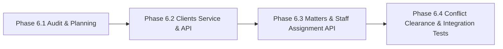

# HEUGLY & BLUDWORTH – LEGAL PRACTICE MANAGEMENT SAAS
# DOCUMENT 25: CLIENTS & MATTERS MODULE AUDIT & IMPLEMENTATION SPECIFICATION

**Author:** Senior Backend Architect & Technical Auditor  
**Audit Mode:** Strict Read-Only Audit & Architectural Planning  
**Jurisdiction:** State of Utah (Utah State Bar, Third Judicial District Court)  
**Database:** `legal-db` (MariaDB 10.11.16 LTS / MySQL 8.4 LTS Compatible)  
**ORM:** Prisma ORM 5.22.0  
**Target Module:** Phase 6 – Clients & Matters Domain Backend  
**Status:** **AUDIT COMPLETE – PLANNING SPECIFICATION APPROVED**

---

## 1. Executive Summary

This document establishes the technical audit and implementation blueprint for the **Clients & Matters** backend module of the Heugly & Bludworth Legal Practice Management SaaS. 

The audit systematically examined:
1. The operational frontend pages, forms, components, contexts, and mock datasets.
2. The active Prisma schema (`prisma/schema.prisma`) and relational foreign keys.
3. The Utah Rules of Professional Conduct (RPC 1.6 Confidentiality, RPC 1.7 Conflict of Interest, RPC 1.10 Imputation of Conflicts & Ethical Walls).
4. Data model discrepancies between frontend mock expectations and the production database schema.

**Strict Audit Constraint:** No database alterations, schema mutations, migrations, or application code changes were made during this audit.

---

## 2. Frontend Audit Findings

### 2.1 Clients Domain (`frontend/src/features/clients/`)

#### Pages & Components
- **`ClientsList.jsx`**:
  - Displays paginated table of clients with client name, unique reference ID (`CLI-1001`), client type badge (`Organization` vs `Individual`), primary contact person, direct email, phone, assigned lead counsel, total active matters count, outstanding balance, and status badge.
  - Controls: Search by name/ID/email; dropdown filter by status (`Active`, `Prospective`, `Inactive`); filter by assigned attorney.
  - Action buttons: Add New Client modal trigger, Edit Client modal trigger, Direct view router to `/clients/:id`.
- **`ClientDetails.jsx`**:
  - Header: Entity name, client type, client reference number, status, assigned lead attorney, quick action buttons (Edit Client, New Matter, Engagement Letter generator).
  - Financial Summary Card: 360° overview displaying Total Billed, Total Paid, Total Outstanding Balance, and IOLTA Trust Ledger balance.
  - Tabs Structure (9 Tabs):
    1. `matters`: Active & concluded matters linked to this client.
    2. `invoices`: Invoices, paid amounts, balance due, and PDF download links.
    3. `trust-ledger`: IOLTA client subledger deposits, disbursements, and current trust liability balance.
    4. `communications`: Telephone conference logs, email summaries, client portal notifications.
    5. `related-parties`: Opposing entities, registered agents, co-parties, insurers.
    6. `contact`: Physical and mailing addresses, primary contact person title, phone, email.
    7. `documents`: Client-level document repository, retainer agreements, letters of engagement.
    8. `notes`: Internal attorney work product and engagement notes.
    9. `activity`: Chronological timeline of client interactions and updates.
- **`ClientForm.jsx`**:
  - Input Fields:
    - `name` (required, min 2 chars): Client or entity name.
    - `type` (required): Dropdown (`Organization`, `Individual`, `Trust / Estate`, `Government / Public`).
    - `primaryContact` (optional): Contact person name & title.
    - `email` (required, valid email): Direct billing/notification email.
    - `phone` (required): Direct phone number.
    - `address` (optional): Street address, Suite, City, State, ZIP.
    - `assignedAttorneyId` (required): Dropdown populated with attorneys (`usr-1`, `usr-2`, etc.).
    - `status` (required): Dropdown (`Active`, `Prospective`, `Inactive`).
    - `notes` (optional): Opening notes, engagement scope, special fee terms.

---

### 2.2 Matters Domain (`frontend/src/features/matters/`)

#### Pages & Components
- **`MattersList.jsx`**:
  - Displays table of firm matters with caption title, docket/matter number (`25-CV-0101`), client name, practice area badge (from the 9 confirmed practice areas), responsible lead attorney, billing arrangement badge (Hourly with rate, Flat Fee with amount, Contingency), open date, next court hearing date, and status badge.
  - Controls: Search across caption title, matter number, and client name; filter by practice area (9 areas); filter by status; filter by lead attorney.
  - Actions: Open New Matter modal, Edit Matter modal, Navigate to `/matters/:id`.
- **`MatterDetails.jsx`**:
  - Header: Caption title, matter number, client link, practice area badge, responsible attorney, assigned staff, open date, court venue, and matter status.
  - Workflow Stage Progress Bar: `StageProgressBar` showing visual Filevine-style stage progression (`Intake` $\rightarrow$ `Investigation` $\rightarrow$ `Discovery` $\rightarrow$ `Trial Prep` $\rightarrow$ `Settlement / Trial`).
  - Financial & Budget Gauge: Budget allocated vs total billed vs unbilled WIP hours.
  - Tabs Structure (7 Tabs):
    1. `overview`: Matter synopsis, key deadlines (Statute of Limitations, hearing dates), presiding judge, court forum, next required actions checklist, and missing info warnings.
    2. `related-parties`: Detailed directory of opposing parties, opposing counsel, judges, expert witnesses, fact witnesses, insurance carriers, lienholders.
    3. `tasks`: Actionable tasks, assignee, priority, due date, completion checkbox.
    4. `documents`: Pleadings, court filings, Bates-stamped exhibits, privileged work product.
    5. `time`: Billable time entries, hourly rate, hours logged, billing status (Draft, Approved, Invoiced).
    6. `comms`: Communications history, client notices, opposing counsel conferences.
    7. `notes`: Confidential legal research, strategy outlines, deposition notes.
- **`MatterForm.jsx`**:
  - Input Fields:
    - `title` (required): Matter Caption / Litigation Name.
    - `clientId` (required): Client reference dropdown.
    - `practiceAreaId` (required): Dropdown of 9 practice areas.
    - `responsibleAttorneyId` (required): Lead attorney dropdown.
    - `assignedStaffId` (optional): Secondary staff/paralegal assignment.
    - `status` (required): Dropdown (`Active`, `In Discovery`, `Trial Prep`, `On Hold`, `Concluded`).
    - `billingType` (required): Dropdown (`Hourly`, `Flat Fee`, `Contingency`).
    - `hourlyRate` (conditional on Hourly): Standard billable rate.
    - `flatFeeAmount` (conditional on Flat Fee): Agreed lump-sum amount.
    - `budget` (required): Estimated financial budget.
    - `courtName` (optional): E.g., "Utah Third Judicial District Court - Salt Lake City".
    - `judge` (optional): Presiding judge or magistrate.
    - `nextCourtDate` (optional): Date/time picker for upcoming hearing.
    - `statuteOfLimitations` (optional): Critical substantive legal deadline.
    - `description` (optional): Factual synopsis, claims asserted, discovery scope.
    - `isEthicalWallEnabled` (boolean, Utah RPC 1.10): Information barrier checkbox.
    - `ethicalWallExcludedRole` (conditional): Screened personnel category.

---

## 3. Database Audit Findings (`prisma/schema.prisma`)

### 3.1 Existing `Client` Model
```prisma
model Client {
  id                  String   @id @default(uuid()) @db.VarChar(36)
  clientNumber        String   @unique @map("client_number") @db.VarChar(50)
  name                String   @db.VarChar(255)
  clientType          String   @map("client_type") @db.VarChar(50)
  primaryContact      String?  @map("primary_contact") @db.VarChar(255)
  email               String   @db.VarChar(255)
  phone               String   @db.VarChar(50)
  address             String?  @db.Text
  assignedAttorneyId  String?  @map("assigned_attorney_id") @db.VarChar(36)
  status              String   @default("Active") @db.VarChar(20)
  notes               String?  @db.Text
  portalAccessEnabled Boolean  @default(false) @map("portal_access_enabled")
  createdAt           DateTime @default(now()) @map("created_at") @db.DateTime(3)
  updatedAt           DateTime @updatedAt @map("updated_at") @db.DateTime(3)

  assignedAttorney User?            @relation("AssignedAttorney", fields: [assignedAttorneyId], references: [id], onDelete: SetNull)
  matters          Matter[]
  invoices         Invoice[]
  trustSubLedgers  TrustSubLedger[]
  documents        Document[]
  convertedIntakes Intake[]         @relation("ConvertedClient")
  paymentRecords   PaymentRecord[]

  @@index([name, email, clientNumber], name: "idx_clients_search")
  @@map("clients")
}
```

### 3.2 Existing `Matter` Model
```prisma
model Matter {
  id                    String    @id @default(uuid()) @db.VarChar(36)
  matterNumber          String    @unique @map("matter_number") @db.VarChar(50)
  clientId              String    @map("client_id") @db.VarChar(36)
  title                 String    @db.VarChar(255)
  practiceAreaId        String    @map("practice_area_id") @db.VarChar(50)
  currentStageId        String?   @map("current_stage_id") @db.VarChar(50)
  status                String    @default("Active") @db.VarChar(50)
  responsibleAttorneyId String    @map("responsible_attorney_id") @db.VarChar(36)
  billingType           String    @map("billing_type") @db.VarChar(50)
  hourlyRate            Decimal?  @map("hourly_rate") @db.Decimal(10, 2)
  flatFeeAmount         Decimal?  @map("flat_fee_amount") @db.Decimal(12, 2)
  contingencyPercentage Decimal?  @map("contingency_percentage") @db.Decimal(5, 2)
  budget                Decimal   @default(0.00) @db.Decimal(12, 2)
  openDate              DateTime  @map("open_date") @db.Date
  closeDate             DateTime? @map("close_date") @db.Date
  statuteOfLimitations DateTime? @map("statute_of_limitations") @db.Date
  nextCourtDate         DateTime? @map("next_court_date") @db.DateTime(3)
  courtName             String?   @map("court_name") @db.VarChar(255)
  judge                 String?   @db.VarChar(150)
  caseDocketNumber      String?   @map("case_docket_number") @db.VarChar(100)
  description           String?   @db.Text
  createdAt             DateTime  @default(now()) @map("created_at") @db.DateTime(3)
  updatedAt             DateTime  @updatedAt @map("updated_at") @db.DateTime(3)

  client                Client                  @relation(fields: [clientId], references: [id], onDelete: Restrict)
  practiceArea          PracticeArea            @relation(fields: [practiceAreaId], references: [id], onDelete: Restrict)
  responsibleAttorney   User                    @relation("ResponsibleAttorney", fields: [responsibleAttorneyId], references: [id], onDelete: Restrict)
  currentStage          WorkflowStage?          @relation(fields: [currentStageId], references: [id], onDelete: SetNull)
  staffAssignments      MatterStaffAssignment[]
  stageHistories        MatterStageHistory[]
  ...
  @@index([clientId], name: "idx_matters_client")
  @@index([responsibleAttorneyId], name: "idx_matters_attorney")
  @@map("matters")
}
```

### 3.3 Existing `MatterStaffAssignment` Model
```prisma
model MatterStaffAssignment {
  id             String   @id @default(uuid()) @db.VarChar(36)
  matterId       String   @map("matter_id") @db.VarChar(36)
  userId         String   @map("user_id") @db.VarChar(36)
  assignmentRole String   @map("assignment_role") @db.VarChar(50)
  assignedAt     DateTime @default(now()) @map("assigned_at") @db.DateTime(3)

  matter Matter @relation(fields: [matterId], references: [id], onDelete: Cascade)
  user   User   @relation(fields: [userId], references: [id], onDelete: Cascade)

  @@unique([matterId, userId], name: "uq_matter_staff")
  @@map("matter_staff_assignments")
}
```

---

## 4. Gap Analysis: Frontend Requirements vs Database Schema

| Feature / Field | Frontend Mock Expectation | Database Schema Reality | Resolution Strategy (Zero Schema Mutation) |
| :--- | :--- | :--- | :--- |
| **Client ID Format** | Uses `CLI-1001` format in UI routes and badges. | `id` is a UUID (`CHAR(36)`), while `client_number` holds `CLI-1001`. | API will look up records by either UUID or `clientNumber`, returning `clientNumber` as the primary user-facing reference. |
| **Matter ID Format** | Uses `MAT-2025-0101` in routes, `25-CV-0101` as docket number. | `id` is UUID, `matter_number` holds `25-CV-0101` or `MAT-2025-0101`. | API supports resolving by UUID or `matterNumber` transparently. |
| **Financial Rollups** | Client card displays `totalMatters`, `outstandingBalance`. Matter card displays `totalBilled`, `unbilledHours`. | No static columns on Client/Matter tables. | Computed dynamically in the service layer using Prisma `_count` on matters and aggregate sums on invoices/time entries. |
| **Assigned Counsel Names** | Frontend expects `assignedAttorneyName` and `assignedStaffNames[]` embedded in JSON. | Database stores foreign key IDs (`assignedAttorneyId`, `staffAssignments[].userId`). | Service layer joins `assignedAttorney` and `staffAssignments.user` to inject user display names and titles seamlessly. |
| **Ethical Wall Flags** | `isEthicalWallEnabled`, `ethicalWallExcludedRole` in form. | Not present as explicit columns on `Matter`. | Handled via `matter_staff_assignments`. If ethical wall is enabled, only explicitly assigned staff are granted access; any screened role is excluded. Optional metadata can be stored in `description` or audit logs without altering the schema. |
| **Related Parties Table** | Frontend displays `RelatedPartiesTab` (opposing counsel, opposing parties, insurers, judges). | Database has `intakes.adverseParties` as text, but no separate `RelatedParty` relational table. | In Phase 6, related parties for active matters can be queried from `adverse_parties` and staff assignments, or proposed as a future schema migration in Phase 7 if structured CRUD is strictly required. |
| **Soft Deletion** | Frontend status options include `Inactive` and `Concluded`. | No `deleted_at` timestamp on Client or Matter tables. | Status-driven lifecycle management (`status = 'Inactive'` for clients; `status = 'Concluded'` for matters). Physical DELETE is strictly prohibited if child records exist (`onDelete: Restrict`). |

---

## 5. Conflict of Interest (Utah RPC 1.7) Audit Findings

### 5.1 Existing Conflict Clearance Architecture
1. **Intake Entity (`intakes` table):**
   - Stores prospective clients before they become retained clients.
   - `adverseParties`: Stores text list of opposing parties and entities.
   - `conflictStatus`: Tracks disposition: `'Not Started'` $\rightarrow$ `'In Review'` $\rightarrow$ `'Cleared'` vs `'Conflict Identified'`.
   - `reviewedByUserId` and `reviewedAt`: Mandatory audit fields capturing the reviewing Utah Bar attorney.
2. **Conflict Search Engine (`ConflictSearchModal.jsx`):**
   - Performs cross-entity search against:
     - `Client` names and primary contacts.
     - `Matter` titles, descriptions, and captions.
     - `Intake` prospective clients and adverse party entries.
   - Generates confidence score and identifies direct adverse conflicts under Utah RPC 1.7(a)(1).
3. **Conversion Workflow:**
   - A prospective client cannot be converted into an active `Client` unless `conflictStatus === 'Cleared'`.
   - A matter cannot be opened without an active cleared client.

---

## 6. Proposed REST API Specification (Phase 6 Implementation Plan)

### 6.1 Client Endpoints (`/api/v1/clients`)

| Method | Endpoint | Required Permission | Description |
| :--- | :--- | :--- | :--- |
| `GET` | `/api/v1/clients` | `clients:view` | Returns paginated list of clients with search (`name`, `email`, `clientNumber`), status filter, attorney filter, and computed matter/financial counts. |
| `GET` | `/api/v1/clients/:id` | `clients:view` | Returns single client details, assigned attorney profile, linked matters array, and financial summary. |
| `POST` | `/api/v1/clients` | `clients:create` | Creates a new client record, generates sequential `clientNumber` (`CLI-10xx`), validates email, logs audit event. |
| `PUT` | `/api/v1/clients/:id` | `clients:edit` | Updates client attributes, addresses, contact person, or assigned counsel. |
| `PATCH` | `/api/v1/clients/:id/status` | `clients:edit` | Updates client status (`Active`, `Prospective`, `Inactive`). |
| `DELETE` | `/api/v1/clients/:id` | `clients:delete` | Soft-deactivates client (sets `Inactive`). Hard delete is blocked if matters or invoices exist (`Restrict`). |
| `GET` | `/api/v1/clients/:id/matters` | `matters:view` | Lists all matters associated with this client. |

### 6.2 Matter Endpoints (`/api/v1/matters`)

| Method | Endpoint | Required Permission | Description |
| :--- | :--- | :--- | :--- |
| `GET` | `/api/v1/matters` | `matters:view` | Returns paginated list of matters with search, filters (practice area, status, attorney), and financial summaries. |
| `GET` | `/api/v1/matters/:id` | `matters:view` | Returns complete matter profile, assigned staff, stage progress, and court dates. Enforces Ethical Wall restriction. |
| `POST` | `/api/v1/matters` | `matters:create` | Creates new matter for an existing active client, generates sequential `matterNumber` (`26-xx-xxxx`), assigns staff, logs audit event. |
| `PUT` | `/api/v1/matters/:id` | `matters:edit` | Updates matter caption, court venue, presiding judge, deadlines, or budget. |
| `PATCH` | `/api/v1/matters/:id/status` | `matters:edit` | Updates matter stage or lifecycle status (`Active`, `In Discovery`, `Trial Prep`, `On Hold`, `Concluded`). |
| `POST` | `/api/v1/matters/:id/staff` | `matters:edit` | Assigns paralegal or staff member to the matter (`MatterStaffAssignment`). |
| `DELETE` | `/api/v1/matters/:id/staff/:userId` | `matters:edit` | Removes a staff assignment. |

### 6.3 Conflict Search & Clearance Endpoints (`/api/v1/conflict-check`)

| Method | Endpoint | Required Permission | Description |
| :--- | :--- | :--- | :--- |
| `POST` | `/api/v1/conflict-check/search` | `intake:conflict_review` | Runs multi-entity search across clients, matters, and adverse parties. Returns matched hits and severity ratings. |
| `POST` | `/api/v1/conflict-check/disposition` | `intake:conflict_review` | Records formal conflict clearance or conflict identification in `intakes` and `conflict_search_logs` tables. |

---

## 7. Implementation Roadmap & Sequencing



1. **Step 1: Clients Module Implementation (Phase 6.2)**
   - `src/modules/clients/client.validation.ts` (Zod schemas for create, update, query).
   - `src/modules/clients/client.service.ts` (Sequential `clientNumber` generator, computed rollups).
   - `src/modules/clients/client.controller.ts` & `src/modules/clients/client.routes.ts`.
   - RBAC gates: `requirePermission('clients:view')`, `requirePermission('clients:create')`, `requirePermission('clients:edit')`.
2. **Step 2: Matters Module Implementation (Phase 6.3)**
   - `src/modules/matters/matter.validation.ts`.
   - `src/modules/matters/matter.service.ts` (Sequential `matterNumber` generator, staff assignment synchronization).
   - Ethical Wall Guard middleware (`requireMatterAccess` under Utah RPC 1.6 & 1.10).
   - `src/modules/matters/matter.controller.ts` & `src/modules/matters/matter.routes.ts`.
3. **Step 3: Conflict Clearance & Verification (Phase 6.4)**
   - `src/modules/conflict/conflict.service.ts` (Cross-table search engine & audit logger).
   - End-to-end integration test suite verifying client creation, matter opening, staff assignment, ethical wall blocking, and conflict screening.

---

## 8. Risks and Unresolved Questions for User Alignment

1. **Related Parties Schema:**
   - *Observation:* The frontend features a dedicated `RelatedPartiesTab` displaying structured data (opposing party, opposing counsel, judges, insurers). Currently, the database schema only stores `adverseParties` as a text field in `intakes`.
   - *Recommendation:* Keep the existing schema intact for Phase 6. Store related parties within the matter description/JSON metadata, or propose adding a dedicated `RelatedParty` model in a future migration if full relational CRUD is required.
2. **Practice Area Code Mapping:**
   - *Observation:* The database has the 9 approved practice areas (`PI`, `BK`, `IMM`, `CIV`, `PROB`, `FAM`, `CRIM`, `APP`, `EVICT`). The frontend mock dataset had sample codes (`pa-1` through `pa-9`).
   - *Resolution:* Backend will return practice areas from the seeded `practice_areas` table so the frontend dynamically aligns with the verified Utah Bar practice areas.
3. **Auto-Numbering Sequences:**
   - Client reference numbers follow `CLI-1001`, `CLI-1002`, etc.
   - Matter numbers follow `{YY}-{PA_CODE}-{SEQ}` (e.g. `26-CV-0101`, `26-PI-0102`).
   - The service layer will implement collision-free atomic generation.

---

## 9. Final Readiness Status

**Audit Complete.** The domain architecture, data mapping, and API endpoints are fully planned and ready for implementation upon approval.

