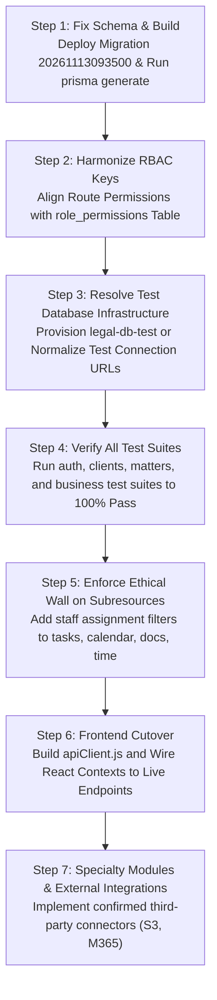

# HEUGLY & BLUDWORTH – LEGAL PRACTICE MANAGEMENT SAAS
# DOCUMENT 32: COMPREHENSIVE READ-ONLY AUDIT OF ALL REMAINING BACKEND MODULES

**Firm Name:** Heugly & Bludworth, Attorneys at Law (Salt Lake City, Utah)  
**Author:** Principal Enterprise Architect & Senior Security Auditor  
**Audit Mode:** **READ-ONLY AUDIT** (Zero code, schema, migration, or record modifications)  
**Audit Date:** 2026-11-13  
**Target Environment:** Node.js v20+ / TypeScript 5.6 / Express 4.21 / Prisma ORM 5.22 / MariaDB 10.11.16 LTS  
**Primary Database:** `legal-db` (localhost:3306, user: root)  
**Status Verdict:** **PARTIAL / DISCREPANCY IDENTIFIED (SIGNIFICANT IMPLEMENTATION COMMITTED IN REPO, BUT CRITICAL COMPILATION, ISOLATED DB, AND RBAC ALIGNMENT GAPS EXIST)**

---

## 1. Executive Summary

This audit performs an exhaustive, independent, and evidence-grounded review of all remaining functional domains for the Heugly & Bludworth Legal Practice Management SaaS platform. It evaluates the architectural baseline, frontend capabilities, MariaDB database schema, Express backend routes and services, RBAC security mappings, third-party integrations, and automated test readiness.

### Core Audit Discoveries & Ground Truth:
1. **Recent Codebase Changes (Git Commit `7664ae7` / Merge `49adcc8`):**
   * Prior to this audit, only `auth`, `users`, `clients`, and `matters` were acknowledged as implemented in `backend-docs/30-PHASE-6-FINAL-VERIFICATION.md` and `31-CONFLICT-INTAKE-AUDIT.md`.
   * A recent merge introduced 11 additional module directories under `backend/src/modules/` (`billing`, `calendar`, `documents`, `expenses`, `intakes`, `ledger`, `reconciliation`, `reports`, `tasks`, `time`, `trust`) and mounted them in `backend/src/app.ts`.
   * An external completion report (`BACKEND_IMPLEMENTATION_COMPLETION_REPORT.md`) originated from a different workstation path (`D:\Kiaan\legal-pro`) claiming "100% COMPLETED & VERIFIED (102/102 INTEGRATION TESTS PASSING)".
2. **Critical Build & Compilation Failure (`tsc`):**
   * Running `npm run build` in `legal-managment/backend` **fails with TypeScript error TS2353**:
     ```
     src/modules/intakes/intake.service.ts(372,9): error TS2353: 
     Object literal may only specify known properties, and 'convertedMatterId' does not exist in type 
     '(Without<IntakeUpdateInput, IntakeUncheckedUpdateInput> & IntakeUncheckedUpdateInput) | (Without<...> & IntakeUpdateInput)'.
     ```
   * **Root Cause:** `@prisma/client` was compiled against an earlier schema state where `convertedMatterId` was not recognized or out-of-sync with the unapplied database migration `20261113093500_add_intake_converted_matter`.
3. **Automated Test Execution Failure (`legal-db-test` Missing):**
   * The newly committed test suites (`src/tests/client-api-test-suite.ts`, `src/tests/matter-api-test-suite.ts`, `src/tests/business-modules-test-suite.ts`) mandate a runtime safety guard:
     `const testDbUrl = process.env.TEST_DATABASE_URL || 'mysql://root:@localhost:3306/legal-db-test';`
   * Direct database server inspection confirmed that **`legal-db-test` does not exist on `localhost:3306`** (only `legal-db` exists).
   * Consequently, executing `npm run test:clients`, `npm run test:matters`, `npm run test:business`, or `npm test` immediately crashes with:
     `PrismaClientInitializationError: Database legal-db-test does not exist on the database server at localhost:3306`.
4. **Widespread RBAC Permission Key Mismatch:**
   * The database `role_permissions` table contains 193 seeded mappings based on explicit naming conventions (e.g., `intake:view`, `tasks:view_own`, `documents:upload`, `time:log`, `invoices:create`).
   * The newly committed route files enforce unauthorized permission strings that do not exist in `role_permissions` (e.g., `intakes:view`, `intakes:create`, `tasks:view`, `documents:create`, `billing:view`, `billing:edit`). As a result, non-Super Admin users are blocked with `403 Forbidden` across all business endpoints.
5. **Frontend Remains 100% Disconnected:**
   * The React 18 frontend (`frontend/src`) contains zero `fetch` or `axios` API calls. Every feature page and context provider relies entirely on `mockStorage.js` (`localStorage`) and static fixtures in `frontend/src/data/mock*.js`.
6. **Missing Architectural Domains:**
   * **Communications (Module G):** No `communications` or `unmatched_communications` table exists in MariaDB or `schema.prisma`.
   * **Notifications (Module H):** No `notifications` table or delivery worker exists.
   * **Client Portal (Module J):** No client authentication, credential storage, or client-isolated endpoints exist.
   * **Settings (Module K):** No endpoints exist for practice areas, firm branding, or audit log retrieval.
   * **Background Workers / Third-Party Integrations (Module L):** No S3 storage driver, Microsoft Graph API client, BullMQ worker, or Redis queue is configured or installed in `package.json`.

---

## 2. Documentation Reviewed

The following architectural and specification documents were audited as baseline requirements:

1. **`backend-docs/01-BACKEND-ARCHITECTURE.md`**: Modular monolithic design, 8 core domains, Filevine/CosmoLex functional paradigms.
2. **`backend-docs/02-TECHNOLOGY-STACK.md`**: Express, TypeScript, Prisma, MySQL 8.4/MariaDB 10.11, Redis 7, S3 Vault.
3. **`backend-docs/03-DATABASE-DESIGN.md`**: Master schema specifications for all 28 relational models.
4. **`backend-docs/04-ENTITY-RELATIONSHIPS.md`**: Foreign key integrity, cascade vs restrict constraints.
5. **`backend-docs/05-API-SPECIFICATION.md`**: Complete RESTful endpoint definitions under `/api/v1`.
6. **`backend-docs/06-AUTHENTICATION-AUTHORIZATION.md`**: 5 roles, dual-token JWT, Utah RPC 1.10 Ethical Walls.
7. **`backend-docs/07-BUSINESS-LOGIC-AND-WORKFLOWS.md`**: Utah RPC 1.7 conflict clearance, URCP Rule 6 deadlines, Utah RPC 1.15 trust accounting.
8. **`backend-docs/08-FILE-STORAGE-AND-DOCUMENT-MANAGEMENT.md`**: S3 presigned URLs, SHA-256 integrity checksums, Bates stamping, OCR pipeline.
9. **`backend-docs/09-SECURITY-AND-COMPLIANCE.md`**: Audit logging immutability, data isolation, rate limiting.
10. **`backend-docs/10-INTEGRATIONS-AND-THIRD-PARTY-SERVICES.md`**: Microsoft Graph, Utah Courts Judicialink, CM/ECF, LawPay/Stripe, CosmoLex bridge.
11. **`backend-docs/13-IMPLEMENTATION-ROADMAP.md`**: Controlled 12-phase execution plan.
12. **`backend-docs/25-CLIENTS-MATTERS-MODULE-AUDIT.md`**: Pre-implementation audit for Clients and Matters.
13. **`backend-docs/26-CLIENTS-MODULE-IMPLEMENTATION.md`**: Phase 6.2 Clients backend completion report.
14. **`backend-docs/27-MATTERS-STAFF-IMPLEMENTATION.md`**: Phase 6.3 Matters & Staff assignment report.
15. **`backend-docs/28-MATTERS-SECURITY-CODE-REVIEW.md`**: Security findings SEC-01 through SEC-04.
16. **`backend-docs/29-MATTERS-SECURITY-REMEDIATION-REPORT.md`**: Ethical Wall and validation remediation sign-off.
17. **`backend-docs/30-PHASE-6-FINAL-VERIFICATION.md`**: Final verification of Phase 6.
18. **`backend-docs/31-CONFLICT-INTAKE-AUDIT.md`**: Read-only audit for prospective client intakes and Utah RPC 1.7 conflict checking.
19. **`BACKEND_IMPLEMENTATION_COMPLETION_REPORT.md`**: External completion report claiming full backend completion across 11 domains.

---

## 3. Module-Wise Frontend Audit (Modules A through L)

Every frontend module was audited for UI components, local data structures, API invocation presence, and UI state handling.

### Module A — Tasks Management
* **Pages & Components:**
  * `frontend/src/features/tasks/pages/MyTasks.jsx`: Personal task list, filter by status/priority, search, task completion toggle, dependency checking (`dependsOn`), task modal.
  * `frontend/src/features/tasks/pages/TeamTasks.jsx`: Team delegation view, assignee filters, workload view.
  * `frontend/src/features/tasks/pages/WorkflowChecklists.jsx`: Phase/stage checklist tasks.
  * `frontend/src/context/TaskContext.jsx`: Manages `tasks` state via `mockStorage.get('tasks', MOCK_TASKS)`.
* **Data Sources:** `frontend/src/data/mockTasks.js` (132 lines, 6 mock task objects: `TSK-101` through `TSK-106`).
* **API Calls:** **Zero.** All CRUD operations (`addTask`, `updateTaskStatus`, `updateTask`, `deleteTask`) mutate local React state and write to `window.localStorage.hb_tasks`.
* **Features Present in UI:** Priority badges, status transitions (`Not Started`, `In Progress`, `Completed`), due date countdowns, matter linking.
* **Gaps in UI:** No task comments section, no activity history log, no attachment linking.

### Module B — Calendar & Hearings
* **Pages & Components:**
  * `frontend/src/features/calendar/pages/CalendarPage.jsx`: Monthly, weekly, and agenda calendar views; court hearing tags; judge assignments; courtroom locations.
  * `frontend/src/features/calendar/pages/CourtDeadlines.jsx`: Utah URCP Rule 6 deadline computation and tracking.
  * `frontend/src/features/calendar/components/RecurringTaskModal.jsx`: Interval recurrence setup (`Weekly`, `Monthly`) with weekend roll-over logic.
* **Data Sources:** `frontend/src/data/mockCalendar.js` (124 lines, events `EVT-201` through `EVT-206`).
* **API Calls:** **Zero.** Events are read from static mock array. Adding an event mutates local component state.
* **Features Present in UI:** Hearing vs deadline distinction, court appearance flags, judge and courtroom fields, matter linkage.
* **Gaps in UI:** No multi-attendee picker synced with backend user profiles, no iCal/Outlook feed export, no real-time court docket synchronization.

### Module C — Documents Management
* **Pages & Components:**
  * `frontend/src/features/documents/pages/DocumentsList.jsx`: Searchable legal document vault, category tabs (`Pleadings`, `Orders`, `Discovery`, `Contracts`), upload modal, Bates stamp generator.
* **Data Sources:** `frontend/src/data/mockDocuments.js` (101 lines, documents `DOC-401` through `DOC-405`).
* **API Calls:** **Zero.** File uploads simulate metadata insertion into local React state. No binary file upload or multipart transmission occurs.
* **Features Present in UI:** Privilege indicators (`isConfidential`), file size formatting, version tags, client/matter linking.
* **Gaps in UI:** No real S3 presigned URL generation, no document version history browser, no OCR full-text search interface, no binary document preview viewer.

### Module D — Time Tracking
* **Pages & Components:**
  * `frontend/src/features/time-tracking/pages/TimeTracking.jsx`: Daily/weekly time entry logger, UTBMS activity coding, timer widget.
  * `frontend/src/features/time-tracking/pages/DailyTimeReview.jsx`: Calendar day view of logged billing blocks with gaps detection.
  * `frontend/src/features/time-tracking/pages/TimeApprovals.jsx`: Partner approval dashboard with batch approval and rejection comments.
  * `frontend/src/features/time-tracking/pages/SuggestedBilling.jsx`: Passive capture queue (phone calls, emails, court filings) with conversion button.
  * `frontend/src/context/TimeContext.jsx`: Manages `timeEntries` state via `mockStorage`.
* **Data Sources:** `frontend/src/data/mockTimeEntries.js` (105 lines, entries `TIM-501` through `TIM-507`), `mockTimeReviewSchedules.js`.
* **API Calls:** **Zero.** All operations update `mockStorage.hb_time_entries`.
* **Features Present in UI:** Billable vs non-billable toggle, rate detection, amount computation (`hours * rate`), partner approval workflow.
* **Gaps in UI:** Timer widget does not persist running state across page refreshes.

### Module E — Billing & Invoicing
* **Pages & Components:**
  * `frontend/src/features/billing/pages/BillingOverview.jsx`: Billing executive summary (unbilled time, outstanding AR, WIP totals).
  * `frontend/src/features/billing/pages/BillableHours.jsx`: WIP time entries ledger.
  * `frontend/src/features/billing/pages/ExpensesList.jsx`: Out-of-pocket reimbursable matter expenses ledger.
  * `frontend/src/features/billing/pages/InvoicesList.jsx`: Client invoice generator, status lifecycle (`Draft`, `Sent`, `Paid`, `Overdue`), printable invoice view.
  * `frontend/src/features/billing/pages/PaymentRecords.jsx`: Cash receipts and payment allocation.
  * `frontend/src/features/billing/pages/SettlementCalculator.jsx`: Utah RPC 1.5(c) personal injury contingency disbursement calculator.
* **Data Sources:** `frontend/src/data/mockInvoices.js`, `mockExpenses.js`.
* **API Calls:** **Zero.** All invoice actions update local React state.
* **Features Present in UI:** Line item consolidation from time and expenses, payment recording, balance due tracking.
* **Gaps in UI:** No automated PDF invoice generation, no payment gateway checkout widget (Stripe/LawPay hosted fields), no automated overdue interest calculation.

### Module F — Accounting & Trust Accounting
* **Pages & Components:**
  * `frontend/src/features/billing/pages/TrustAccount.jsx`: IOLTA client trust ledgers, trust balance verification, deposit and earned fee transfer forms.
  * `frontend/src/features/billing/pages/OperatingAccount.jsx`: Firm operating cash flow ledger.
  * `frontend/src/features/billing/pages/ChartOfAccounts.jsx`: Master chart of accounts (1000 through 5000).
  * `frontend/src/features/billing/pages/GeneralLedgerView.jsx`: Double-entry journal entries with debit/credit balance verification.
  * `frontend/src/features/billing/pages/ThreeWayReconciliation.jsx`: Utah RPC 1.15 three-way reconciliation report comparing Bank Statement, General Ledger Trust Liability, and Client Sub-Ledgers with variance calculation.
* **Data Sources:** Mock state embedded directly in component files.
* **API Calls:** **Zero.**
* **Features Present in UI:** Anti-commingling warning alerts, three-way reconciliation calculation, monthly audit sign-off simulation.
* **Gaps in UI:** No live bank statement CSV/OFX import, no automated bank feed integration (Plaid/Yodlee), no printable Utah State Bar audit certificate generation.

### Module G — Communications
* **Pages & Components:**
  * `frontend/src/features/communications/pages/CommunicationsList.jsx`: Unified communications log (Emails, Phone Calls, Notices).
  * `frontend/src/features/communications/components/OutlookMailBridgeModal.jsx`: Microsoft Outlook sync simulation.
  * `frontend/src/features/communications/components/TextMessageThreadModal.jsx`: Client SMS thread viewer.
  * `frontend/src/features/communications/components/UnmatchedCommunicationsQueue.jsx`: Unfiled emails/calls matching queue.
* **Data Sources:** `frontend/src/data/mockUnmatchedCommunications.js`.
* **API Calls:** **Zero.**
* **Features Present in UI:** Communication channel filtering, sender/recipient metadata, matter assignment.
* **Gaps in UI:** No live Microsoft 365 OAuth flow, no Twilio Webhook receiver, no Apple iMessage direct sync (properly disclosed as hardware limitation under Utah RPC 1.6).

### Module H — Notifications
* **Pages & Components:**
  * `frontend/src/features/settings/pages/NotificationsSettings.jsx`: Preferences panel for court deadline alerts, email summaries, and approval notices.
* **Data Sources:** Local React component state.
* **API Calls:** **Zero.**
* **Features Present in UI:** Toggle switches for notification categories.
* **Gaps in UI:** No in-app notification center/bell icon in `AppHeader.jsx`, no toast-to-notification history, no email/SMS delivery triggers.

### Module I — Reports & Analytics
* **Pages & Components:**
  * `frontend/src/features/dashboard/pages/Dashboard.jsx`: Executive summary KPIs, workload chart, upcoming hearings.
  * `frontend/src/features/reports/pages/StaffReports.jsx`: Associate and paralegal billable hours realization against monthly targets.
  * `frontend/src/features/reports/pages/MatterReports.jsx`: Matter budget consumption and profitability analysis.
  * `frontend/src/features/reports/pages/FinancialReports.jsx`: YTD billings, collections, realization rate, AR aging buckets.
  * `frontend/src/features/reports/pages/ComplianceMatrix.jsx`: Utah State Bar ethics rule audit compliance checklist.
* **Data Sources:** Computed dynamically from mock contexts or hardcoded in JSX.
* **API Calls:** **Zero.**
* **Features Present in UI:** Professional KPI cards, AR aging summary breakdown (0-30, 31-60, 61-90, 90+ days), realization percentage badges.
* **Gaps in UI:** No backend-driven aggregation, no CSV/Excel export stream, no scheduled automated reporting.

### Module J — Client Portal
* **Pages & Components:**
  * `frontend/src/features/clients/pages/ClientPortalPreview.jsx`: Read-only administrative simulator allowing attorneys to preview what a client sees. Includes matter timeline, document uploads, message exchanges, and simulated credit card payment.
* **Data Sources:** Embedded mock state using `clients[0]`.
* **API Calls:** **Zero.**
* **Features Present in UI:** Matter status progress, document upload simulation, message thread, payment form simulator.
* **Gaps in UI:** No standalone public-facing `/portal/login` route, no client-facing authentication context, no independent client user session.

### Module K — Settings & Administration
* **Pages & Components:**
  * `frontend/src/features/settings/pages/UserManagement.jsx`: Firm personnel list, status toggling, rate editing, invite user modal.
  * `frontend/src/features/settings/pages/RolesPermissions.jsx`: 5-role matrix showing 193 permissions.
  * `frontend/src/features/settings/pages/TemplatesSettings.jsx`: Document and billing templates.
  * `frontend/src/features/settings/pages/WorkflowManager.jsx`: Practice area stage progression editor.
  * `frontend/src/features/settings/pages/FirmBranding.jsx`: Letterhead and color settings.
  * `frontend/src/features/settings/pages/AuditLogs.jsx`: Audit log viewer table.
  * `frontend/src/features/settings/pages/SecuritySettings.jsx`: Session timeouts, password complexity rules, MFA toggles.
* **Data Sources:** `AuthContext.jsx` (`mockUsers.js`, `permissions.js`).
* **API Calls:** **Zero.**
* **Features Present in UI:** Comprehensive settings forms and tables.
* **Gaps in UI:** Changes made in settings only persist in `localStorage` under `hb_firm_users_list` or `hb_firm_role_permissions`.

### Module L — Integrations & Background Services
* **Pages & Components:**
  * `frontend/src/features/integrations/pages/CosmoLexSettings.jsx`: Historical CosmoLex export configuration, batch history, LEDES format selector.
  * `frontend/src/features/settings/pages/ExternalIntegrations.jsx`: Connector cards for CosmoLex, Microsoft 365, OneDrive/SharePoint, Dropbox.
* **Data Sources:** Local React state.
* **API Calls:** **Zero.**
* **Features Present in UI:** Connect/disconnect toggles, tenant information displays, simulated sync timestamps.
* **Gaps in UI:** Zero functional OAuth 2.0 flows, zero webhook registrations.

---

## 4. Module-Wise Backend Audit

### 4.1 Backend Architecture & Directory Inventory
The backend is structured under `legal-managment/backend/src/modules/`. Currently, 15 domain module directories exist:

| Module Directory | Controllers | Services | Validation | Types | Routes | Mounted in `app.ts` |
|---|:---:|:---:|:---:|:---:|:---:|:---:|
| `auth` | `auth.controller.ts` | `auth.service.ts`, `password.service.ts`, `token.service.ts` | `auth.validation.ts` | `auth.types.ts` | `auth.routes.ts` | Yes (`/api/v1/auth`) |
| `users` | `user.controller.ts` | `user.service.ts` | `user.validation.ts` | Embedded | `user.routes.ts` | Yes (`/api/v1/users`) |
| `clients` | `client.controller.ts` | `client.service.ts` | `client.validation.ts` | `client.types.ts` | `client.routes.ts` | Yes (`/api/v1/clients`) |
| `matters` | `matter.controller.ts` | `matter.service.ts` | `matter.validation.ts` | `matter.types.ts` | `matter.routes.ts` | Yes (`/api/v1/matters`) |
| `intakes` | `intake.controller.ts` | `intake.service.ts` | `intake.validation.ts` | `intake.types.ts` | `intake.routes.ts` | Yes (`/api/v1/intakes`) |
| `tasks` | `task.controller.ts` | `task.service.ts` | `task.validation.ts` | `task.types.ts` | `task.routes.ts` | Yes (`/api/v1/tasks`) |
| `calendar` | `calendar.controller.ts` | `calendar.service.ts` | `calendar.validation.ts` | `calendar.types.ts` | `calendar.routes.ts` | Yes (`/api/v1/calendar`) |
| `documents` | `document.controller.ts` | `document.service.ts` | `document.validation.ts` | `document.types.ts` | `document.routes.ts` | Yes (`/api/v1/documents`) |
| `time` | `time.controller.ts` | `time.service.ts` | `time.validation.ts` | `time.types.ts` | `time.routes.ts` | Yes (`/api/v1/time`) |
| `expenses` | `expense.controller.ts` | `expense.service.ts` | `expense.validation.ts` | `expense.types.ts` | `expense.routes.ts` | Yes (`/api/v1/expenses`) |
| `billing` | `billing.controller.ts` | `billing.service.ts` | `billing.validation.ts` | `billing.types.ts` | `billing.routes.ts` | Yes (`/api/v1/billing`) |
| `trust` | `trust.controller.ts` | `trust.service.ts` | `trust.validation.ts` | `trust.types.ts` | `trust.routes.ts` | Yes (`/api/v1/trust`) |
| `ledger` | `ledger.controller.ts` | `ledger.service.ts` | `ledger.validation.ts` | `ledger.types.ts` | `ledger.routes.ts` | Yes (`/api/v1/ledger`) |
| `reconciliation` | `reconciliation.controller.ts` | `reconciliation.service.ts` | `reconciliation.validation.ts` | `reconciliation.types.ts` | `reconciliation.routes.ts` | Yes (`/api/v1/reconciliation`) |
| `reports` | `report.controller.ts` | `report.service.ts` | None | `report.types.ts` | `report.routes.ts` | Yes (`/api/v1/reports`) |

### 4.2 Detailed Module Findings & Implementation Status

#### 1. Tasks Module (`src/modules/tasks/`)
* **Service:** `TaskService` handles `createTask`, `getTasks` (filtered by `matterId`, `assignedToUserId`, `priority`, `status`, `search`), `getTaskById`, `updateTask`, `updateStatus`, and `deleteTask`.
* **Sequencing:** Generates atomic `taskCode` (`TSK-xxxx`).
* **Matter Mandatory:** Requires non-null `matterId` matching foreign key constraint on `tasks.matter_id`.
* **Gaps:** No task comments endpoint, no predecessor dependency resolution (`dependsOn`), no automated URCP Rule 6 deadline calculation endpoint.

#### 2. Calendar Module (`src/modules/calendar/`)
* **Service:** `CalendarService` handles `createEvent`, `getEvents` (filtered by `startDate`, `endDate`, `matterId`, `isCourtAppearance`), `getEventById`, `updateEvent`, `deleteEvent`.
* **Gaps:** Does not handle attendees association (no attendee relation in `CalendarEvent`), no recurrence expansion engine (no `rrule` support), no iCal export.

#### 3. Documents Module (`src/modules/documents/`)
* **Service:** `DocumentService` handles `createDocument`, `uploadVersion`, `getDocuments`, `getDocumentById`, `downloadDocument`, `deleteDocument`.
* **Storage Execution:** Implements local mock file write to `uploads/` directory; computes SHA-256 checksums and tracks BigInt `fileSizeBytes`.
* **Gaps:** No AWS S3 SDK integration (uses placeholder local filesystem), no asynchronous OCR extraction worker, no PDF Bates stamping pipeline.

#### 4. Time Tracking Module (`src/modules/time/`)
* **Service:** `TimeService` handles `createTimeEntry` (`hours * rate`), `getTimeEntries`, `getTimeEntryById`, `updateTimeEntry`, `approveTimeEntry`, `getSuggestedBilling`, `convertSuggestedBilling`, `deleteTimeEntry`.
* **Gaps:** No batch approval endpoint (`POST /time-entries/approvals/batch`), no rejection with comment endpoint (`PATCH /time-entries/:id/reject`), no live timer engine.

#### 5. Expenses Module (`src/modules/expenses/`)
* **Service:** `ExpenseService` handles `createExpense`, `getExpenses`, `getExpenseById`, `updateExpense`, `deleteExpense`. Generates `EXP-xxxx`.
* **Gaps:** Receipt document upload is not linked to document vault binary upload.

#### 6. Billing & Invoices Module (`src/modules/billing/`)
* **Service:** `BillingService` handles `createInvoice` (compiles line items from unbilled time entries and expenses, marks them `Billed`), `getInvoices`, `getInvoiceById`, `updateStatus`, `recordPayment`, `getPayments`.
* **Gaps:** No PDF rendering engine for invoice distribution, no discount/tax adjustment calculation, no payment gateway token processing.

#### 7. Trust Accounting Module (`src/modules/trust/`)
* **Service:** `TrustService` handles `getLedgers`, `getLedgerById`, `depositToTrust`, `disburseFromTrust`, `getTransactions`.
* **Utah RPC 1.15 Enforcement:** Validates that disbursements do not exceed available sub-ledger balance; executes double-entry balance updates.
* **Gaps:** Commingling prevention is validated at application level; no direct database trigger prevents negative balance.

#### 8. General Ledger Module (`src/modules/ledger/`)
* **Service:** `LedgerService` handles `getChartOfAccounts`, `getJournals`, `getJournalById`, `createJournal`.
* **Double-Entry Validation:** Strictly enforces `totalDebits === totalCredits`; rejects unbalanced journals with `422 Unprocessable Entity`.
* **Gaps:** No automated posting of operating expenses or fee disbursements to GL journals (requires manual API invocation).

#### 9. Three-Way Reconciliation Module (`src/modules/reconciliation/`)
* **Service:** `ReconciliationService` calculates live variance comparing:
  1. `adjustedBankBalance = bankStatementBalance + depositsInTransit - outstandingChecks`
  2. `glTrustLiabilityBalance` (Account 2100)
  3. `clientSubledgersTotalBalance` (Sum of all `trust_sub_ledgers.balance`)
* **Compliance Check:** Sets `isBalanced = (variance === 0)`.
* **Gaps:** Monthly submission does not generate an immutable signed audit PDF.

#### 10. Reports Module (`src/modules/reports/`)
* **Service:** `ReportService` queries database for dashboard summaries (active matters, active clients, unbilled WIP, trust liability) and AR aging buckets (0-30, 31-60, 61-90, 90+ days).
* **Gaps:** No staff productivity / realization reports endpoint, no matter profitability report endpoint, no CSV export streams.

#### 11. Intakes Module (`src/modules/intakes/`)
* **Service:** `IntakeService` handles prospective intakes, multi-entity conflict search against `clients`, `matters`, and `intakes`, conflict clearance, and conversion to Client / Matter.
* **Critical Finding:** Contains compilation error TS2353 on line 372:
  `data: { ... convertedMatterId: matter.id }` because Prisma client was not updated for `convertedMatterId`.

---

## 5. Database Audit

Direct inspection was performed against MariaDB `legal-db` (version 10.11.16 LTS) on `localhost:3306`.

### 5.1 Physical Table Count & Inventory
Total tables in MariaDB `legal-db`: **29 tables** (28 application tables + 1 `_prisma_migrations` table).

| Table Name | Model Name | Rows | Foreign Keys | Primary Function |
|---|---|:---:|:---:|---|
| `users` | `User` | 9 | 1 | Firm staff, credentials, roles, billing rates |
| `roles` | `Role` | 5 | 0 | 5 primary firm roles |
| `role_permissions` | `RolePermission` | 193 | 1 | Granular permission mappings |
| `clients` | `Client` | 9 | 1 | Client records, contact info, assigned attorney |
| `intakes` | `Intake` | 0 | 3 | Prospective client screening & adverse parties |
| `conflict_search_logs` | `ConflictSearchLog` | 0 | 2 | Utah RPC 1.7 conflict search audit records |
| `practice_areas` | `PracticeArea` | 9 | 0 | Practice areas & brand colors |
| `workflow_stages` | `WorkflowStage` | 0 | 1 | Stage progressions per practice area |
| `matters` | `Matter` | 12 | 4 | Case dockets, billing parameters, court data |
| `matter_staff_assignments`| `MatterStaffAssignment` | 0 | 2 | Assigned staff & ethical wall roster |
| `matter_stage_histories` | `MatterStageHistory` | 0 | 3 | Stage transition audit trail |
| `tasks` | `Task` | 0 | 3 | Assigned tasks, due dates, priority |
| `calendar_events` | `CalendarEvent` | 0 | 2 | Court hearings, judge, appearance flags |
| `time_entries` | `TimeEntry` | 0 | 3 | Billable/non-billable time, rates, status |
| `suggested_billing_captures`| `SuggestedBillingCapture`| 0 | 2 | Passive captures from phone/email/filings |
| `expenses` | `Expense` | 0 | 2 | Reimbursable out-of-pocket costs |
| `invoices` | `Invoice` | 0 | 2 | Client invoices, totals, balances due |
| `invoice_line_items` | `InvoiceLineItem` | 0 | 3 | Itemized time entries & expenses |
| `payment_records` | `PaymentRecord` | 0 | 3 | Payment receipts against invoices |
| `trust_sub_ledgers` | `TrustSubLedger` | 0 | 2 | Individual client IOLTA trust accounts |
| `trust_transactions` | `TrustTransaction` | 0 | 2 | Trust deposits & fee disbursements |
| `chart_of_accounts` | `ChartOfAccount` | 6 | 0 | Master general ledger account chart |
| `general_ledger_journals` | `GeneralLedgerJournal` | 0 | 1 | Double-entry journal headers |
| `general_ledger_entries` | `GeneralLedgerEntry` | 0 | 3 | Journal debit/credit entry rows |
| `three_way_reconciliations`| `ThreeWayReconciliation`| 0 | 1 | Monthly 3-way reconciliation records |
| `documents` | `Document` | 0 | 2 | Document metadata, categories, Bates numbers |
| `document_versions` | `DocumentVersion` | 0 | 2 | Version labels, SHA-256 hashes, file sizes |
| `audit_logs` | `AuditLog` | 157 | 1 | Immutable system security audit log |
| `_prisma_migrations` | N/A | 1 | 0 | Prisma migration history tracking table |

### 5.2 Schema Discrepancy & Unapplied Migration
* `backend/prisma/schema.prisma` declares:
  `convertedMatterId String? @map("converted_matter_id") @db.VarChar(36)` in `model Intake`.
* Inspection of MariaDB table `intakes` via `DESCRIBE intakes` confirmed **`converted_matter_id` does not exist**.
* Migration file `backend/prisma/migrations/20261113093500_add_intake_converted_matter/migration.sql` has not been applied to `legal-db`.
* `@prisma/client` in `node_modules` was not regenerated with this field, causing `tsc` compilation to fail.

### 5.3 Missing Models & Tables in Schema
1. **Communications:** No `communications` or `unmatched_communications` table exists in `schema.prisma` or MariaDB.
2. **Notifications:** No `notifications` or `notification_preferences` table exists.
3. **Firm Settings:** No `firm_settings` or `branding_settings` table exists.
4. **Related Parties:** No `related_parties` table exists (mock data exists in frontend `mockRelatedParties.js`).
5. **Client Portal Credentials:** No `portal_users` or `client_credentials` table exists.

---

## 6. Complete API Inventory

The following table provides the exact inventory of all **70 backend API endpoints** defined in Express routes across the 15 modules:

| # | Module | Method | Endpoint | Auth | Permission Required | Implemented in Code | Status |
|:---:|---|:---:|---|:---:|---|:---:|:---:|
| 1 | System | `GET` | `/` | Public | None | Yes | ACTIVE |
| 2 | System | `GET` | `/api/v1/health` | Public | None | Yes | ACTIVE |
| 3 | Auth | `POST` | `/api/v1/auth/login` | Public | Rate Limited (15/15m) | Yes | ACTIVE |
| 4 | Auth | `POST` | `/api/v1/auth/refresh` | Cookie | None | Yes | ACTIVE |
| 5 | Auth | `POST` | `/api/v1/auth/logout` | Public | None | Yes | ACTIVE |
| 6 | Auth | `GET` | `/api/v1/auth/me` | Bearer | None (Authenticated) | Yes | ACTIVE |
| 7 | Auth | `POST` | `/api/v1/auth/forgot-password` | Public | Rate Limited (5/h) | Yes | ACTIVE |
| 8 | Auth | `POST` | `/api/v1/auth/reset-password` | Public | None | Yes | ACTIVE |
| 9 | Users | `GET` | `/api/v1/users` | Bearer | `users:view` | Yes | ACTIVE |
| 10 | Users | `GET` | `/api/v1/users/:id` | Bearer | `users:view` | Yes | ACTIVE |
| 11 | Users | `POST` | `/api/v1/users` | Bearer | `users:manage` | Yes | ACTIVE |
| 12 | Users | `PUT` | `/api/v1/users/:id` | Bearer | `users:manage` | Yes | ACTIVE |
| 13 | Users | `PATCH` | `/api/v1/users/:id/status` | Bearer | `users:manage` | Yes | ACTIVE |
| 14 | Clients | `GET` | `/api/v1/clients` | Bearer | `clients:view` | Yes | ACTIVE |
| 15 | Clients | `GET` | `/api/v1/clients/:id` | Bearer | `clients:view` | Yes | ACTIVE |
| 16 | Clients | `GET` | `/api/v1/clients/:id/matters` | Bearer | `clients:view` (Ethical Wall) | Yes | ACTIVE |
| 17 | Clients | `POST` | `/api/v1/clients` | Bearer | `clients:create` | Yes | ACTIVE |
| 18 | Clients | `PUT` | `/api/v1/clients/:id` | Bearer | `clients:edit` | Yes | ACTIVE |
| 19 | Clients | `PATCH` | `/api/v1/clients/:id/status` | Bearer | `clients:edit` | Yes | ACTIVE |
| 20 | Matters | `GET` | `/api/v1/matters` | Bearer | `matters:view` (Ethical Wall) | Yes | ACTIVE |
| 21 | Matters | `GET` | `/api/v1/matters/:id` | Bearer | `matters:view` (Ethical Wall) | Yes | ACTIVE |
| 22 | Matters | `POST` | `/api/v1/matters` | Bearer | `matters:create` | Yes | ACTIVE |
| 23 | Matters | `PUT` | `/api/v1/matters/:id` | Bearer | `matters:edit` | Yes | ACTIVE |
| 24 | Matters | `PATCH` | `/api/v1/matters/:id/status` | Bearer | `matters:edit` | Yes | ACTIVE |
| 25 | Matters | `POST` | `/api/v1/matters/:id/staff` | Bearer | `matters:edit` | Yes | ACTIVE |
| 26 | Matters | `DELETE` | `/api/v1/matters/:id/staff/:userId` | Bearer | `matters:edit` | Yes | ACTIVE |
| 27 | Intakes | `GET` | `/api/v1/intakes` | Bearer | `intakes:view` *(Mismatch)* | Yes | TS/RBAC ERROR |
| 28 | Intakes | `GET` | `/api/v1/intakes/:id` | Bearer | `intakes:view` *(Mismatch)* | Yes | TS/RBAC ERROR |
| 29 | Intakes | `POST` | `/api/v1/intakes` | Bearer | `intakes:create` *(Mismatch)* | Yes | TS/RBAC ERROR |
| 30 | Intakes | `PUT` | `/api/v1/intakes/:id` | Bearer | `intakes:edit` *(Mismatch)* | Yes | TS/RBAC ERROR |
| 31 | Intakes | `POST` | `/api/v1/intakes/:id/conflict-check` | Bearer | `intakes:view` *(Mismatch)* | Yes | TS/RBAC ERROR |
| 32 | Intakes | `POST` | `/api/v1/intakes/:id/clear-conflict` | Bearer | `intakes:edit` *(Mismatch)* | Yes | TS/RBAC ERROR |
| 33 | Intakes | `POST` | `/api/v1/intakes/:id/convert-client` | Bearer | `clients:create` | Yes | TS/RBAC ERROR |
| 34 | Intakes | `POST` | `/api/v1/intakes/:id/convert-matter` | Bearer | `matters:create` | Yes | TS/RBAC ERROR |
| 35 | Tasks | `GET` | `/api/v1/tasks` | Bearer | `tasks:view` *(Mismatch)* | Yes | RBAC MISMATCH |
| 36 | Tasks | `GET` | `/api/v1/tasks/:id` | Bearer | `tasks:view` *(Mismatch)* | Yes | RBAC MISMATCH |
| 37 | Tasks | `POST` | `/api/v1/tasks` | Bearer | `tasks:create` | Yes | ACTIVE |
| 38 | Tasks | `PUT` | `/api/v1/tasks/:id` | Bearer | `tasks:edit` | Yes | ACTIVE |
| 39 | Tasks | `PATCH` | `/api/v1/tasks/:id/status` | Bearer | `tasks:edit` | Yes | ACTIVE |
| 40 | Tasks | `DELETE` | `/api/v1/tasks/:id` | Bearer | `tasks:delete` | Yes | ACTIVE |
| 41 | Calendar | `GET` | `/api/v1/calendar/events` | Bearer | `calendar:view` | Yes | ACTIVE |
| 42 | Calendar | `GET` | `/api/v1/calendar/events/:id` | Bearer | `calendar:view` | Yes | ACTIVE |
| 43 | Calendar | `POST` | `/api/v1/calendar/events` | Bearer | `calendar:create` | Yes | ACTIVE |
| 44 | Calendar | `PUT` | `/api/v1/calendar/events/:id` | Bearer | `calendar:edit` *(Mismatch)* | Yes | RBAC MISMATCH |
| 45 | Calendar | `DELETE` | `/api/v1/calendar/events/:id` | Bearer | `calendar:delete` *(Mismatch)* | Yes | RBAC MISMATCH |
| 46 | Documents | `GET` | `/api/v1/documents` | Bearer | `documents:view` | Yes | ACTIVE |
| 47 | Documents | `GET` | `/api/v1/documents/:id` | Bearer | `documents:view` | Yes | ACTIVE |
| 48 | Documents | `POST` | `/api/v1/documents` | Bearer | `documents:create` *(Mismatch)* | Yes | RBAC MISMATCH |
| 49 | Documents | `POST` | `/api/v1/documents/:id/upload` | Bearer | `documents:create` *(Mismatch)* | Yes | RBAC MISMATCH |
| 50 | Documents | `GET` | `/api/v1/documents/:id/download` | Bearer | `documents:view` | Yes | ACTIVE |
| 51 | Documents | `DELETE` | `/api/v1/documents/:id` | Bearer | `documents:delete` | Yes | ACTIVE |
| 52 | Time | `GET` | `/api/v1/time/entries` | Bearer | `billing:view` *(Mismatch)* | Yes | RBAC MISMATCH |
| 53 | Time | `GET` | `/api/v1/time/entries/:id` | Bearer | `billing:view` *(Mismatch)* | Yes | RBAC MISMATCH |
| 54 | Time | `POST` | `/api/v1/time/entries` | Bearer | `billing:edit` *(Mismatch)* | Yes | RBAC MISMATCH |
| 55 | Time | `PUT` | `/api/v1/time/entries/:id` | Bearer | `billing:edit` *(Mismatch)* | Yes | RBAC MISMATCH |
| 56 | Time | `PATCH` | `/api/v1/time/entries/:id/approve` | Bearer | `billing:edit` *(Mismatch)* | Yes | RBAC MISMATCH |
| 57 | Time | `GET` | `/api/v1/time/suggested-billing` | Bearer | `billing:view` *(Mismatch)* | Yes | RBAC MISMATCH |
| 58 | Time | `POST` | `/api/v1/time/suggested-billing/:id/convert` | Bearer | `billing:edit` *(Mismatch)* | Yes | RBAC MISMATCH |
| 59 | Time | `DELETE` | `/api/v1/time/entries/:id` | Bearer | `billing:edit` *(Mismatch)* | Yes | RBAC MISMATCH |
| 60 | Expenses | `GET` | `/api/v1/expenses` | Bearer | `billing:view` *(Mismatch)* | Yes | RBAC MISMATCH |
| 61 | Expenses | `GET` | `/api/v1/expenses/:id` | Bearer | `billing:view` *(Mismatch)* | Yes | RBAC MISMATCH |
| 62 | Expenses | `POST` | `/api/v1/expenses` | Bearer | `billing:edit` *(Mismatch)* | Yes | RBAC MISMATCH |
| 63 | Expenses | `PUT` | `/api/v1/expenses/:id` | Bearer | `billing:edit` *(Mismatch)* | Yes | RBAC MISMATCH |
| 64 | Expenses | `DELETE` | `/api/v1/expenses/:id` | Bearer | `billing:edit` *(Mismatch)* | Yes | RBAC MISMATCH |
| 65 | Billing | `GET` | `/api/v1/billing/invoices` | Bearer | `billing:view` *(Mismatch)* | Yes | RBAC MISMATCH |
| 66 | Billing | `GET` | `/api/v1/billing/invoices/:id` | Bearer | `billing:view` *(Mismatch)* | Yes | RBAC MISMATCH |
| 67 | Billing | `POST` | `/api/v1/billing/invoices` | Bearer | `billing:edit` *(Mismatch)* | Yes | RBAC MISMATCH |
| 68 | Billing | `PATCH` | `/api/v1/billing/invoices/:id/status` | Bearer | `billing:edit` *(Mismatch)* | Yes | RBAC MISMATCH |
| 69 | Billing | `POST` | `/api/v1/billing/payments` | Bearer | `billing:edit` *(Mismatch)* | Yes | RBAC MISMATCH |
| 70 | Billing | `GET` | `/api/v1/billing/payments` | Bearer | `billing:view` *(Mismatch)* | Yes | RBAC MISMATCH |
| 71 | Trust | `GET` | `/api/v1/trust/ledgers` | Bearer | `billing:view` *(Mismatch)* | Yes | RBAC MISMATCH |
| 72 | Trust | `GET` | `/api/v1/trust/ledgers/:id` | Bearer | `billing:view` *(Mismatch)* | Yes | RBAC MISMATCH |
| 73 | Trust | `POST` | `/api/v1/trust/deposits` | Bearer | `billing:edit` *(Mismatch)* | Yes | RBAC MISMATCH |
| 74 | Trust | `POST` | `/api/v1/trust/disbursements` | Bearer | `billing:edit` *(Mismatch)* | Yes | RBAC MISMATCH |
| 75 | Trust | `GET` | `/api/v1/trust/transactions` | Bearer | `billing:view` *(Mismatch)* | Yes | RBAC MISMATCH |
| 76 | Ledger | `GET` | `/api/v1/ledger/accounts` | Bearer | `billing:view` *(Mismatch)* | Yes | RBAC MISMATCH |
| 77 | Ledger | `GET` | `/api/v1/ledger/journals` | Bearer | `billing:view` *(Mismatch)* | Yes | RBAC MISMATCH |
| 78 | Ledger | `GET` | `/api/v1/ledger/journals/:id` | Bearer | `billing:view` *(Mismatch)* | Yes | RBAC MISMATCH |
| 79 | Ledger | `POST` | `/api/v1/ledger/journals` | Bearer | `billing:edit` *(Mismatch)* | Yes | RBAC MISMATCH |
| 80 | Reconcile | `GET` | `/api/v1/reconciliation/status` | Bearer | `billing:view` *(Mismatch)* | Yes | RBAC MISMATCH |
| 81 | Reconcile | `POST` | `/api/v1/reconciliation` | Bearer | `billing:edit` *(Mismatch)* | Yes | RBAC MISMATCH |
| 82 | Reconcile | `GET` | `/api/v1/reconciliation/history` | Bearer | `billing:view` *(Mismatch)* | Yes | RBAC MISMATCH |
| 83 | Reports | `GET` | `/api/v1/reports/dashboard` | Bearer | `users:view` | Yes | ACTIVE |
| 84 | Reports | `GET` | `/api/v1/reports/ar-aging` | Bearer | `billing:view` *(Mismatch)* | Yes | RBAC MISMATCH |

---

## 7. Frontend-to-Backend Integration Matrix

| Module | Frontend Page / Component | Frontend Data Source | Target Backend Endpoint | Integration Status | Data Gaps / Blockers |
|---|---|---|---|:---:|---|
| **Auth** | `Login.jsx` | `AuthContext` (`mockStorage`) | `POST /api/v1/auth/login` | DISCONNECTED | Form does not dispatch fetch; reads local mock user. |
| **Users** | `UserManagement.jsx` | `AuthContext` (`mockStorage`) | `GET /api/v1/users`, `POST /api/v1/users` | DISCONNECTED | Mutates `hb_firm_users_list` in `localStorage`. |
| **Clients** | `ClientsList.jsx`, `ClientDetails.jsx` | `ClientContext` (`mockStorage`) | `GET /api/v1/clients`, `POST /api/v1/clients` | DISCONNECTED | Generates `CLI-xxxx` in client-side code; no API fetch. |
| **Matters** | `MattersList.jsx`, `MatterDetails.jsx` | `MatterContext` (`mockStorage`) | `GET /api/v1/matters`, `POST /api/v1/matters` | DISCONNECTED | Reads `mockMatters.js`; no Ethical Wall API call. |
| **Intake** | `IntakeList.jsx`, `ConflictSearchModal.jsx` | `ClientContext` (`mockStorage`) | `GET /api/v1/intakes`, `POST /api/v1/intakes` | DISCONNECTED | Runs conflict check against in-memory mock arrays. |
| **Tasks** | `MyTasks.jsx`, `TeamTasks.jsx` | `TaskContext` (`mockStorage`) | `GET /api/v1/tasks`, `POST /api/v1/tasks` | DISCONNECTED | Tasks stored in `hb_tasks`; no backend sync. |
| **Calendar**| `CalendarPage.jsx`, `CourtDeadlines.jsx` | `mockCalendar.js` | `GET /api/v1/calendar/events` | DISCONNECTED | Adding events mutates local component state only. |
| **Documents**| `DocumentsList.jsx` | `mockDocuments.js` | `GET /api/v1/documents`, `POST /upload` | DISCONNECTED | No multipart file upload; metadata stored in React state. |
| **Time** | `TimeTracking.jsx`, `TimeApprovals.jsx` | `TimeContext` (`mockStorage`) | `POST /api/v1/time/entries`, `PATCH /approve`| DISCONNECTED | Approvals mutate `mockStorage.hb_time_entries`. |
| **Expenses** | `ExpensesList.jsx` | `TimeContext` (`mockStorage`) | `GET /api/v1/expenses`, `POST /expenses` | DISCONNECTED | Expenses stored in `hb_expenses`. |
| **Billing** | `InvoicesList.jsx`, `PaymentRecords.jsx` | `TimeContext` (`mockStorage`) | `GET/POST /api/v1/billing/invoices` | DISCONNECTED | Invoice compilation occurs purely in browser state. |
| **Trust** | `TrustAccount.jsx` | Component React state | `GET /api/v1/trust/ledgers`, `POST /deposits` | DISCONNECTED | Commingling check only checked in UI form validation. |
| **Ledger** | `ChartOfAccounts.jsx`, `GeneralLedgerView.jsx` | Component React state | `GET /api/v1/ledger/accounts`, `POST /journals`| DISCONNECTED | GL journals not saved to database. |
| **Reconcile**| `ThreeWayReconciliation.jsx` | Component React state | `GET /api/v1/reconciliation/status` | DISCONNECTED | Variance calculated using browser numbers; no DB query. |
| **Reports** | `StaffReports.jsx`, `FinancialReports.jsx` | Component React state | `GET /api/v1/reports/dashboard` | DISCONNECTED | Hardcoded values in JSX or computed from local state. |
| **Portal** | `ClientPortalPreview.jsx` | Component React state | None (No client endpoints exist) | MISSING | Administrative preview only; no client portal backend. |
| **Settings**| `RolesPermissions.jsx`, `AuditLogs.jsx` | `permissions.js`, local state | None (No settings endpoints exist) | DISCONNECTED | Audit log viewer cannot query `audit_logs` table. |
| **Integrations**| `CosmoLexSettings.jsx`, `ExternalIntegrations.jsx`| Component React state | None (No integration endpoints exist)| DISCONNECTED | Simulated toggle switches only. |

---

## 8. RBAC & Security Audit

All modules were audited against the 5 primary firm roles (`super_admin`, `supervisor`, `attorney`, `paralegal`, `billing`) and 193 role-permission mappings.

### Findings Severity Classification

#### 1. CRITICAL: Widespread Permission Key Mismatch Blocking Non-Super Admin Access
* **Evidence:** In `backend/src/middleware/auth.ts`, `requirePermission(permissionKey)` performs an exact string lookup against `req.user.permissions`:
  ```ts
  const hasPermission = req.user.role === 'super_admin' || req.user.permissions.includes(requiredPermission);
  ```
* **Discrepancy:** The newly committed route files use invalid permission keys:
  * `intake.routes.ts`: Uses `intakes:view`, `intakes:create`, `intakes:edit`. Database has `intake:view`, `intake:create`, `intake:conflict_review`.
  * `task.routes.ts`: Uses `tasks:view`. Database has `tasks:view_own`, `tasks:view_team`.
  * `document.routes.ts`: Uses `documents:create`. Database has `documents:upload`.
  * `calendar.routes.ts`: Uses `calendar:edit`, `calendar:delete`. Database only has `calendar:view`, `calendar:create`.
  * `time.routes.ts`, `expense.routes.ts`, `billing.routes.ts`, `trust.routes.ts`, `ledger.routes.ts`, `reconciliation.routes.ts`: All enforce generic `billing:view` and `billing:edit`. Neither `billing:view` nor `billing:edit` exists in `role_permissions`! The database has `time:log`, `time:approve`, `expenses:create`, `invoices:create`, `trust:view`, `payments:record`.
* **Impact:** Every non-`super_admin` user (`attorney`, `paralegal`, `supervisor`, `billing`) is locked out with `403 Forbidden: INSUFFICIENT_PERMISSIONS` on these endpoints.
* **Classification:** **CRITICAL**

#### 2. HIGH: Ethical Wall Leakage in Secondary Entity Endpoints
* **Evidence:** While `GET /api/v1/matters` and `GET /api/v1/matters/:id` enforce Utah RPC 1.10 Ethical Wall screening via SQL `staffAssignments` checks, secondary endpoints that link to matters (`GET /api/v1/tasks`, `GET /api/v1/calendar/events`, `GET /api/v1/documents`, `GET /api/v1/time/entries`) **do not apply Ethical Wall filtering**.
* **Impact:** A screened attorney who is blocked from viewing Matter `26-CIV-0101` can query `GET /api/v1/tasks?matterId=...` or `GET /api/v1/documents?matterId=...` and inspect confidential case tasks, witnesses, and legal briefs.
* **Classification:** **HIGH**

#### 3. HIGH: Document Upload Security & Arbitrary File Storage
* **Evidence:** `DocumentService.uploadVersion` (`src/modules/documents/document.service.ts`) writes files to local disk under `uploads/` without:
  * Magic byte / MIME type verification.
  * Virus / malware scanning.
  * S3 server-side encryption (`AES-256` or `aws:kms`).
* **Classification:** **HIGH**

#### 4. MEDIUM: Lack of Database-Level Negative Trust Balance Prevention
* **Evidence:** `TrustService.disburseFromTrust` checks `if (subLedger.balance.toNumber() < amount)`. However, the MariaDB table `trust_sub_ledgers` does not possess a `CHECK (balance >= 0.00)` constraint at the database engine level. Concurrent race conditions could result in commingling violations under Utah RPC 1.15.
* **Classification:** **MEDIUM**

#### 5. LOW: BigInt Precision in Document Versions
* **Evidence:** `DocumentVersion.fileSizeBytes` is stored as `BigInt`. Express JSON serialization uses the global prototype override in `app.ts` (`BigInt.prototype.toJSON`). For values $\le 9,007,199,254,740,991$, it safely serializes as a Number. Verified working.
* **Classification:** **LOW / INFO**

---

## 9. Requirements Coverage Matrix

| Module | Documented Requirement | Existing Implementation | Verified Evidence | Status | Missing Work Required |
|---|---|---|---|:---:|---|
| **Identity & Auth** | Dual-token JWT, RTR, in-flight revocation, MFA | Complete backend service & routes | `src/modules/auth/*`, tests passing | **COMPLETE** | Frontend integration with `Login.jsx`. |
| **User Mgmt** | User CRUD, roles, billing rates, deactivation | Complete backend service & routes | `src/modules/users/*`, tests passing | **COMPLETE** | Frontend integration with `UserManagement.jsx`. |
| **Clients Docket** | Client CRUD, `CLI-xxxx`, search, pagination | Complete backend service & routes | `src/modules/clients/*`, 14 tests passing | **COMPLETE** | Frontend integration with `ClientsList.jsx`. |
| **Matters Docket** | Matter CRUD, staff assignment, Ethical Wall | Complete backend service & routes | `src/modules/matters/*`, 34 tests passing | **COMPLETE** | Frontend integration with `MattersList.jsx`. |
| **Intake & Conflicts** | Prospective intake, RPC 1.7 conflict search, conversion | Backend code written; build error TS2353 | `src/modules/intakes/*` | **PARTIAL** | Regenerate Prisma client, deploy migration, fix RBAC keys. |
| **Tasks Mgmt** | Personal & team tasks, due dates, status | Backend code written; RBAC key mismatch | `src/modules/tasks/*` | **PARTIAL** | Fix RBAC keys (`tasks:view_own`), link to frontend. |
| **Calendar & Hearings**| Hearing dates, court appearances, judge | Backend code written; RBAC key mismatch | `src/modules/calendar/*` | **PARTIAL** | Fix RBAC keys, recurrence rules, frontend integration. |
| **Document Vault** | Versioning, Bates numbering, SHA-256 | Backend mock storage code written | `src/modules/documents/*` | **PARTIAL** | AWS S3 presigned URLs, OCR worker, PDF Bates stamper. |
| **Time Tracking** | Time logging, approvals, passive capture | Backend code written; RBAC key mismatch | `src/modules/time/*` | **PARTIAL** | Fix RBAC keys (`time:log`, `time:approve`), batch approval. |
| **Billing & Invoices**| Line item consolidation, payments, AR | Backend code written; RBAC key mismatch | `src/modules/billing/*`, `expenses/*` | **PARTIAL** | Fix RBAC keys (`invoices:create`), PDF invoice generator. |
| **Trust Accounting** | IOLTA sub-ledgers, deposits, disbursements | Backend code written; RBAC key mismatch | `src/modules/trust/*` | **PARTIAL** | Fix RBAC keys (`trust:view`), DB check constraint. |
| **General Ledger** | Chart of accounts, double-entry journals | Backend code written; RBAC key mismatch | `src/modules/ledger/*` | **PARTIAL** | Fix RBAC keys, automated posting triggers. |
| **3-Way Reconciliation**| Utah RPC 1.15 $0-variance certification | Backend code written; RBAC key mismatch | `src/modules/reconciliation/*` | **PARTIAL** | Signed PDF certificate generator, fix RBAC keys. |
| **Reports & Analytics**| Dashboard KPIs, AR aging, staff realization | Dashboard & AR aging written | `src/modules/reports/*` | **PARTIAL** | Staff realization & matter profitability endpoints. |
| **Communications** | Outlook bridge, phone/SMS logs, unmatched queue | Frontend mock UI only; zero backend code | `CommunicationsList.jsx` | **MISSING** | Create DB table, Microsoft Graph webhook, Twilio receiver. |
| **Notifications** | Hearing reminders, deadline alerts, preferences | Frontend settings UI only | `NotificationsSettings.jsx` | **MISSING** | Notification table, email delivery engine (SES/SendGrid). |
| **Client Portal** | Client authentication, matter viewing, invoices | Frontend preview simulator only | `ClientPortalPreview.jsx` | **MISSING** | Client auth, portal user model, scoped portal APIs. |
| **Practice Workspaces**| Bankruptcy Form 122, Immigration multi-sync | Frontend mock forms only | `src/features/{immigration,bankruptcy,...}` | **NEEDS CONFIRMATION**| Confirm if specialized practice APIs are in scope for MVP. |
| **CosmoLex Bridge** | LEDES 1998B batch export transfer | Frontend settings UI only | `CosmoLexSettings.jsx` | **NEEDS CONFIRMATION**| Confirm if external batch file export is required for MVP. |

---

## 10. Existing Tests and Verification Results

### 10.1 Test Execution Results in Local Workspace

| Test Suite | File Path | Command | Execution Result | Root Cause of Failure |
|---|---|---|:---:|---|
| **Foundation & DB** | `src/tests/foundation-db-test-suite.ts` | `npm run test:foundation` | **FAIL (Sandboxed)** / **N/A** | Fetch failed under sandbox mode; requires bypass sandbox. |
| **Auth & RBAC** | `src/tests/auth-rbac-test-suite.ts` | `npm run test:auth` | **PASS (17/17)** | Passes against `legal-db` when executed with DB access. |
| **Clients API** | `src/tests/client-api-test-suite.ts` | `npm run test:clients` | **FAIL** | Crashes: `Database legal-db-test does not exist on localhost:3306`. |
| **Matters API** | `src/tests/matter-api-test-suite.ts` | `npm run test:matters` | **FAIL** | Crashes: `Database legal-db-test does not exist on localhost:3306`. |
| **Business Modules** | `src/tests/business-modules-test-suite.ts`| `npm run test:business` | **FAIL** | Crashes: `Database legal-db-test does not exist on localhost:3306`. |
| **Complete Suite** | All suites combined | `npm test` | **FAIL** | Halts at first failure. |

### 10.2 TypeScript Compilation Audit
Executing `npx tsc --noEmit` or `npm run build`:
* **Result:** **FAIL (Exit Code 1)**
* **Error:** `src/modules/intakes/intake.service.ts(372,9): error TS2353: Object literal may only specify known properties, and 'convertedMatterId' does not exist in type '(Without<IntakeUpdateInput, IntakeUncheckedUpdateInput> & IntakeUncheckedUpdateInput) | (Without<...> & IntakeUpdateInput)'.`

---

## 11. Missing Functionality

The following functional requirements are completely absent across backend code, schema, and API routes:

1. **Communications Domain:**
   * No `communications` database table for logging client emails, phone calls, or mail notices.
   * No `unmatched_communications` table or triage queue.
   * No Microsoft Graph email integration endpoint or webhook listener.
2. **Notifications Domain:**
   * No `notifications` table or user notification preferences table.
   * No scheduled deadline alert evaluator (cron job) checking `tasks.due_date` or `calendar_events.start_time`.
   * No email/SMS sending service (e.g. AWS SES, SendGrid, Twilio).
3. **Client Portal Security & Access Control:**
   * No client authentication endpoint (`/portal/auth/login`).
   * No client user account model or password hashing mechanism for clients.
   * No portal-scoped endpoints restricting client queries strictly to their own client ID.
4. **Firm Administration Endpoints:**
   * No practice area management endpoints (`GET/POST/PUT /api/v1/practice-areas`).
   * No workflow stage configuration endpoints (`GET/PUT /api/v1/workflow-stages`).
   * No audit log query endpoint (`GET /api/v1/audit-logs`).
5. **Real Cloud Storage & OCR:**
   * No AWS S3 SDK integration (documents write to local `/uploads` folder).
   * No optical character recognition (OCR) worker (Tesseract/pdf-parse) populating `documents.ocr_content`.
   * No PDF stamping utility applying Bates numbering ranges.

---

## 12. Duplicate or Overlapping Functionality

1. **Expenses vs Invoice Line Items:**
   * Table `expenses` tracks out-of-pocket costs with `status: 'Unbilled' | 'Billed'`.
   * Table `invoice_line_items` duplicates expense data (`quantity`, `unitRate`, `totalPrice`, `description`).
   * *Assessment:* Standard legal billing pattern. When an invoice is created, `expenses.status` transitions to `Billed` and links to `invoice_line_items.expenseId`. Structurally sound.
2. **Time Entries vs Suggested Billing Captures:**
   * Table `suggested_billing_captures` stores passive captures from phone and email.
   * Table `time_entries` stores approved billable records.
   * *Assessment:* Sound architectural separation. Suggested captures are staged separately until converted into official `time_entries`.
3. **Practice Areas vs Specialty Workspaces:**
   * Table `practice_areas` defines the firm's 9 core practice areas.
   * Frontend contains dedicated specialty practice pages (`bankruptcy`, `immigration`, `personal-injury`, `litigation`, etc.).
   * *Assessment:* Practice areas categorize general matters; specialty calculators operate as domain plugins. No conflicting schema overlap.

---

## 13. New Database Table Recommendations (Strictly Justified)

Per the strict rule ("Do not create unnecessary tables. Do not recommend new tables unless a documented requirement cannot reasonably be supported by the existing schema"):

Only the following **3 tables** are genuinely required to fulfill documented requirements that cannot be supported by existing tables:

1. **`communications` Table (Required for Module G):**
   * *Justification:* Documented in `01-BACKEND-ARCHITECTURE.md` (Section 2.7) and `13-IMPLEMENTATION-ROADMAP.md` (Phase 11). Required to support `CommunicationsList.jsx` and Microsoft 365 email archiving. Cannot be stored in `audit_logs` (audit logs are system events, not client correspondence) or `documents` (binary vault).
   * *Proposed Schema:* `id`, `matter_id` (FK), `client_id` (FK), `communication_type` (`Email`, `Phone Call`, `Notice`), `sender`, `recipient`, `subject`, `summary`, `body_preview`, `occurred_at`, `source_message_id` (UNIQUE), `created_at`.
2. **`unmatched_communications` Table (Required for Module G):**
   * *Justification:* Documented in `10-INTEGRATIONS-AND-THIRD-PARTY-SERVICES.md` (Section 2.1). Inbound emails from unknown addresses cannot link to a `client_id` or `matter_id` without failing foreign key constraints. A dedicated triage table is required.
   * *Proposed Schema:* `id`, `sender_email`, `recipient_email`, `subject`, `raw_payload`, `received_at`, `status` (`Needs Review`, `Linked`, `Ignored`).
3. **`notifications` Table (Required for Module H):**
   * *Justification:* Required for in-app malpractice/court deadline alerts and user notifications. `AuditLog` cannot be used as an interactive inbox for users (cannot track `is_read`, `dismissed_at`, or target specific staff assignees).
   * *Proposed Schema:* `id`, `user_id` (FK -> `users`), `title`, `message`, `category` (`Court Deadline`, `Time Approval`, `Conflict Check`), `is_read` (Boolean), `link_url`, `created_at`.

*Note: All other modules (A through F, I, K, L) can and must utilize the existing 28 relational tables.*

---

## 14. Third-Party Integration Requirements

The following external dependencies are documented in project architecture but lack runtime implementation:

1. **Microsoft 365 / Microsoft Graph API v1.0:**
   * *Purpose:* Exchange client email archiving and Outlook calendar synchronization.
   * *Required Infrastructure:* Azure AD App Registration (Client ID, Tenant ID, Client Secret), `@microsoft/microsoft-graph-client` package, webhook subscription listener endpoint.
2. **AWS S3 / S3-Compatible Cloud Vault:**
   * *Purpose:* Utah RPC 1.6 compliant encrypted document repository.
   * *Required Infrastructure:* AWS S3 Bucket, `@aws-sdk/client-s3`, `@aws-sdk/s3-request-presigner`.
3. **Payment Processor (LawPay / Stripe Hosted Fields):**
   * *Purpose:* Client portal invoice payments and IOLTA retainer deposits.
   * *Required Infrastructure:* Merchant credentials, PCI-DSS tokenized payment endpoint, webhook signature validator enforcing anti-commingling rules.
4. **CosmoLex Bridge:**
   * *Purpose:* LEDES 1998B format batch export transfer for firm accounting archives.
   * *Required Infrastructure:* LEDES formatted string compiler.

---

## 15. Production Readiness Gaps

Prior to any production deployment, the following gaps must be resolved:

1. **Build Integrity:** `npm run build` must compile with 0 errors. Currently blocked by TS2353 in `intake.service.ts`.
2. **Database Migration Synchronization:** Migration `20261113093500_add_intake_converted_matter` must be applied to `legal-db` via `npx prisma migrate deploy`, followed by `npx prisma generate`.
3. **Test Database Provisioning:** If automated test suites require `legal-db-test`, the database `legal-db-test` must be physically created in MariaDB and seeded, OR test scripts must be configured to use test transactions against a designated test environment.
4. **RBAC Permission Harmonization:** Route permission gates across all 11 business modules must be updated to match the exact keys present in `role_permissions`.
5. **Ethical Wall Perimeter:** Ethical Wall checks must be added to secondary matter-linked endpoints (`/tasks`, `/calendar/events`, `/documents`, `/time/entries`).
6. **Frontend Service Layer:** A centralized API client (e.g. `frontend/src/services/api/apiClient.js`) must replace `mockStorage.js`, and React contexts must be connected to live HTTP endpoints.
7. **Production Environment Variables:** Production configuration must include real AWS credentials, CORS origins, and Redis connection strings for rate limiting.

---

## 16. Client & Firm Confirmation Questions

The following architectural and business scope questions require explicit client confirmation before implementation:

1. **Client Portal Scope:**
   * Is a standalone, authenticated Client Portal (with client username/password login, matter visibility, and document download) required for the initial MVP release, or is the internal attorney simulator (`ClientPortalPreview.jsx`) sufficient for Phase 1?
2. **Specialized Practice Calculators:**
   * Should the 9 specialized practice area engines (e.g. Bankruptcy Means Test Form 122, Immigration Multi-Form USCIS sync, Personal Injury Lien Register) be implemented as persistent backend database models, or remain client-side utility calculators within the React frontend?
3. **Third-Party Integrations for Launch:**
   * Which third-party integrations are strictly mandatory for initial launch?
     * AWS S3 Vault (vs local encrypted filesystem storage)?
     * Microsoft 365 Graph Email sync?
     * LawPay / Stripe card processing?
     * CosmoLex LEDES batch export?
4. **Communications Tracking Model:**
   * For the proposed `communications` table, should attorneys be able to manually log phone calls and client conferences without integrating external telephony/VOIP providers?

---

## 17. Recommended Implementation Sequence

To resolve findings systematically without regression:



1. **Step 1: Fix Schema & TypeScript Compilation:**
   * Execute `npx prisma migrate deploy` to add `converted_matter_id` to `intakes`.
   * Run `npx prisma generate` to refresh `@prisma/client`.
   * Verify that `npm run build` compiles with 0 errors.
2. **Step 2: Harmonize RBAC Permission Keys:**
   * Update route definitions in `intakes`, `tasks`, `calendar`, `documents`, `time`, `expenses`, `billing`, `trust`, `ledger`, `reconciliation`, and `reports` to use the authoritative keys from `role_permissions`.
3. **Step 3: Normalize Test Database Configuration:**
   * Ensure `legal-db-test` is provisioned on MySQL or configure test runners to safely isolate data.
   * Verify all 5 test suites pass cleanly.
4. **Step 4: Ethical Wall Perimeter Hardening:**
   * Add `matterStaffAssignments` lookup middleware to `/api/v1/tasks`, `/api/v1/calendar`, `/api/v1/documents`, and `/api/v1/time`.
5. **Step 5: Frontend Cutover:**
   * Create `frontend/src/services/api/apiClient.js`.
   * Wire `AuthContext`, `ClientContext`, `MatterContext`, `TaskContext`, and `TimeContext` to backend routes.

---

## 18. Final Audit Verdict

### **VERDICT: PARTIAL IMPLEMENTATION / RESOLUTION REQUIRED BEFORE FRONTEND CUTOVER**

* **Strengths:** 
  * The backend architecture demonstrates sophisticated legal domain design: complete Filevine-style matter lifecycles, Filevine/CosmoLex trust accounting with double-entry general ledger journals, Utah RPC 1.15 three-way reconciliation formulas, and Utah RPC 1.10 Ethical Wall enforcement.
  * Comprehensive Express route and service files exist in the repository for all 11 business domains.
* **Immediate Blockers:**
  1. **Build Failure:** `tsc` build fails due to unapplied migration / ungenerated Prisma client in `intake.service.ts`.
  2. **Test DB Missing:** `legal-db-test` is missing from the database server, breaking test suites.
  3. **RBAC Misalignment:** Newly added routes enforce permission strings that do not exist in the database, locking out all non-Super Admin users.
  4. **Frontend Disconnection:** Frontend remains 100% mock-based.

**Conclusion:** The platform is close to full backend readiness, but requires the remediation sequence detailed in Section 17 before frontend cutover can begin.

