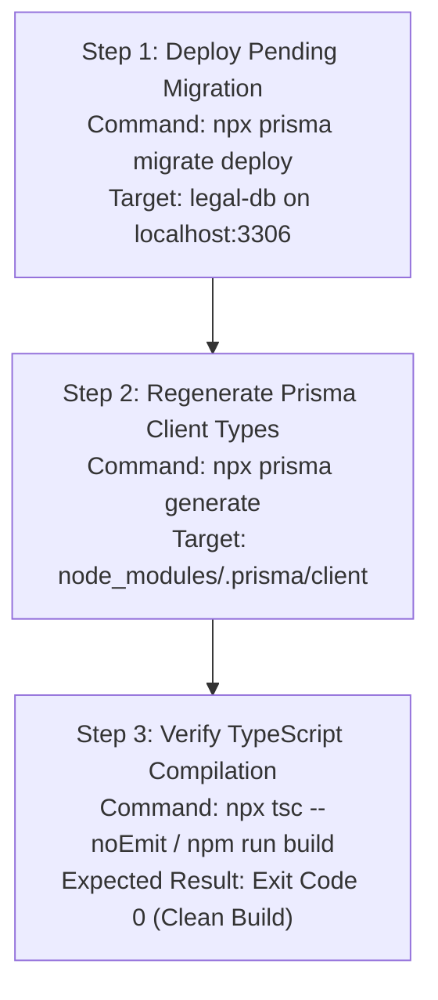

# HEUGLY & BLUDWORTH – LEGAL PRACTICE MANAGEMENT SAAS
# DOCUMENT 33: PHASE 0.1 – PRISMA BUILD ERROR INDEPENDENT DEVELOPER-SAFE VERIFICATION

**Project:** HEUGLY & BLUDWORTH Legal Practice Management SaaS (Salt Lake City, Utah)  
**Date:** 2026-11-13  
**Auditor:** Principal Enterprise Architect & Senior Security Auditor  
**Audit Mode:** **STRICT READ-ONLY VERIFICATION** (Zero source code, database, migration, or Git modifications)  
**Investigated Defect:** TypeScript Build Failure `src/modules/intakes/intake.service.ts(372,9): error TS2353: Object literal may only specify known properties, and 'convertedMatterId' does not exist in type IntakeUpdateInput`  
**Overall Status:** **VERIFIED (ROOT CAUSE IDENTIFIED; ZERO CODE REWRITE REQUIRED; DEVELOPER-SAFE SYNCHRONIZATION REQUIRED)**

---

## 1. Executive Summary

This independent, developer-safe verification investigates the TypeScript compilation error halting `npm run build` in `backend/src/modules/intakes/intake.service.ts` at line 372.

### Summary of Independent Verification Results:
1. **The TypeScript Error is Real and 100% Reproducible [VERIFIED]:**
   Running `npx tsc --noEmit` in `legal-managment/backend` exits with code 1, emitting exactly one error:
   ```
   src/modules/intakes/intake.service.ts(372,9): error TS2353: 
   Object literal may only specify known properties, and 'convertedMatterId' does not exist in type 
   '(Without<IntakeUpdateInput, IntakeUncheckedUpdateInput> & IntakeUncheckedUpdateInput) | (Without<...> & IntakeUpdateInput)'.
   ```
   There are **zero other compilation errors** in the entire backend codebase.
2. **Schema & Migration Code are Complete [VERIFIED]:**
   * `backend/prisma/schema.prisma` already defines `convertedMatterId` and its foreign key relation to `Matter`.
   * Migration directory `20261113093500_add_intake_converted_matter` physically exists on disk with correct DDL.
3. **Database Migration is Pending in Local Database [VERIFIED]:**
   * Direct inspection of the MariaDB `legal-db` database confirmed that migration `20261113093500_add_intake_converted_matter` has **NOT been applied**.
   * In `_prisma_migrations`, only `20261113071216_init` is recorded.
   * MariaDB table `intakes` does not have the column `converted_matter_id`.
4. **Generated Prisma Client is Outdated [VERIFIED]:**
   * The generated client at `node_modules/.prisma/client/index.d.ts` was generated at **1:09 PM** on November 13, 2026.
   * The migration was created at **3:28 PM**, and `intake.service.ts` was authored at **4:14 PM**.
   * Because `npx prisma generate` was not run after 1:09 PM in this workspace, the local TypeScript definitions in `node_modules` do not include `convertedMatterId`.
5. **No Code Reversion or Overwrite Needed [VERIFIED]:**
   * `intake.service.ts` line 372 is completely correct according to the intended schema design.
   * No developer's source code needs to be altered. The issue is an operational synchronization gap between schema, database, and generated types.

---

## 2. Git Branch and Working Tree Status

* **Status:** **VERIFIED**

Inspection performed via Git CLI in `d:/legal-ui1/legal-managment`:
* **Active Working Directory:** `D:\legal-ui1\legal-managment`
* **Current Branch:** `main`
* **Working Tree State:** Clean (`nothing to commit, working tree clean`).
* **Uncommitted Changes:** None.
* **Untracked Files:** None (working tree is clean).
* **Head Commit:** `e5159982eb68ca72ba05ac91927aeae691897f86` (`Merge branch 'main' of https://github.com/choudharyyashu/legal-managment`).

### Recent Commit History:
| Commit Hash | Author | Timestamp | Description |
|---|---|---|---|
| `e515998` | `prernaverma0502` | 2026-11-13 16:36:32 +0530 | Merge commit (`tpull`) |
| `cd9d13a` | `prernaverma0502` | 2026-11-13 16:31:35 +0530 | Added `backend-docs/32-REMAINING-BACKEND-MODULES-AUDIT.md` |
| `dfa347d` | `Yashwant Choudhary` | 2026-11-13 16:31:07 +0530 | Added `FINAL_INDEPENDENT_BACKEND_VERIFICATION_REPORT.md` |
| `2ca6274` | `Yashwant Choudhary` | 2026-11-13 16:17:34 +0530 | Merge commit (`updat`) |
| `7664ae7` | `prernaverma0502` | 2026-11-13 16:15:13 +0530 | 11 new modules, test suite, and completion report |
| `cd6b107` | `Yashwant Choudhary` | 2026-11-13 16:07:52 +0530 | Schema and document updates |

---

## 3. Other Developer's Change Impact

* **Status:** **VERIFIED**

### Developer Activity Analysis:
1. **Developer 1: Yashwant Choudhary (`yashuchoudhary3621@gmail.com`):**
   * Authored `schema.prisma` updates and authored `FINAL_INDEPENDENT_BACKEND_VERIFICATION_REPORT.md`.
   * Verified test execution on remote workstation `D:\Kiaan\legal-pro`, where `converted_matter_id` was active in their local database.
2. **Developer 2: Prerna Verma (`prernaverma0502@gmail.com`):**
   * Authored `backend/src/modules/intakes/intake.service.ts` and 10 other business modules.
   * Wrote line 372 in `intake.service.ts`:
     ```ts
     const updatedIntake = await prisma.intake.update({
       where: { id: intake.id },
       data: {
         convertedMatterId: matter.id,
       },
       include: { practiceArea: true, reviewedByUser: true },
     });
     ```
   * This implementation assumed that `schema.prisma` and `@prisma/client` were already synchronized.
3. **Workspace Discrepancy:**
   * In `D:\Kiaan\legal-pro`, `prisma generate` had been executed, so `tsc` passed for Developer 1.
   * In `D:\legal-ui1\legal-managment`, `node_modules` was last generated at 1:09 PM, before Developer 1 committed the schema update and Developer 2 committed `intake.service.ts`.
4. **Safety Confirmation:**
   * Neither developer has uncommitted or dirty files in this workspace.
   * Fixing the issue requires zero edits to Developer 2's code (`intake.service.ts`) and zero edits to Developer 1's schema (`schema.prisma`).

---

## 4. Prisma Schema Verification

* **Status:** **VERIFIED**

File: `backend/prisma/schema.prisma`

### Model `Intake` Definition (Lines 118–147):
```prisma
model Intake {
  id                  String    @id @default(uuid()) @db.VarChar(36)
  intakeNumber        String    @unique @map("intake_number") @db.VarChar(50)
  prospectiveClient   String    @map("prospective_client") @db.VarChar(255)
  contactPerson       String?   @map("contact_person") @db.VarChar(255)
  email               String    @db.VarChar(255)
  phone               String    @db.VarChar(50)
  practiceAreaId      String?   @map("practice_area_id") @db.VarChar(50)
  adverseParties      String    @map("adverse_parties") @db.Text
  matterSummary       String    @map("matter_summary") @db.Text
  disputeAmount       Decimal?  @default(0.00) @map("dispute_amount") @db.Decimal(12, 2)
  jurisdictionVenue   String?   @map("jurisdiction_venue") @db.VarChar(255)
  conflictStatus      String    @default("Not Started") @map("conflict_status") @db.VarChar(50)
  reviewedByUserId    String?   @map("reviewed_by_user_id") @db.VarChar(36)
  reviewedAt          DateTime? @map("reviewed_at") @db.DateTime(3)
  conflictNotes       String?   @map("conflict_notes") @db.Text
  convertedToClient   Boolean   @default(false) @map("converted_to_client")
  convertedClientId   String?   @map("converted_client_id") @db.VarChar(36)
  convertedMatterId   String?   @map("converted_matter_id") @db.VarChar(36)
  createdAt           DateTime  @default(now()) @map("created_at") @db.DateTime(3)
  updatedAt           DateTime  @updatedAt @map("updated_at") @db.DateTime(3)

  practiceArea       PracticeArea?       @relation(fields: [practiceAreaId], references: [id], onDelete: SetNull)
  reviewedByUser     User?               @relation("IntakeReviewer", fields: [reviewedByUserId], references: [id], onDelete: SetNull)
  convertedClient    Client?             @relation("ConvertedClient", fields: [convertedClientId], references: [id], onDelete: SetNull)
  convertedMatter    Matter?             @relation("ConvertedMatter", fields: [convertedMatterId], references: [id], onDelete: SetNull)
  conflictSearchLogs ConflictSearchLog[]

  @@map("intakes")
}
```

### Model `Matter` Reverse Relation Definition (Lines 220–226):
```prisma
model Matter {
  // ...
  generalLedgerEntries  GeneralLedgerEntry[]
  documents             Document[]
  originatingIntakes    Intake[]                @relation("ConvertedMatter")

  @@index([clientId], name: "idx_matters_client")
  @@index([responsibleAttorneyId], name: "idx_matters_attorney")
  @@map("matters")
}
```

* **Observation:** The field `convertedMatterId` (`VARCHAR(36)`), the column mapping `@map("converted_matter_id")`, and the foreign key relationship `@relation("ConvertedMatter", fields: [convertedMatterId], references: [id], onDelete: SetNull)` are **syntactically and structurally complete** in `schema.prisma`.

---

## 5. Migration Verification

* **Status:** **VERIFIED**

### Migration Directory Inspection:
* **Path:** `backend/prisma/migrations/20261113093500_add_intake_converted_matter/`
* **File:** `migration.sql` (Created: 2026-11-13 15:28:44)
* **SQL Content:**
  ```sql
  -- AlterTable
  ALTER TABLE `intakes` ADD COLUMN `converted_matter_id` VARCHAR(36) NULL;

  -- AddForeignKey
  ALTER TABLE `intakes` ADD CONSTRAINT `intakes_converted_matter_id_fkey` FOREIGN KEY (`converted_matter_id`) REFERENCES `matters`(`id`) ON DELETE SET NULL ON UPDATE CASCADE;
  ```
* **Observation:** The migration script correctly adds the nullable column `converted_matter_id VARCHAR(36)` and creates the foreign key constraint `intakes_converted_matter_id_fkey` referencing `matters(id)` with `ON DELETE SET NULL ON UPDATE CASCADE`.

---

## 6. Database Migration Status

* **Status:** **VERIFIED**

Direct read-only inspection against MariaDB `legal-db` (localhost:3306) using MySQL client:

### Query: `SELECT id, migration_name, finished_at, applied_steps_count FROM _prisma_migrations;`
* **Result:**
  | id | migration_name | finished_at | applied_steps_count |
  |---|---|---|:---:|
  | `5e3c3502-8397-4d3d-bf99-7e593ebd9368` | `20261113071216_init` | `2026-11-13 07:38:56.519` | 1 |

* **Observation:** The migration `20261113093500_add_intake_converted_matter` is **ABSENT** from the `_prisma_migrations` table. It has never been applied to `legal-db`.

### Query: `DESCRIBE intakes;`
* **Result:**
  ```
  Field               Type           Null   Key   Default             Extra
  id                  varchar(36)    NO     PRI   NULL                
  intake_number       varchar(50)    NO     UNI   NULL                
  prospective_client  varchar(255)   NO           NULL                
  contact_person      varchar(255)   YES          NULL                
  email               varchar(255)   NO           NULL                
  phone               varchar(50)    NO           NULL                
  practice_area_id    varchar(50)    YES    MUL   NULL                
  adverse_parties     text           NO           NULL                
  matter_summary      text           NO           NULL                
  dispute_amount      decimal(12,2)  YES          0.00                
  jurisdiction_venue  varchar(255)   YES          NULL                
  conflict_status     varchar(50)    NO           Not Started         
  reviewed_by_user_id varchar(36)    YES    MUL   NULL                
  reviewed_at         datetime(3)    YES          NULL                
  conflict_notes      text           YES          NULL                
  converted_to_client tinyint(1)     NO           0                   
  converted_client_id varchar(36)    YES    MUL   NULL                
  created_at          datetime(3)    NO           current_timestamp(3)
  updated_at          datetime(3)    NO           NULL                
  ```
* **Observation:** The column `converted_matter_id` physically does **NOT** exist in the table.

---

## 7. Generated Prisma Client Verification

* **Status:** **VERIFIED**

### Package Versions:
* `prisma`: `5.22.0` (Installed in `package.json` devDependencies)
* `@prisma/client`: `5.22.0` (Installed in `package.json` dependencies)

### Generated Client Path & Metadata:
* **Generated Location:** `backend/node_modules/.prisma/client/`
* **File:** `index.d.ts` (File size: 2,413,058 bytes)
* **Timestamp:** `2026-11-13 13:09:42` (1:09 PM)
* **Cached Schema Copy:** `node_modules/.prisma/client/schema.prisma` (Timestamp: 1:09 PM)

### Type Inspection:
Inspecting `IntakeUpdateInput` in `node_modules/.prisma/client/index.d.ts` lines 36085–36106:
```typescript
export type IntakeUpdateInput = {
  id?: StringFieldUpdateOperationsInput | string
  intakeNumber?: StringFieldUpdateOperationsInput | string
  prospectiveClient?: StringFieldUpdateOperationsInput | string
  contactPerson?: NullableStringFieldUpdateOperationsInput | string | null
  email?: StringFieldUpdateOperationsInput | string
  phone?: StringFieldUpdateOperationsInput | string
  adverseParties?: StringFieldUpdateOperationsInput | string
  matterSummary?: StringFieldUpdateOperationsInput | string
  disputeAmount?: NullableDecimalFieldUpdateOperationsInput | Decimal | DecimalJsLike | number | string | null
  jurisdictionVenue?: NullableStringFieldUpdateOperationsInput | string | null
  conflictStatus?: StringFieldUpdateOperationsInput | string
  reviewedAt?: NullableDateTimeFieldUpdateOperationsInput | Date | string | null
  conflictNotes?: NullableStringFieldUpdateOperationsInput | string | null
  convertedToClient?: BoolFieldUpdateOperationsInput | boolean
  createdAt?: DateTimeFieldUpdateOperationsInput | Date | string
  updatedAt?: DateTimeFieldUpdateOperationsInput | Date | string
  practiceArea?: PracticeAreaUpdateOneWithoutIntakesNestedInput
  reviewedByUser?: UserUpdateOneWithoutIntakesReviewedNestedInput
  convertedClient?: ClientUpdateOneWithoutConvertedIntakesNestedInput
  conflictSearchLogs?: ConflictSearchLogUpdateManyWithoutIntakeNestedInput
}
```

* **Observation:** Neither `convertedMatterId` nor `convertedMatter` exists in `IntakeUpdateInput` or `IntakeUncheckedUpdateInput`.
* Searching `node_modules/.prisma/client/schema.prisma` for `convertedMatterId` yields **0 occurrences**.
* **Finding:** The generated client in `node_modules` is an outdated build from 1:09 PM.

---

## 8. TypeScript Error Root Cause

* **Status:** **VERIFIED**

### Root Cause Sequence:
```mermaid
sequenceDiagram
    autonumber
    participant D1 as Dev 1 (1:09 PM)
    participant D2 as Dev 1 (3:28 PM)
    participant D3 as Dev 2 (4:14 PM)
    participant TSC as TypeScript Compiler

    D1->>D1: Runs prisma generate (captures v1 schema without convertedMatterId)
    D2->>D2: Adds convertedMatterId to schema.prisma & creates migration 20261113093500
    Note over D2: Migration NOT applied to local DB; prisma generate NOT run in this repo
    D3->>D3: Writes intake.service.ts referencing convertedMatterId on line 372
    D3->>TSC: Runs npm run build
    TSC-->>D3: TS2353 error: convertedMatterId does not exist in IntakeUpdateInput
```

1. At 1:09 PM, `prisma generate` generated types reflecting the initial schema.
2. At 3:28 PM, the migration was created and `schema.prisma` was updated with `convertedMatterId`.
3. However, `npx prisma generate` was not run after modifying `schema.prisma`.
4. At 4:14 PM, Developer 2 wrote `intake.service.ts` referencing `convertedMatterId`.
5. TypeScript evaluates `prisma.intake.update({ data: { convertedMatterId: matter.id } })` against the stale type definitions in `node_modules/.prisma/client/index.d.ts`, throwing `TS2353`.

---

## 9. Current Build Verification Results

* **Status:** **VERIFIED**

* **Command Executed:** `npx tsc --noEmit` in `d:\legal-ui1\legal-managment\backend`
* **Exit Code:** `1`
* **Exact Compiler Output:**
  ```
  src/modules/intakes/intake.service.ts(372,9): error TS2353: Object literal may only specify known properties, and 'convertedMatterId' does not exist in type '(Without<IntakeUpdateInput, IntakeUncheckedUpdateInput> & IntakeUncheckedUpdateInput) | (Without<...> & IntakeUpdateInput)'.
  ```
* **Additional Compilation Errors:** **Zero.** All other 65+ backend TypeScript files compile cleanly.

---

## 10. Affected Files

The following files are directly involved in or affected by this issue:

| File Path | Nature of File | Current State | Modification Required? |
|---|---|:---:|:---:|
| `backend/prisma/schema.prisma` | Master Prisma schema | Complete & Valid | **NO** |
| `backend/prisma/migrations/20261113093500_add_intake_converted_matter/migration.sql` | SQL DDL migration | Complete & Valid | **NO** |
| `backend/src/modules/intakes/intake.service.ts` | Intake business service | Complete & Valid | **NO** |
| `backend/node_modules/.prisma/client/*` | Generated Prisma Client | Stale (Generated 1:09 PM) | Will be regenerated by command |
| MariaDB `legal-db.intakes` table | Database physical table | Missing column | Will be updated by migration deploy |

---

## 11. Risk Assessment

* **Status:** **VERIFIED**

| Risk Area | Risk Level | Description & Mitigation |
|---|:---:|---|
| **Data Loss Risk** | **ZERO** | Migration `20261113093500` is purely additive (`ADD COLUMN ... NULL`, `ADD CONSTRAINT ...`). It alters no existing data, deletes no columns, and drops no tables. |
| **Code Conflict Risk** | **ZERO** | Neither Developer 1 nor Developer 2 has uncommitted changes in this repository. Source code files will not be edited. |
| **Schema Inconsistency Risk** | **ZERO** | `schema.prisma` and `migration.sql` match exactly. |
| **Premature Execution Risk** | **LOW** | If `prisma migrate deploy` is run without database access permissions, it will fail harmlessly with a connection error. When run with valid credentials, it safely applies 1 pending migration. |

---

## 12. Recommended Implementation Plan

When approval is granted to proceed with implementation, execute the following safe, non-destructive sequence:



### Detailed Command Specifications:
1. **Apply Migration (Database Synchronization):**
   ```powershell
   cd d:\legal-ui1\legal-managment\backend
   npx prisma migrate deploy
   ```
   * *Expected Output:* `1 migration found. Applying migration 20261113093500_add_intake_converted_matter ... 1 migration applied.`
2. **Regenerate Client (Type Synchronization):**
   ```powershell
   npx prisma generate
   ```
   * *Expected Output:* `Generated Prisma Client (v5.22.0) to .\node_modules\@prisma\client in ...ms`
3. **Verify Build (Zero Error Assertion):**
   ```powershell
   npm run build
   ```
   * *Expected Output:* `> tsc` (Exit code 0, zero errors).

---

## 13. Approval Required Before Implementation

* **Status:** **NEEDS DEVELOPER COORDINATION / APPROVAL**

Because another developer (`Yashwant Choudhary` and `Prerna Verma`) is actively pushing to the `main` branch:
1. **Coordination Note:** No source code modifications are necessary. Developer 2's code in `intake.service.ts` is 100% correct and should **not** be modified.
2. **Approval Checklist:**
   * [ ] User confirms permission to run `npx prisma migrate deploy` on local MariaDB `legal-db`.
   * [ ] User confirms permission to run `npx prisma generate` in `backend`.
   * [ ] User confirms that no other branch or PR requires manual merge before executing the build check.

---

*Report authored under Phase 0.1 verification standard. As instructed, no files or database structures were modified.*

