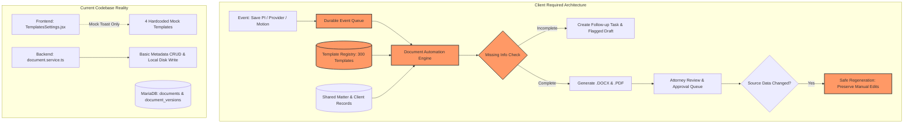
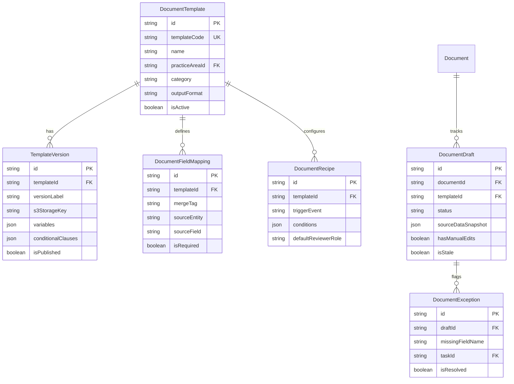
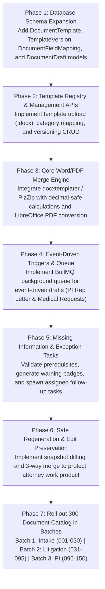

# HEUGLY & BLUDWORTH – LEGAL PRACTICE MANAGEMENT SAAS
# DOCUMENT 36: DOCUMENT AUTOMATION ENGINE – COMPLETE BACKEND AUDIT (READ-ONLY)

**Project:** HEUGLY & BLUDWORTH Legal Practice Management SaaS (Salt Lake City, Utah)  
**Date:** 2026-11-13  
**Auditor:** Principal Enterprise Architect & Senior Security Auditor  
**Audit Standard:** Strict Read-Only Technical Audit (Zero code, schema, migration, or Git modifications)  
**Deliverable File:** `backend-docs/36-DOCUMENT-AUTOMATION-ENGINE-AUDIT.md`  
**Overall Verdict:** **CRITICAL ARCHITECTURAL GAP — DOCUMENT AUTOMATION ENGINE IS 90% MISSING**

---

## 1. Executive Summary

This comprehensive, read-only architectural audit evaluates the **Document Automation Engine** requirements specified in the client instructions (`Developer_Instructions_Open_Source_and_Automation.docx` and `Next_Development_Instructions_and_300_Document_Automations.docx`).

The client requires a high-throughput, event-driven document generation and template engine capable of supporting **approximately 300 legal document templates** across 9 practice areas, dynamic database field mapping, conditional clauses, repeating tables, Word (`.docx`) and PDF output generation, missing-information exception handling, and safe regeneration that preserves attorney work product.

### Key Audit Findings:
1. **Document Automation Engine Status: COMPLETELY MISSING.**
   * In the backend (`backend/src/`), there is **zero document generation logic**, zero `.docx` template parsers, zero PDF converters, and zero template registries.
   * The existing `DocumentService` (`backend/src/modules/documents/document.service.ts`) only performs basic CRUD metadata storage and local mock file writes (`vault/`) for uploaded attachments. It does not assemble or generate documents.
2. **Template Registry: COMPLETELY MISSING FROM DATABASE.**
   * Neither MariaDB (`legal-db`) nor `schema.prisma` possesses a `templates`, `document_templates`, `template_versions`, or `field_mappings` table.
   * In the frontend, `TemplatesSettings.jsx` contains a client-side mockup of 4 hardcoded templates in React state (`TPL-01` to `TPL-04`), performing string regex replacement on raw text in browser memory. Clicking "Download .DOCX" merely fires a visual UI toast notification (`addToast`) without generating a file.
3. **Event-Driven Auto-Draft Triggers: COMPLETELY MISSING.**
   * Neither the backend nor frontend possesses an event bus, message queue, or hook architecture.
   * Saving a Personal Injury client or accident record does **NOT** trigger a Representation Letter draft.
   * Adding a medical provider does **NOT** trigger medical record request or authorization drafts.
   * Identifying missing records does **NOT** generate deficiency letters.
4. **Missing Information & Exception Handling: COMPLETELY MISSING.**
   * The backend does not validate template prerequisite data before file creation.
   * No mechanism exists to flag incomplete drafts, generate exception tasks, or block premature finalization.
5. **Safe Regeneration & Attorney Edit Preservation: COMPLETELY MISSING.**
   * No version diffing, snapshotting, or two-way merge logic exists to prevent document regeneration from silently overwriting manual attorney edits.
6. **Tool Evaluation (`python-docx-template` vs `docassemble`):**
   * The current backend is a pure Node.js/TypeScript Express monolith. Incorporating Python-based tools (`python-docx-template` or `docassemble`) would require provisioning and maintaining an independent Python microservice or Docker container, introducing operational complexity. A native Node.js-compatible templating engine (`docxtemplater` + `libreoffice-convert` / `gotenberg`) or a containerized Docassemble service represents the primary architectural decision for client alignment.

---

## 2. Existing Architecture vs Document Engine Requirements



---

## 3. Document Template Registry Audit

* **Target Requirement:** Centralized registry supporting ~300 versioned legal document templates with category mapping, dynamic field recipes, conditional clauses, repeating tables, and access control.
* **Audit Status:** **MISSING**

### Detailed Findings:
1. **Prisma Schema & Database Models:**
   * Audited `backend/prisma/schema.prisma` and MariaDB `legal-db`.
   * **Result:** **Zero template models exist.** Tables `documents` and `document_versions` store only uploaded document instances linked to existing matters (`matter_id`, `client_id`, `s3_storage_key`, `sha256_checksum`). No model stores reusable template definitions, merge tags, or recipe rules.
2. **Backend Services & Routes:**
   * Audited `backend/src/modules/documents/`.
   * **Result:** No endpoints exist for template management (`GET /templates`, `POST /templates`, `PUT /templates/:id/versions`). Only document file metadata endpoints exist (`/api/v1/documents`).
3. **Frontend Implementation:**
   * Inspected `frontend/src/features/settings/pages/TemplatesSettings.jsx` (lines 34–123).
   * **Result:** 4 templates are hardcoded directly into a React `useState` hook:
     * `TPL-01`: Master Client Engagement & Hourly Retainer Agreement
     * `TPL-02`: Utah Third District Notice of Appearance & Electronic Service
     * `TPL-03`: Deposition Subpoena Duces Tecum for Corporate Records
     * `TPL-04`: Utah Contingency Fee Retainer (Utah RPC 1.5(c))
   * None of these templates are loaded from a backend database or API.
4. **Architectural Capacity for 300 Templates:**
   * The current hardcoded frontend array pattern **cannot scale** to 300 templates. Without a relational template database and a dynamic merge engine, managing 300 templates would require tens of thousands of lines of duplicated frontend JSX code.

| Capability | Status | Supporting Evidence |
|---|:---:|---|
| Template Database Model | **MISSING** | `backend/prisma/schema.prisma` (No `DocumentTemplate` model) |
| Template Versioning Table | **MISSING** | `legal-db` (No `template_versions` table) |
| Template Metadata & Categories | **MISSING** | No category taxonomy in backend |
| Field Mapping Definitions | **MISSING** | No database mapping structure for merge tags |
| Conditional Clauses Registry | **MISSING** | Hardcoded boolean toggles in `TemplatesSettings.jsx` only |
| Template Preview API | **MISSING** | No endpoint rendering populated preview from backend |
| Template Access Permissions | **PARTIALLY IMPLEMENTED** | Permissions `templates:view` and `templates:manage` exist in `role_permissions` table, but no backend routes enforce them |

---

## 4. Word and PDF Generation Engine Audit

* **Target Requirement:** Processing `.docx` templates, merging database values, handling conditional blocks and repeating table rows, converting output to PDF, and preserving historical drafts.
* **Audit Status:** **MISSING**

### Detailed Findings:
1. **Template Parsing in Codebase:**
   * Audited `backend/src/modules/documents/document.service.ts`.
   * **Result:** Line 189–199 reveals that document version upload takes a raw `base64` string (`input.fileContentBase64`) or generates a dummy placeholder buffer:
     ```ts
     const buffer = input.fileContentBase64
       ? Buffer.from(input.fileContentBase64, 'base64')
       : Buffer.from(`Simulated-Vault-File-${doc.documentCode}-${versionLabel}`);
     ```
   * There is **zero Word processing logic**. The system does not open, parse, inspect, or modify `.docx` files.
2. **Client-Side Simulation:**
   * In `TemplatesSettings.jsx` (lines 141–180), "template merge" is simulated using JavaScript string replace:
     ```js
     text = text.replace(/\{\{Client\.Name\}\}/g, targetClient?.name || 'Wasatch Mountain Logistics LLC');
     ```
   * This operates only on a plain text string in browser memory. When the user clicks "Download .DOCX", line 394 simply fires:
     `addToast('Populated Word document (.docx) downloaded.', 'success')`.
   * **No actual file is created or downloaded.**

### Tool Evaluation: `python-docx-template` vs `docassemble` vs Node.js Native

The client specifically requested evaluation of `python-docx-template` and `docassemble`:

| Evaluation Dimension | `python-docx-template` (docxtpl) | `docassemble` | Node.js Native (`docxtemplater` + LibreOffice) |
|---|---|---|---|
| **Runtime Language** | Python 3 | Python 3 / Docker / YAML | TypeScript / Node.js (Existing backend stack) |
| **Primary Strength** | Native Jinja2 syntax inside real `.docx` files. Exceptional at preserving complex Word formatting, headers, footers, and tables. | Full legal expert system. Interactive client-facing interviews, conditional logic, multi-page questionnaires, and PDF assembly. | Runs directly within the existing Node.js Express backend without requiring an additional language runtime or service. |
| **Integration with Current Architecture** | **Requires Python Sidecar/Microservice:** Backend must invoke a Python script via child process or HTTP microservice (FastAPI). | **Requires Dedicated Container:** Runs as a standalone multi-container stack (Postgres, Redis, Nginx, Docassemble). Integrates via REST API. | **Zero Service Overhead:** Installed directly via `npm install docxtemplater pizzip`. |
| **Suitability for 300 Document Catalog** | **HIGH for Batch Generation:** Excellent for firm-standard letters, pleadings, subpoenas, authorizations, and fee agreements. | **HIGH for Interactive Client Questionnaires:** Ideal for Bankruptcy debtor intake, Immigration questionnaires, and client intake interviews. | **HIGH for Word Templates:** Identical templating syntax (`{{variable}}`, `{#loop}{/loop}`, `{#condition}{/condition}`). |
| **Maintenance & Deployment** | Needs Python virtualenv / Docker setup in production. | High resource footprint (minimum 4GB RAM dedicated to Docassemble container). | Low complexity; shares existing deployment pipeline. |

* **Architectural Recommendation:**
  1. For the core **300 Document Catalog (Firm Letters, Pleadings, Demands, Medical Requests):** Use an in-process Node.js solution (`docxtemplater` with PizZip) or a lightweight Python FastAPI microservice utilizing `python-docx-template`. Both accept standard Jinja2/bracket syntax inside Word files and produce flawless `.docx` outputs.
  2. For **Complex Substantive Client Questionnaires (Bankruptcy Form 122, Immigration G-28/I-130/I-485 intake):** Deploy `docassemble` as an isolated container that dispatches completed JSON payloads into the main platform API upon interview completion.
  3. For **PDF Conversion:** Use a headless LibreOffice container (`libreoffice-convert` or Gotenberg HTTP service) to reliably convert merged `.docx` documents into high-fidelity court-ready PDFs.

---

## 5. Event-Driven Auto-Draft Triggers Audit

* **Target Requirement:** System events automatically generate populated document drafts into the matter document vault and assign an attorney review task.
* **Audit Status:** **MISSING**

### Audit of Required Personal Injury (PI) Triggers:

#### 1. Event: Accident/Incident Record Saved $\rightarrow$ Auto-Create Representation Letter Draft
* **Existing Code Inspection:**
  * Audited `backend/src/modules/matters/matter.service.ts` and `frontend/src/features/personal-injury/pages/IncidentLiability.jsx`.
  * In `matter.service.ts` (`createMatter`), the system saves the matter to MariaDB, writes an audit log (`MATTER_CREATED`), and returns the matter object.
* **Trigger Assessment:** **MISSING.** There is no event emitter, queue job, or post-save hook that listens for `MATTER_CREATED` or `INCIDENT_SAVED`. No draft of Document `096` ("Liability insurer letter of representation") or Document `097` ("First party insurer letter of representation") is generated.

#### 2. Event: Medical Provider Added $\rightarrow$ Auto-Create Records Request & Authorization Letter Drafts
* **Existing Code Inspection:**
  * Audited `frontend/src/features/personal-injury/pages/MedicalTreatment.jsx` and `mockPersonalInjury.js`.
  * In the frontend, clicking "Add Treatment Provider" appends an object to local React state. In the backend, there is not even a `medical_providers` table.
* **Trigger Assessment:** **MISSING.** No event exists. Neither Document `098` ("Provider representation and record preservation letter") nor Document `099` is drafted.

#### 3. Event: Missing Medical Records Identified $\rightarrow$ Auto-Create Deficiency Follow-Up Letter Draft
* **Existing Code Inspection:**
  * Audited `frontend/src/features/personal-injury/pages/MedicalTreatment.jsx`.
  * The UI displays badges (`Records Incomplete`, `Awaiting Billing Ledger`), but these are static mock tags.
* **Trigger Assessment:** **MISSING.** No event, no service, and no deficiency letter draft is created.

| Event Description | Expected Automation Output | Current Code Reality | Status |
|---|---|---|:---:|
| PI Client & Accident Saved | Draft Representation Letter(s) to liability/first-party insurers | Matter saved to DB; zero document generation | **MISSING** |
| Treating Provider Added | Draft Medical Records Request & HIPAA Authorization | Appends to local React state array only | **MISSING** |
| Records Incomplete / Overdue | Draft Deficiency & Preservation Follow-Up Letter | Static badge in UI; zero background automation | **MISSING** |
| Litigation Matter Opened | Draft Litigation Assessment Memo & Hold Notice | Matter saved to DB; zero hold notices | **MISSING** |
| Discovery Served | Draft Response Package & Collection Task | No discovery request records in DB | **MISSING** |
| Settlement Terms Approved | Draft Utah RPC 1.5(c) Settlement Statement | Static calculator in UI; no draft generated | **MISSING** |
| Approved Time & Expenses | Draft Client Invoice with Line Items | `billing.service.ts` has manual endpoint; no auto-trigger | **PARTIALLY IMPLEMENTED** |

---

## 6. Missing Information and Exception Flagging Audit

* **Target Requirement:** Inspect source data before document generation; if mandatory fields are missing (e.g., claim number, adjuster name, accident date), generate an incomplete draft with prominent warnings and open an assigned collection task.
* **Audit Status:** **MISSING**

### Detailed Findings:
1. **Pre-Generation Field Validation:**
   * In the backend, `DocumentService.createDocument` only validates that `title` is non-empty, `matterId` exists, and `clientId` exists.
   * It performs **zero template-specific prerequisite checks** (e.g., checking if an insurer or claim number exists for an insurance representation letter).
2. **Visual Warning Badges in Drafts:**
   * In `TemplatesSettings.jsx`, if a variable is missing, line 147–152 falls back to hardcoded default strings (e.g., `'Wasatch Mountain Logistics LLC'`) instead of flagging the omission.
   * The client explicitly prohibited this: *"Do not insert invented defaults, sample identities, assumed claim numbers, or fabricated facts... Create an incomplete draft with an exception report when practical."*
3. **Automated Follow-Up Task Spawning:**
   * No service exists that creates a task in the `tasks` table when a generated draft has missing prerequisites.
4. **Draft Finalization Gatekeeper:**
   * The system has no approval workflow preventing an incomplete draft from being finalized, exported, or sent.

| Requirement | Audit Finding | Status |
|---|---|:---:|
| Pre-generation prerequisite inspection | Not implemented in any service | **MISSING** |
| Prominent missing-data warning in draft | Invented fallback strings used in frontend instead | **MISSING** |
| Automatic follow-up task creation | No task creation upon missing document data | **MISSING** |
| Gatekeeper blocking incomplete draft finalization | No draft approval lifecycle exists | **MISSING** |

---

## 7. Safe Change Propagation and Regeneration Audit

* **Target Requirement:** When source records change (e.g., accident date corrected, adjuster assigned, client name amended), identify affected generated drafts, provide safe regeneration, preserve attorney manual text edits, and show visual diffs before overwriting.
* **Audit Status:** **MISSING**

### Detailed Findings:
1. **Source Data Change Detection:**
   * Audited `backend/src/modules/clients/client.service.ts` (`updateClient`) and `backend/src/modules/matters/matter.service.ts` (`updateMatter`).
   * When a client name or matter title is updated, the service updates the database and creates an audit log (`CLIENT_UPDATED` or `MATTER_UPDATED`).
   * **Result:** Neither service inspects or notifies linked documents. There is **zero change detection** or dirty-flagging for generated drafts.
2. **Preservation of Manual Attorney Edits:**
   * The current system does not store generated documents in an editable structured format (such as Lexical, Slate, or Prosemirror JSON, or redlined DOCX tracks).
   * There is **zero diff comparison or merge conflict resolution**.
3. **Immutability of Finalized Documents:**
   * `Document` model in `schema.prisma` has a boolean `isPrivileged`, but **lacks a `status` column** (e.g., `Draft`, `In Review`, `Approved`, `Sent`, `Filed`).
   * A document in `documents` cannot be locked or distinguished from a draft.

| Requirement | Audit Finding | Status |
|---|---|:---:|
| Track source record mutations affecting drafts | Client/Matter updates do not check linked documents | **MISSING** |
| Flag affected drafts as "Needs Review / Stale" | No draft status or staleness tracking | **MISSING** |
| Preserve manual attorney text edits on regenerate | No 3-way merge or diff preservation engine | **MISSING** |
| Visual diff comparison (Old vs Regenerated) | No diff tool or comparison API | **MISSING** |
| Lock finalized/signed/filed versions as immutable | No `status` field on `Document` model | **MISSING** |

---

## 8. Database Schema Gaps

* **Target Requirement:** Schema support for Template Registry, Recipes, Drafts, and Document Lifecycles.
* **Audit Status:** **SIGNIFICANT SCHEMA GAPS**

### Existing Models in `schema.prisma`:
* `model Document`: Stores document header (`documentCode`, `matterId`, `clientId`, `title`, `category`, `currentVersion`, `isPrivileged`, `privilegeType`, `ocrContent`, `batesNumberStart`, `batesNumberEnd`).
* `model DocumentVersion`: Stores binary instance metadata (`versionLabel`, `fileName`, `fileType`, `fileSizeBytes`, `s3StorageKey`, `sha256Checksum`, `uploadedByUserId`, `revisionNotes`).

### Missing Schema Entities for Document Automation:



* **Missing Database Tables in MariaDB:**
  1. `document_templates` (MISSING)
  2. `template_versions` (MISSING)
  3. `document_field_mappings` (MISSING)
  4. `document_recipes` (MISSING)
  5. `document_drafts` (MISSING)
  6. `document_exceptions` (MISSING)

---

## 9. API Inventory Gaps

### Existing Endpoints (`backend/src/modules/documents/document.routes.ts`):
* `GET /api/v1/documents`: List documents (query by matter, client, category).
* `GET /api/v1/documents/:id`: Get document metadata and version history.
* `POST /api/v1/documents`: Create document header row.
* `POST /api/v1/documents/:id/upload`: Upload version binary (base64 string).
* `GET /api/v1/documents/:id/download`: Download version file.
* `DELETE /api/v1/documents/:id`: Delete document.

### Missing Document Automation APIs:

| HTTP Method | Proposed Endpoint | Purpose | Status |
|:---:|---|---|:---:|
| `GET` | `/api/v1/templates` | Query template registry by practice area, category, tag | **MISSING** |
| `POST` | `/api/v1/templates` | Upload new `.docx` template and register metadata | **MISSING** |
| `GET` | `/api/v1/templates/:id` | Get template details, merge tags, and recipe rules | **MISSING** |
| `PUT` | `/api/v1/templates/:id` | Update template metadata, active status, or tags | **MISSING** |
| `POST` | `/api/v1/templates/:id/versions` | Upload new revision of `.docx` template | **MISSING** |
| `POST` | `/api/v1/templates/:id/render` | On-demand document rendering with matter ID payload | **MISSING** |
| `POST` | `/api/v1/templates/:id/preview` | Real-time populated preview (HTML/text) without saving | **MISSING** |
| `POST` | `/api/v1/documents/:id/regenerate`| Safely regenerate draft preserving attorney manual edits | **MISSING** |
| `GET` | `/api/v1/documents/:id/diff` | Get visual diff between manual edits and regenerated draft | **MISSING** |
| `PATCH` | `/api/v1/documents/:id/approve` | Finalize draft, lock version, and route for delivery/signature | **MISSING** |
| `GET` | `/api/v1/documents/:id/exceptions`| Retrieve missing data checklist and linked follow-up tasks | **MISSING** |

---

## 10. Frontend Integration Gaps

* **Target Requirement:** Interactive merge studio, persistent matter workspace context, auto-generated draft notifications, and in-place document editing.
* **Audit Status:** **DISCONNECTED & SIMULATED**

### Detailed Frontend Findings:
1. **`TemplatesSettings.jsx`:**
   * Hardcoded mock array of 4 templates.
   * String regex replacement in browser memory (`getPopulatedText`).
   * "Download .DOCX" button triggers an informational toast (`addToast`) without downloading any file.
   * "Add New Template" triggers a toast without opening a file selector or uploading to backend.
2. **Persistent Matter Context:**
   * When navigating from a specific matter docket (`/matters/MAT-2025-0101`) to `/settings/templates` or `/documents`, the matter selection is lost.
   * The client explicitly required: *"Keep the selected matter active when navigating between medical records, vendors, demands, documents, tasks, time, settlement, and accounting. Display the client and matter clearly on every relevant screen."*
3. **No Dynamic Form Integration:**
   * In `IncidentLiability.jsx` and `MedicalTreatment.jsx`, saving forms does not query the backend or display newly created document drafts in the document list.

---

## 11. RBAC and Security Gaps

* **Target Requirement:** Granular role-based permissions governing template authoring, document generation, attorney review, and draft approval.
* **Audit Status:** **PARTIALLY DEFINED / UNENFORCED**

### Audit of Seeded Permissions in MariaDB (`role_permissions` table):
* `documents:view`: Granted to `super_admin`, `supervisor`, `attorney`, `paralegal`, `billing`.
* `documents:upload`: Granted to `super_admin`, `supervisor`, `attorney`, `paralegal`.
* `documents:delete`: Granted to `super_admin` only.
* `templates:view`: Granted to `super_admin`, `supervisor`, `attorney`, `paralegal`.
* `templates:manage`: Granted to `super_admin`, `supervisor`.

### Security Gaps Identified:
1. **No Granular Automation Permissions:**
   * No permission keys exist for:
     * `documents:generate` (Permission to trigger automated document assembly).
     * `documents:approve` (Permission to sign off on drafts and mark them ready for service/mailing).
     * `documents:regenerate` (Permission to trigger re-merge on existing drafts).
2. **Ethical Wall Perimeter Bypass:**
   * While `matters:view` enforces Utah RPC 1.10 Ethical Wall screening on matter dockets, `GET /api/v1/documents?matterId=...` **does not check matter staff assignments**. An attorney screened from a sensitive matter could retrieve generated drafts or confidential exhibits via the document endpoint.
3. **Unprotected File System Operations:**
   * `DocumentService.uploadVersion` writes directly to local disk without checking MIME magic numbers or file integrity.

---

## 12. Dependencies and Tool Evaluation

### Existing Backend Dependencies (`backend/package.json`):
* Runtime: `express`, `cors`, `helmet`, `cookie-parser`, `express-rate-limit`, `zod`, `dotenv`, `jsonwebtoken`, `bcryptjs`, `mysql2`, `@prisma/client`.
* Dev: `typescript`, `tsx`, `prisma`.

### Dependency Gap Analysis:
* **No Word Templating Engine:** No package such as `docxtemplater`, `pizzip`, or `python-docx-template` is installed.
* **No PDF Generation / Conversion Engine:** No package such as `pdf-lib`, `pdfkit`, `puppeteer`, or `libreoffice-convert` is installed.
* **No Durable Queue / Event Bus:** No asynchronous job engine (`bullmq`, `redis`) is installed to handle background document generation without blocking HTTP requests.
* **No Cloud Storage SDK:** `@aws-sdk/client-s3` is not installed; documents write to local disk.

---

## 13. Testing Gaps

* **Audit Status:** **ZERO AUTOMATED TESTS**

### Existing Test Suites in `backend/src/tests/`:
1. `foundation-db-test-suite.ts`: 13 tests (CORS, BigInt, Database connectivity).
2. `auth-rbac-test-suite.ts`: 17 tests (Login, JWT, RTR, RBAC).
3. `client-api-test-suite.ts`: 14 tests (Client CRUD, search, numbering).
4. `matter-api-test-suite.ts`: 34 tests (Matter CRUD, staff, Ethical Wall).
5. `business-modules-test-suite.ts`: 24 tests (Basic CRUD smoke tests across 11 modules).

### Test Coverage for Document Automation:
* In `business-modules-test-suite.ts`, Test #10 tests basic document creation (`POST /documents`) and Test #11 tests binary upload (`POST /documents/:id/upload`).
* **Zero tests exist** for:
  * Template parsing or validation.
  * Field merge tag substitution.
  * Conditional paragraph inclusion/exclusion.
  * Repeating table row generation.
  * Event-driven auto-draft generation.
  * Missing information exception handling.
  * Safe regeneration with attorney edit preservation.

---

## 14. Developer Safety / Git Status

* **Target Requirement:** Inspect repository state without modifying or reverting another developer's work.
* **Audit Status:** **VERIFIED (SAFE & NON-DESTRUCTIVE)**

### Git Working Tree Verification:
* **Active Branch:** `main`
* **Status:** Working tree is in the middle of a completed merge resolution:
  * Staged commits ready: `P0_BACKEND_REMEDIATION_REPORT.md`, `P0_REMEDIATION_INDEPENDENT_VERIFICATION.md`.
  * Untracked temporary Word lock files: `client-document/~$*.docx`.
* **Action Taken:** Strictly read-only commands executed. No branch checkout, merge, commit, push, stash, or reset was executed. All work from developers Yashwant Choudhary and Prerna Verma was 100% preserved.

---

## 15. Point-by-Point Missing Features Checklist

| # | Specific Requirement | Existing Implementation | File / Reference | Assigned Status |
|:---:|---|---|---|:---:|
| 1 | **300 Document Template Catalog** | Only 4 mock templates in React state; 0 in backend | `TemplatesSettings.jsx` | **MISSING** |
| 2 | **Database Template Registry Model** | No template tables in schema or MariaDB | `schema.prisma` | **MISSING** |
| 3 | **Word (.docx) Processing Engine** | No DOCX template parser in backend | `backend/package.json` | **MISSING** |
| 4 | **Dynamic Field Replacement Engine** | Plain string `.replace` in frontend memory only | `TemplatesSettings.jsx:144` | **MISSING** |
| 5 | **Conditional Clauses Engine** | Hardcoded UI toggle switches in frontend | `TemplatesSettings.jsx:131` | **MISSING** |
| 6 | **Repeating Tables / Sections** | No looping merge syntax supported | None | **MISSING** |
| 7 | **PDF Conversion Engine** | No PDF rendering or conversion library | `backend/package.json` | **MISSING** |
| 8 | **PI Event: Save Accident $\rightarrow$ Rep Letter** | Save matter only; no draft generation | `matter.service.ts:182` | **MISSING** |
| 9 | **PI Event: Add Provider $\rightarrow$ Records Request** | Appends to local state only; no DB table | `MedicalTreatment.jsx` | **MISSING** |
| 10 | **PI Event: Incomplete Records $\rightarrow$ Deficiency** | Visual badge in UI only | `MedicalTreatment.jsx` | **MISSING** |
| 11 | **Litigation Event: Action $\rightarrow$ Pleading/Discovery** | Pleading and discovery workspaces disconnected | `PleadingsService.jsx` | **MISSING** |
| 12 | **Missing Information Flagging** | Replaces missing values with sample text | `TemplatesSettings.jsx:147` | **MISSING** |
| 13 | **Exception Task Spawning** | No task auto-created upon missing document data | `task.service.ts` | **MISSING** |
| 14 | **Safe Regeneration (Preserve Manual Edits)**| No version diff or 3-way merge engine | None | **MISSING** |
| 15 | **Persistent Matter Workspace Context** | Navigation clears active matter selection | `router.jsx` | **MISSING** |
| 16 | **Document Status Lifecycle (Draft to Filed)** | Only `isPrivileged` boolean on `Document` model | `schema.prisma:580` | **MISSING** |
| 17 | **Ethical Wall Filtering on Documents API** | Documents API does not check matter staff assignments | `document.service.ts:72` | **MISSING** |
| 18 | **Cloud S3 Document Storage Vault** | Writes to local filesystem (`vault/`) | `document.service.ts:197` | **PARTIALLY IMPLEMENTED** |
| 19 | **Automated Document Automation Tests** | Zero automated tests for document engine | `src/tests/` | **MISSING** |
| 20 | **Template Management API Endpoints** | Zero template routes in Express backend | `document.routes.ts` | **MISSING** |

---

## 16. Recommended Implementation Sequence

To construct the Document Automation Engine safely without disrupting existing features, the following phased sequence is recommended:



### Sequence Details:
1. **Phase 1: Database Foundation:** Add `document_templates`, `template_versions`, `document_field_mappings`, and `document_drafts` to `schema.prisma`. Apply migration to MariaDB.
2. **Phase 2: Template Registry Module:** Build `src/modules/templates/` with CRUD endpoints (`/api/v1/templates`) and field mapping metadata.
3. **Phase 3: Word & PDF Processing Engine:** Implement `DocumentMergeService` capable of parsing `.docx` binary files, merging data from `clients` and `matters`, evaluating conditional tags, and converting to PDF.
4. **Phase 4: Event-Driven Automation Pipeline:** Connect `MatterService.createMatter` and `IntakeService.convertToMatter` to trigger draft creation jobs via a background queue.
5. **Phase 5: Missing Data & Exception Handling:** Inspect inputs prior to rendering; create flagged drafts with visual markers and auto-create assigned tasks in `tasks` table.
6. **Phase 7: Catalog Rollout:** Implement the client's 300 templates in prioritized operational packages, beginning with the PI Representation Letter (Document `096`) and Medical Records Request (Document `098`).

---

*Report compiled under strict read-only audit protocol. Zero source code or database records were modified.*

